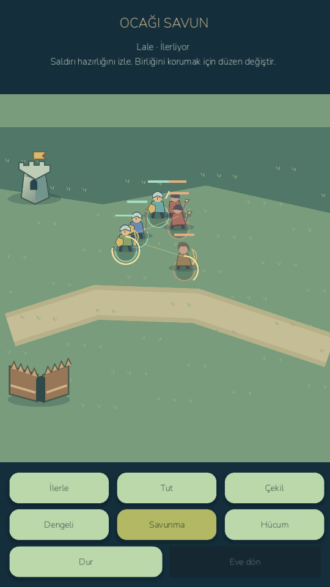
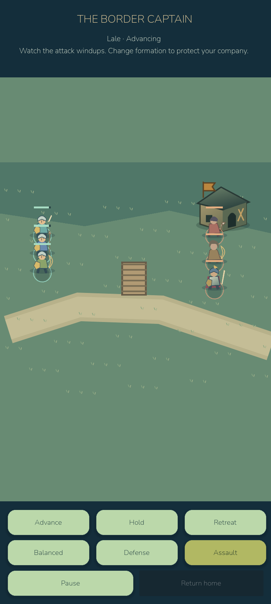

# Milestone E audit and critical D prerequisite

The E brief requires an audit first. HEAD `f1684d969f934f2ebef6e10d1c07d47dfde0b54f` / `age085-milestone-c` contained C only: no barracks, soldiers, formations, defenses or raid/camp. `age085-d-base-c` preserves the starting point. D was not silently assumed complete.

Implemented optional Chapter IV: three paid/worker-made kit types, citizen reservations, instructor labor, upkeep, recovery, formations, visible combat, village defenses, captain camp, quests16–20 and save restoration. Twelve original SVGs cover three buildings, three soldiers/kits and three enemies. Prior artwork and the first fifteen quest records remain. See MILITARY_SYSTEM.md for behavior/limits.

All539 retained game checks and separate runtime smoke pass unchanged. New military suite44 assertions and twelve seeded legal1–20 campaigns pass. Rendered desktop victory measured60.15FPS/p9516.76ms, scene setup5.36ms, model step152µs,69 draw calls,49.5MB static memory. These are short automated samples. Godot MCP inspected Turkish UI/live battle with an empty runtime error list. Native Computer Use was unavailable.

Android API35/x86_64 emulator: ten live touch/gameplay checks plus five genuine external-process restart checks pass. Commands used ADB input. Active camp restored exactly, then native retreat/home preserved the incomplete quest. Player planet/backups/settings were byte-compared before/after update/startup; none changed. Short live raid55.49FPS/p9528.55ms; setup7.84ms, model step191µs,65 draw calls,48.9MB static/28.6MB video memory. No phone was connected; phone performance/thermals/battery remain unverified.

Deliverables: `D:/LittleGod/builds/android/LittleGod-0.8.5-milestone-D-critical-debug.apk` (devD/code88) and isolated `...-qa-debug.apk`; desktop `D:/LittleGod/Launch LittleGod.cmd`. Evidence: `builds/phase085d/`. C APK/source/tag remain. Checkpoint `age085-d-critical` is not a final E release. E1–E6 were not part of this checkpoint. No paid infrastructure, publication or security bypass occurred.

