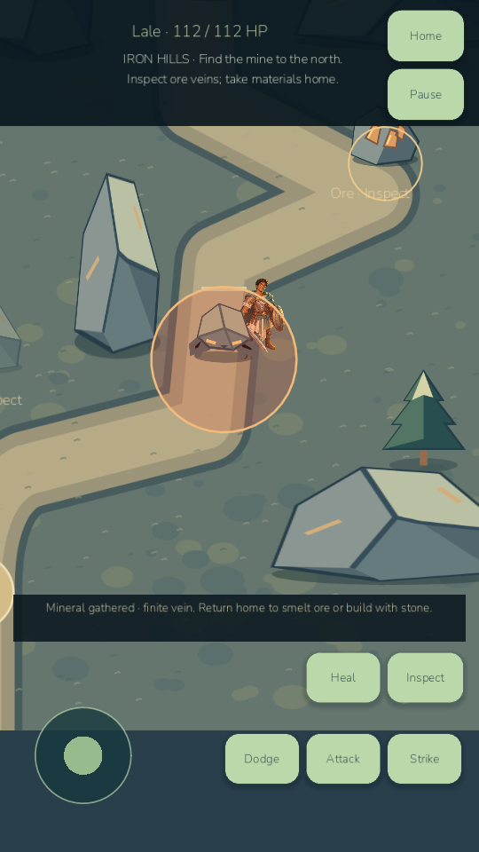

# E2A/E2B — playable Iron Hills, partial E2

Build0.8.5-devE2B / Android code90. This execution delivers the world-map foundation and actual Iron Hills exploration. **E2C Ashen Desert, E2D quest22 and complete E2 acceptance remain unfinished.** Campaign stays1–21; no `age085-e2-regions` or final E tag is claimed. Safe baseline: `age085-e2-base-e1` at914728f. Release checkpoint: `age085-e2b-iron-hills`.

Implemented a trusted local region registry, bilingual destination inspection, honest unavailable desert card, recommendations/unlocks/resources/enemy/landmark information and explicit distinction from unchanged caravan trading posts. Reused the original hero/combat scene with real static collision, navigable mining paths, finite mineral pickup, persistent mine discovery and home banking. The two enemies actually fight: armored slow aimed heavy attacks versus quick locked lunges and recovery repositioning. A zero-distance recovery edge found by tests was fixed.

Ten original vector assets cover mountain terrain, cliffs, ore, pine, mine/cart, both enemies and two map previews. They are usable imported gameplay layers/sprites. The desert preview is labeled unavailable and does not pretend to be a playable scene. Original C artwork, warrior, Wildwood, worlds, online source and older APKs remain. Actual rendered inspection caught prop occlusion and excessive static draw commands; the mine/deposits now sort with actors and the terrain imports once.

All639 retained game assertions pass unchanged. New40 regional and10 combat assertions pass: **689 game assertions**. Six legal seeded journeys complete the real1–21 campaign then explore, gather, fight, discover and return from Iron Hills. No injected XP or flags substitute for legal progression. Desktop rendered movement/combat/damage/pickup/discovery/return/save checks pass. Godot MCP inspected Turkish map/entry with an empty runtime error list. Native Computer Use APIs were unavailable; Godot/MCP/ADB supply actual rendering evidence.

Android native QA:20 checks plus6 genuine force-stop/relaunch checks pass at each60/30 cap. Actual ADB inputs select the map card, enter, move the joystick, attack, dodge, inspect both deposits/discovery and return home. Route-following/fight automation between these controls is explicitly engine-driven. Pending caravan state and active node/discovery data restore exactly; banked materials and private saves persist. Player primary/backup/temp/settings bytes remain identical. No real player's slot was cleared. Physical phone was unauthorized for this run, so no E2B phone claim is made.

Player APK: `D:/LittleGod/builds/android/LittleGod-0.8.5-milestone-E2B-debug.apk` (60816150bytes, SHA256 `8e816d4ff84a321dc85106d3f2b9eb34f86bf94403571390ef13f6d277b6f969`). Isolated QA APK uses `.betaqa`. Player APK v2/v3 signatures, in-place installation and startup also passed on the emulator; a private benchmark marker prevented player-save writes and primary/backup/temp/settings bytes remained identical. Cold activity start reported1199ms, which does not establish complete gameplay readiness. Desktop launcher: `D:/LittleGod/Launch LittleGod.cmd`, verified Godot4.7.2 runtime under tools/godot. Source archive: `D:/LittleGod/builds/LittleGod-0.8.5-milestone-E2B-source.zip`; exact commit and archive hash are recorded in builds/phase085e2/checkpoint-manifest.json after checkpointing.

Read REGIONAL_ADVENTURE_ARCHITECTURE.md, REGIONAL_ENEMIES.md, SAVE_MIGRATION_MILESTONE_E2.md and PERFORMANCE_MILESTONE_E2.md for limits and evidence. Quest22 is explicitly absent; QUEST_22_DESIGN.md documents remaining behavior without awarding it. No E3–E6/0.9/1.0 work, purchase, publishing, paid service or security bypass occurred.

