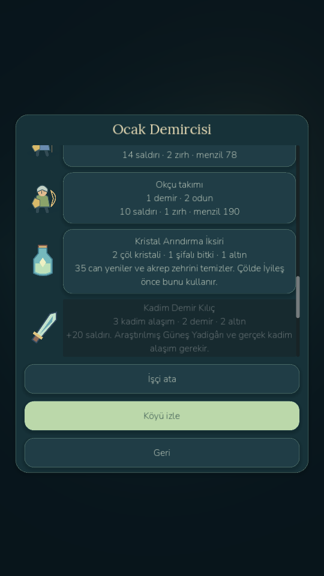

# E3 — Secrets of the Ancients

Verified development build: **0.8.5-devE3 / Android code92**, real realm quests1–23. Baseline57ca7fa / age085-e2-regions is retained as age085-e4-base-e2. Work is isolated on work/e3-sanctuary-validation. Earlier E3 prerequisite-only reports are preserved in docs/history/PRE_E3_*. No E4, E5, E6, throne or Visual Rebirth V4 implementation is claimed.

Sunken Sanctuary is an opt-in fourth region beneath Ashen Desert, unlocked by claimed22 and an armed Warrior. Five connected spaces use the existing CharacterBody2D controller, camera, combat, equipment, inventory, home and save architecture. Two ordered persistent puzzles control colliding animated doors. Two periodic hazards have warning, active and recovery windows, real damage, dodge protection and once-per-cycle persistence. Wrong sequences reset safely; solved gates latch. Home is always available.

Ancient Sentinel has a frontal strike, defensive counter and recovery opening. Sun Priest's Shade has an aimed hitscan spell, locked-target area attack and short recovery relocation. Sunward Warden alternates frontal strike/directional energy, with real armor and vulnerability windows. Shared death/XP/loot code still owns rewards. Dungeon attacks respect walls and closed doors.

The cracked-wall passage leads to optional treasure. Inscription and abandoned-forge lore reveal the Sunforged Dynasty; treasury, relic discovery and research enter the localized Chronicle. The unique Sun Relic is an actual industry item with one persistent ID, protected from crafting/salvage. A full inventory leaves one canonical pickup on the pedestal and supports safe retry. At home its research unlocks four staffed-forge recipes: Ancient Iron Blade (+20 attack), Sunguard Shield (+7 defense), Ruinwalker Armor (+18HP/+4defense/+4 trap resistance), Sunstone Talisman (+2 trap resistance). Resistance stacks only for dungeon hazards; minimum damage1. Gear effects are consumed by real combat.

Finite dungeon rewards total7 alloy,1 core and4 sunstone fragments. Crafting all four spends6 alloy,1 core and2 fragments plus real old materials and labor. No free resources, XP, quest flags or kills are inserted in legal journeys. Quest23 requires inscription, both mechanisms, Warden defeat, relic ownership, alive return, research, and forging/equipping an upgrade; its reward claims once.

Original assets: vector room floor/wall/preview, tablet, pedestal, three distinct elite silhouettes, three material icons, relic and four equipment icons. Source generator: devtools/create_sanctuary_art.py. Eight original bounded mono PCM cues cover stone steps, switch, door, trap warning/activation, sword swing/impact and relic. Generator: devtools/create_sanctuary_audio.py. Existing Warrior artwork is preserved. Doors fade open; runes/plates, telegraphs, hit flash and death feedback follow simulation state. This is modest procedural presentation, not a frame-animation remake or an approved V4 style.

**822 game checks pass:745 retained unchanged +77 E3 checks.** Three legal1–23 seeds7/42/2026 pass with all four items actually forged/equipped. Tests cover old saves, pending forge/caravan preservation, active/puzzle/trap/full-inventory saves, offline freeze, read-only APIs, malformed state, elite attacks, material conservation, unique relic retry/protection, quest once and four-region identity. The authentic E2 fixture was made from the old checkpoint before sanctuary code, not fabricated from new data. Rendered desktop has 38 passing checks, including real navigation/collision/puzzles/combat/relic/treasure/return/research/forge/equip/23 and a final saved world. A real workshop localization error found visually was corrected; script errors are rejected independently of boolean reports.

Android native input covers entry, joystick, inscription, all three switches, attack, dodge, relic pickup, return, research and quest23 reward. Automated routes, combat commands and forge/equip helpers are explicitly labelled. Force-stop/reopen verifies exact active puzzle/world restoration at both caps. QA runs in .betaqa and player primary/backup/temp/settings bytes are preserved. Player APK signing, update and private-marker startup pass separately. No physical phone was connected in the final ADB inventory; no phone performance, thermals, battery, haptic or simultaneous-multitouch claim is made.

| Measured scene | FPS | p95 ms |
|---|---:|---:|
| Desktop · relic chamber | 60.81 | 17.12 |
| Emulator 60 · Sustained combat (test path generation excluded) | 59.96 | 25.42 |
| Emulator 60 · Relic chamber | 60.15 | 19.20 |
| Emulator 30 · Sustained combat (test path generation excluded) | 30.56 | 41.85 |
| Emulator 30 · Relic chamber | 30.17 | 38.18 |

Desktop setup 11.65ms, simulation step 122µs, 99 sampled draw calls, static tracked memory 50.85MiB. Android measurements, memory snapshots and frame samples are in docs/benchmarks/phase085e3. Initial inclusive bot samples were poor (21.79FPS/p95137.93ms; after reboot17.83FPS/p95160.64ms). They remain in builds/phase085e3/android-60-initial and android-60-inclusive. Those include developer AStar route construction; the final combat sampler excludes test navigation and records steady rendering separately. These are distinct measurements, not a claim that reboot fixed the game. No stable60FPS guarantee is made for physical mid-range devices.

The measured pre-cache sustained-combat run was24.21FPS/p9593.65ms at60, and19.07FPS/p9577.73ms at30; retained in builds/phase085e3/android-60-before-cache and android-30-before-cache. Sanctuary's static inscriptions/geometry now retain canvas commands until their phase/mechanism/door fade changes. Combat effects rebuild at the authoritative20Hz instead of every render frame, and unchanged door colliders are not reassigned. These changes preserve simulation and telegraph timing. Final Android profiles include whole-physics-callback and effect-draw CPU counters. No global timescale or game-balance change was used. Pack opening/closing and Pause interruption clear held/pending attack input, and are verified with external Android taps. Godot MCP separately rendered the actual authentic-E2 destination and entry; its error list was empty. The private benchmark marker prevented touching desktop player slots.

Reproduce: python -X utf8 devtools/verify_sanctuary.py; Godot --path . --script tests/sanctuary_playtest.gd; python -X utf8 devtools/android_sanctuary_validate.py --fps 60 (or --fps 30). Desktop tests use private user files. Do not reset the player's package or world. Godot headless/editor/export can report known resource/ObjectDB cleanup warnings; no new script/runtime error is accepted.

- Desktop launcher: D:/LittleGod/Launch LittleGod.cmd.
- Verified runtime: D:/LittleGod/tools/godot/Godot_v4.7.2-stable_win64.exe.
- Player APK: D:/LittleGod/builds/android/LittleGod-0.8.5-milestone-E3-debug.apk.
- QA APK: D:/LittleGod/builds/android/LittleGod-0.8.5-milestone-E3-qa-debug.apk.
- Source: D:/LittleGod/builds/LittleGod-0.8.5-milestone-E3-source.zip.
- Exact checkpoint/archive/APK hashes: D:/LittleGod/builds/phase085e3/checkpoint-manifest.json.

