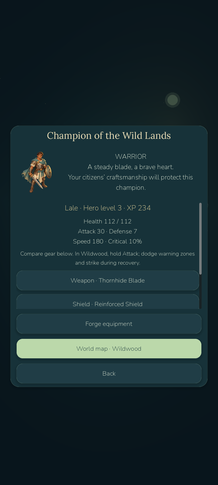
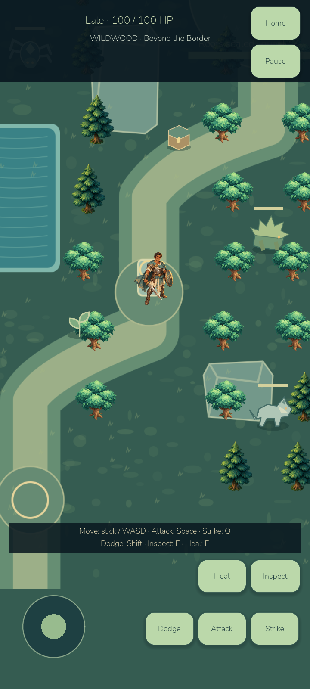

# Milestone C implementation log

Base: `age085-milestone-b`, commit6bb4100. Safe base `age085-c-base-b`. All459 baseline checks passed before changes. No0.9 work or military development.

## C1 — verified hero foundation

Explicit chapter migration preserves2200XP, earlier claims, original common balances, civilian IDs/equipment and pending forge queues. Campaignv3 adds private hero/adventure state and zero material balances. A named Warrior has separate hero XP/level, deterministic stats, compatible weapon/shield/armor/artifact slots and persistent health/cooldowns. Combat equipment is made in the existing paid-material, worker-driven forge queue; it cannot be equipped by civilians. Existing tools remain unchanged.

Twelve new hero checks pass, including an authentic tagged-B fixture with a pending job, migration idempotency, exact preservation, legal1–11 progression and an actual sword's attack effect. The real Godot profile was rendered/inspected. C1 checkpoint is `age085-c1-hero`; adventure movement/combat/loot/boss remain pending at this checkpoint. The final `age085-milestone-c` tag is reserved for complete C verification.

## C2 - verified Wildwood exploration
Separate playable scene, real CharacterBody2D/StaticBody2D collision, touch movement, AStar path checks, actual Sunstone interaction, safe return and quest12 pass. Nine model checks and rendered physics traversal pass. Home simulation/offline combat pause explicitly while away. C2 checkpoint: age085-c2-wildwood. Combat is next; no complete-C claim.

## C3 - verified real combat
Wolf bite/chase, armored slow Thorn Beast heavy warning and Spider locked-target leap use distinct real state machines. Equipment-derived attacks, cooldowns, dodge invulnerability, herb/potion healing, death and weighted persisted drops work. Legal1-13 model journey, exact loot/death restoration and actual rendered physics fight (enemy hit back, warning visible, enemy defeated and loot picked up) pass. Texture lifetime was fixed after visual inspection caught a white herb quad. C3 checkpoint: age085-c3-combat.

## C4 - verified blacksmith integration
A legal1-14 journey brings real leather/thornhide/herbs home, pays iron/material costs through the existing forge and equips the Thornhide Blade and reinforced shield. Attack/defense, material consumption, exact inventory restoration and explicit cleared-trail revisits pass six checks. C4 checkpoint: age085-c4-equipment. Boss is next.

## C5 — verified guardian encounter
Thornheart now has a locked frontal sweep, targeted roots and a phase-II radial shockwave. Three legal routes (seeds2026,77,138) completed all15 quests, banked the unique living heart, forged Heartward and verified its health effect; 18 assertions passed. Real rendered CharacterBody2D combat verified warning, phase II, two dodges and victory; screenshots builds/phase085c/thornheart-*.png. Initial desktop sample:60.13FPS,16.884ms p95,72us/20Hz combat step,8.609ms scene construction,48,469,520 static tracked bytes,505 draw calls. This is an RTX4070 laptop measurement, not Android. Visual inspection exposed unclamped camera edges; camera bounds and readable combat messages are being polished for C6. Android and final full regression suite remain outstanding.

## C6 — release verification

Implemented and inspected the complete C slice: realm11–15, named Warrior, original generated portrait/sprite, real Wildwood collision and input, three hostile species, equipped-stat attacks/defense, dodge/healing, weighted persistent drops, worker-driven combat crafting, multi-pattern/two-phase Thornheart, unique living-heart reward and actual return gating. Chapter III ends with continued kingdom care/artifact crafting/revisits. No military D or0.9 work was started.

Visual iteration used actual Godot/Android frames. Fixed black camera edges and HUD occlusion, invisible pre-quest14 root barrier, transient white herb texture, hero hidden behind the large guardian, loot notifications and category comparisons. Added readable combat messages, large Home/Pause controls, hold-to-attack, mouse aiming on desktop, a touch-emulation guard, defeat fade and dodge/rarity feedback. Static terrain/props are cached. Walking/attack animations are procedural, not a skeletal animation claim. Source assets/provenance: ASSET_INVENTORY.md and art/warrior-prompt.md; Warrior was generated with the built-in image_gen tool, not a purchased pack or paid external API.

Verification:459 retained+80 new=539 passing game checks; original assertions were not weakened. New breakdown:{'hero': 12, 'exploration': 9, 'combat': 6, 'combat_crafting': 6, 'boss': 21, 'adventure_invariants': 19, 'boss_patterns': 7}. Separate runtime smoke,50 original first-village scenarios,50 Iron Age/offline scenarios and20 legal1–15 seed scenarios pass. Campaign probes use real building/worker/crafting/combat commands, not forced XP/resources/claim flags. Synthetic malformed/capacity cases are explicitly negative tests. Exact archive-B fixture migration, pending queue preservation, active/defeated/warning/completed saves, offline pause, item conservation and unique boss callbacks pass. A negative quest test proves old loot cannot replace returning the actual heart.

Actual rendered desktop exploration, enemy hit-back/loot and guardian warning/phase-II/dodge/victory pass. Godot MCP inspected Hero Hall/world map/real adventure with an empty runtime error list. Native Computer Use was unavailable. Android passes14 adventure checks including external joystick and attack/skill/dodge/heal/inspect taps,3 actual force-stop/relaunch restore checks and16 retained industry/ADB equip checks. Original player planet40618bytes and backup41031bytes stayed byte-identical; absent temp/settings remained absent. Only betaqa was cleared. These are automated tests, not human beta evidence.

Performance: desktop about60FPS,47 draw calls versus initial505; instrumented Android guardian57.76FPS/20.11ms p95, postbattle60.00FPS,30-cap30.00FPS. Full emulator-process restart recovered substantial host-session slowdown without a data wipe. Rendering optimization and emulator effects are distinguished in PERFORMANCE_MILESTONE_C.md; hitches and physical-device validation remain open.

Release:0.8.5-devC/code87; APK `D:\LittleGod\builds\android\LittleGod-0.8.5-milestone-C-debug.apk`,60406912bytes, SHA256 `5d35e8dd97f7664c0932bfbda837099b5876f9c5b83c661b75bcbcbdafc8d602`. Debug signature and package installation/startup validated; ARM64 and x86_64 included. Desktop launcher `D:/LittleGod/Launch LittleGod.cmd` uses the existing verified4.7.2 runtime. Source archive `D:/LittleGod/builds/LittleGod-0.8.5-milestone-C-source.zip`; exact final commit/hash/CRC is in builds/phase085c/checkpoint-manifest.json. Final verified tag: `age085-milestone-c`, separate from incomplete full0.8.5 and0.9. Intermediate checkpoints: C1 0efeb8d, C2 14f9a37, C3 9fa3d3b, C4 a0257ea, C5 7f2f852. Earlier builds/tags/source remain.

Known limits: one authored region, simple bounded enemy navigation, procedural sprite animation, finite32-item inventory without salvage/discard, short emulator samples, no physical phone/haptic/thermal testing or human long-term balancing. Home/offline simulation deliberately pauses in an active adventure. The existing API/.NET App-Control block remains untouched. No paid service purchase, public deployment or store publication occurred.

