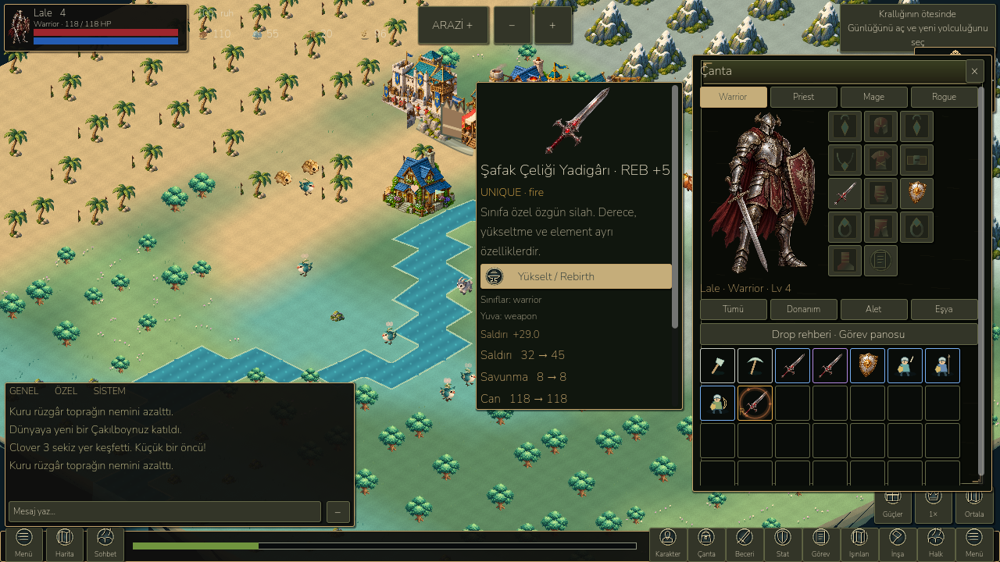
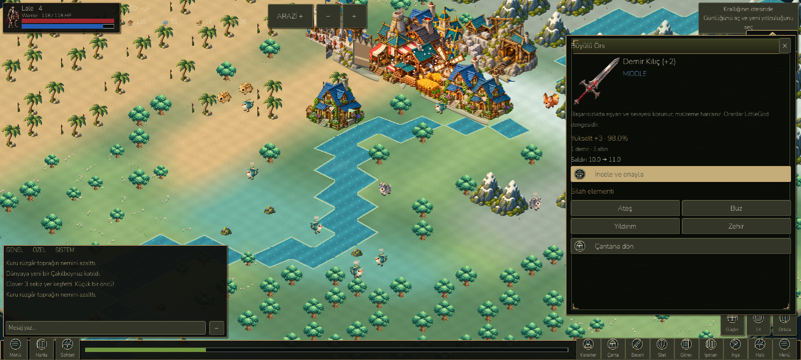
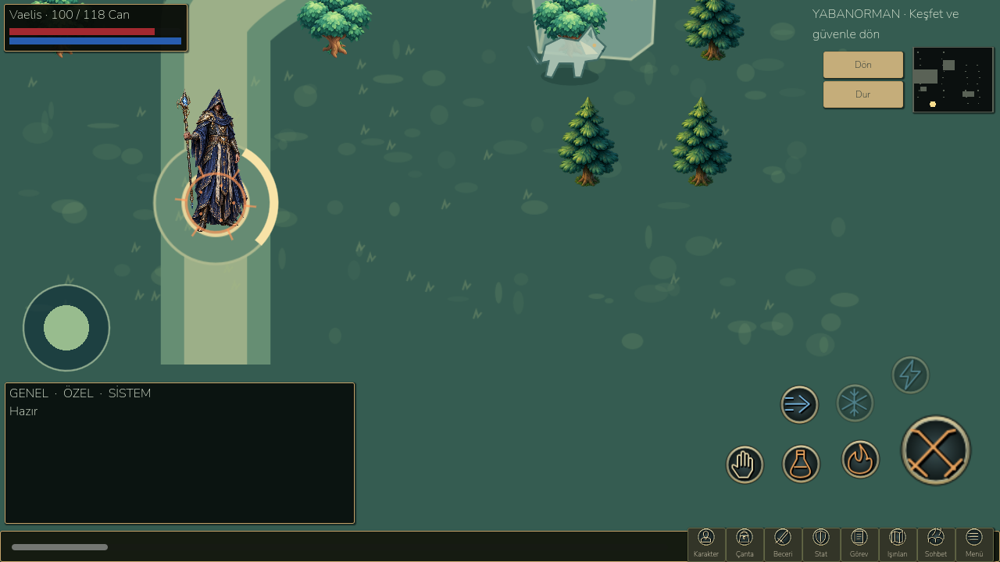

# KO Bugda research and LittleGod armory checkpoint

26 October 2026. This is a working expansion of the existing LittleGod RPG. **The entire requested one-to-one recreation is not complete.** This checkpoint implements equipment enhancement, item rebirth, rarity presentation, original item icons, extra class-weapon drops, a searchable bestiary, one-time contracts and class spell overlays. It preserves the existing maps, campaign, saves, kingdom expansion and Android package isolation.

## Research, evidence and unresolved reference data

The requested [drop database](https://kobugda.com/drops), anvil, probability, set, calculator, skill, quest and rebirth pages were examined. Current interactive item/drop/stat grids were not present in the returned page content; direct HTTP returned 403 and local browser access was disabled in Work settings. No access restriction was bypassed. The readable [classic drop list](https://old.kobugda.com/Drops) was also inspected; it explicitly describes some tables as player-observed rather than official.

The site's own guides conflict. Its [anvil simulator guide](https://kobugda.com/blog/knight-online-anvil-simulator-guide) publishes standard upgrade chances of 98/80/57/35/20/6/1% and retention on failure, but its example contradicts one table row. The [rebirth upgrade guide](https://kobugda.com/blog/knight-online-rebirth-upgrade-system-guide) describes high/unique equipment conversion at +7 or higher, mapping +7/+8/+9/+10 to rebirth +1/+5/+11/+21, approximately 25% rebirth strengthening, and possible destruction. Those are not a verified authoritative server ruleset. Item rebirth is also distinct from the [character rebirth system](https://kobugda.com/rebirth).

Quest references inspected: [seven keyholders](https://kobugda.com/quests/keyholder), [skill powder unlocks](https://kobugda.com/quests/skill) and [NPC daily objectives](https://kobugda.com/quests/daily). LittleGod contracts use existing real enemies, collected crafts and enhancement state, with explicit rewards. Seven-NPC keyholder quests, character rebirth and powder skill unlocks remain unimplemented.

The research manifest records **13 source entries**, missing data and conflicts: `docs/research/kobugda-audit.json`. `complete` is deliberately false. The adaptation catalogue contains **55 current LittleGod definitions**, including eight new weapons; it is not a complete KO item database. It separates original game values from reference facts. No source icon, map, costume or animation was copied into the project; no redistribution license was found. Sixteen original painted icons were generated with ImageGen and copied into `assets/rpg/equipment-atlas-v2.png`. Their exact generation prompt and provenance are beside the atlas. Existing vector fallback icons remain; not all inventory items have new painted art.

## Implemented behavior

- Low, Middle, High and Unique grade colors are separate from enhancement levels. Inventory cells show grade borders and +/REB labels. Four class weapons, four headpieces, four torso pieces, ring, necklace, shield and scroll designs form the new atlas. Icons are shared by appropriate item families rather than pretending to depict every individual variant.
- Eight original High/Unique weapons, two per class, are valid industry definitions with real costs, class restrictions, crafting times, attack and stable instance IDs. They can be crafted through the existing forge; completed output uses the prior building collection system.
- Normal refinement +0 through +10. Current explicit LittleGod success chances per target level: **100,100,98,80,57,35,20,6,1,1 percent**. These are an adaptation, not a verified KO table. Every attempt shows the chance, material cost and exact affected item stats before a second confirmation.
- Eligible High/Unique weapons, shields and armor pieces at +7/+8/+9/+10 convert at 100% to REB +1/+5/+11/+21. Accessories cannot reverse. Conversion preserves the corresponding attack bonus. Rebirth strengthens through +21 at an explicitly displayed 25%. No premium boosters or purchased services were added.
- Failure retains the item and current level, consuming the shown materials. This intentionally avoids importing the conflicting destruction claims. Costs currently use ordinary iron/gold, not new owned scroll items. Actual scroll inventory/tiers and scroll-specific chance modifiers are still pending.
- Fire, frost, lightning and poison affinities have distinct visual colors. Applying an affinity to a weapon gives the same explicit +2 attack bonus in this checkpoint. Element-specific resistance/status calculations are not yet implemented.
- Enhancement bonuses feed existing hero stats, equipment comparisons and real combat. Armor defense and accessory health also improve. Item identity and ownership remain unchanged. Equipped active-hero gear may refine at home; locked items, other heroes' reserved gear, military/worker reservations, visits and active expeditions cannot be refined. A completed forge and sufficient resources are required.
- A separate validated version-one private save extension stores per-instance normal/rebirth/element state, deterministic RNG, monotonically increasing action serial, bounded result history, observed enemy defeats and claimed contracts. Old item dictionaries stay unchanged. Existing defeated enemies recorded in the active/stored runs receive one-time contract credit during migration, without creating new loot. A stale confirmation cannot spend resources again. Discard cleans enhancement metadata; public previews do not expose it.
- Rebirth bands produce increasingly strong inventory halos and a weapon-position aura during combat. Four elemental palettes and reduced-motion handling are connected to actual item state. These are procedural overlays, not copied animation frames or full equipment skin replacement.
- Real defeats may add a High weapon for the active class at 25%; the three existing guardian bosses add a Unique class weapon at 100%. Existing baseline drops remain. Added loot still requires interaction, available bag capacity and the original pickup rules. Repeat death dispatch does not award duplicate loot or kill credit. This does not add boss respawn or new farm maps.
- Searchable monster guide lists actual current health/attack/defense, guaranteed resources and weighted extra resource percentages, plus the independent class-weapon chance. It is reachable through the inventory. Four one-time contracts track forest threats, guardian victory, collected Iron Sword craft and successful refinement. Rewards are claimed once at home, with warehouse capacity checked; existing campaign quests are retained.
- Warrior arcs, Priest holy crosses/rings, Mage elemental rings/spokes and Rogue streaks activate from real successful skill input, mana and cooldown rules. Six indices alter the effects; all four starter casts were visually checked. Complete directional frame animation, layered armor/weapon sprites and exact per-reference skill animations remain unfinished.

## Validation

**822 retained campaign checks**, **270 landscape UI checks**, **98 compact UI checks**, **14 RPG interaction checks** and **44 growing-world checks** pass. New armory model suite: **44/44**, covering costs, real stats, nonduplicating serials, protection, reverse conversion, failure retention, RNG/save/load, malformed equipped data, actual drop/pickup and contract claims. New rendered suite: **37/37** at 960×540, 1280×720 and 1600×720, including four actual class skill casts and confirmation reachability. No script errors in the final rendered run. Existing Godot resource warnings on process shutdown remain.

Godot MCP launched the actual verified engine. Mouse clicks opened refinement review and confirmed it: Iron Sword +0 → +1, action serial 0 → 1, iron/gold 20 → 19, valid state. The earlier native Window confirmation caused automation targeting trouble; it was replaced by a themed in-game confirmation panel, then the complete click path was repeated successfully.

Android debug APK installed and launched in `LittleGod_Test`. **10/10** fixture, upgrade, real stats, replay prevention, contract, save, restore, adventure, spell and final-state checks pass. Production save, backup and settings byte hashes are unchanged. Native ADB taps separately opened the bag, selected Iron Sword, opened the anvil, reviewed and confirmed refinement: rendered **+1 → +2**, attack **9 → 10**, gold **21 → 19** and iron **21 → 20**. Native QA interaction intentionally does not autosave; save/load is independently tested by the harness. Screenshots were inspected. Evidence is in `docs/benchmarks/armory/`; actual native and scene images are in `docs/screenshots/armory/`.

The emulator paused-home sample is **24.82 FPS** at the 60 cap, **30.18 FPS** at the battery 30 cap, approximately **54 MB static / 60 MB textures**. It is a short emulator measurement, not stable mid-range-device certification. No physical device was connected. Current combat-map geometry, long-term balance and the full requested visual overhaul remain incomplete.

## Outputs and reproduction

Desktop: `D:/LittleGod/Launch LittleGod.cmd`, using `D:/LittleGod/tools/godot/Godot_v4.7.2-stable_win64.exe`.

Android: `D:/LittleGod/builds/android/LittleGod-Armory-debug.apk`, isolated package `org.littlegod.livinguniverse.rpgqa`, version code 97. Production export preset and player data are preserved. Exact size/hash: `docs/benchmarks/armory/apk.json`.

Run model suite with the verified Godot console executable: `--headless --path D:/LittleGod --script tests/armory.gd`. Rendered suite: `--path D:/LittleGod --script tests/armory_visual.gd`. Export: `python -X utf8 devtools/build_rpg_qa.py --output LittleGod-Armory-debug.apk --manifest armory-apk.json --version-code 97`. Emulator QA: `python -X utf8 devtools/android_rpg_validate.py --phase armory --apk LittleGod-Armory-debug.apk --output armory-android --screenshots armory`.

Remaining reference-sized work: complete source tables and source-art permissions; all individual item families/stat/requirement tables; skill-tree and AP formula reconciliation; set bonuses; actual scroll items and accessory combination; character rebirth; full NPC/map/quest chain adaptation; layered directional animation, exact cast/hit timing and armor swaps; elemental resistances/status; physical Android profiling and live online validation. This checkpoint must not be described as all of those being completed.

