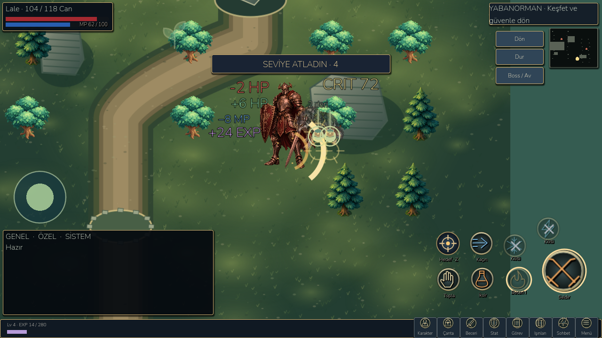

# Action combat, rewards and working navigation — 27 October 2026

## Implemented playable loop

The existing combat simulation already applied weapon damage, enemy windup/recovery attacks, HP, XP and finite loot. This checkpoint connects those real outcomes to visible feedback and fixes navigation problems reported during play. Rewards are not awarded by effects.

- Basic attacks and class skills retain existing collision, range, armor, critical chance, cooldown and line-of-sight. A successful strike displays normal/critical damage, a contact flash, sparks and an impact ring. Ranged attacks show a travelling projectile/trail. Sprites face the opponent; enemies visibly anticipate and recoil from attacks. This is procedural pose animation, not a new skeletal animation library.
- Enemy attacks reduce real hero HP. Red damage text, a short screen-edge flash, optional mild camera response and supported mobile vibration signal the hit. Reduced-motion and battery options suppress camera movement. Existing warning circles and safe dodge windows remain.
- HP and MP values appear beside their bars. Learned skills keep their existing mana requirements; the untrained starter skill now costs **8 MP** in the RPG system. It retains its previous 1.6× strength. Insufficient mana blocks the skill and explains the failure. Basic attacks remain free; mana regenerates through the existing simulation tick. Legacy model-only worlds without the RPG extension keep compatibility; entering a real adventure initializes the RPG extension.
- Mana loss is shown in blue, HP loss in red, recovery in green and EXP in purple. Popups have distinct positions, outlined text, fading and bounded counts. Cooldown and locked-skill indicators remain real-state-driven.
- Enemy death grants the existing enemy XP and drops exactly once. The EXP bar now updates throughout combat instead of being fixed at HUD construction. A new level shows a prioritized banner, real level and existing health/stat progression; new skill/stat point rules are unchanged. A loot notice cannot overwrite a currently displayed level-up notice.
- Drops fall/bounce into place, with a light beam, pickup icon and localized label for the nearest or selected drop. Clicking/tapping a nearby drop collects that exact item. Far drops show an approach prompt; a full bag/warehouse leaves the drop intact. The existing interaction button changes to **Topla** near loot. No auto-loot purchase, duplicated item or free remote collection was introduced.
- Collected resources stay in existing run cargo until safe return; equipment uses existing inventory capacity and IDs. Successful kills checkpoint the actual world. Death, departure, reload and offline progression retain the previous rules.
- Potions/herbs are consumed by the existing healing command. A real heal shows green recovery feedback. Full health, missing supplies and cooldowns produce specific messages.

## Icon/window and boss-flow corrections

Real Godot MCP clicks confirmed that the equipped fixture's bag opened both at home and in combat. The audit found missing locked-state feedback and a reproducible pause-state bug when switching combat windows. Those paths are fixed rather than claiming that all prior bag clicks failed.

Before equipment/heroes unlock, bag/hero/skill/stat icons now open an explanation with a current-quest link instead of silently returning. Switching between combat panels preserves the original pause state; closing the final panel resumes the fight if it was running before. Existing combat travel protection remains.

The home HUD now has **Boss / Av** beside Köy. Combat also has an explicit **Boss / Av** button. The hub separates solo hero bosses from citizen-army battles, lists Wildwood's Thornheart and the sanctuary Warden, shows the existing chapter requirements, links to region entry and drop/hunting quests, and can show a boss-direction marker during the matching active expedition. It does not teleport through locked doors, grant chapter completion or claim a cleared boss has respawned.

## Evidence and checks

- Existing **822 campaign** checks pass, with legal chapter 1–23 campaigns for three seeds.
- Existing **270 landscape UI**, **98 compact HUD**, **142 playbook**, **66 targeting**, **41 class-combat** and **14 RPG interaction** checks pass.
- New `tests/battle_loop.gd`: **46 checks** cover actual counterattack HP loss, hit feedback, deterministic critical skill kill, 8 MP spending, +24 enemy XP, real level-up/health increase, live HUD, falling loot, exact pickup, no repeat reward, potion consumption, insufficient mana, far-loot rejection, full-bag retention, bounded visual events and save/load. Fixture positions, enemy HP and critical RNG are controlled for repeatable QA; the rules award the results.
- New `tests/navigation_clicks.gd`: **61 checks** use mouse motion/press/release through actual viewport hit testing, not direct button signal emission. Home and combat icons, locked states, correct window routes, boss access and resume after repeated panel switches are tested at 960×540, 1280×720 and 1600×720.
- Real Godot screenshots were examined and adjusted: damage/HP/MP/EXP originally overlapped, then were separated. Historical screenshots remain preserved; new images are in `docs/screenshots/battle/`.
- The first campaign run overlapped other activity and failed two primary-save byte-preservation assertions. The isolated recheck and complete rerun passed all 822 checks. No tests or save-preservation assertions were removed. Tests and MCP reviews use private QA slots; the production save was not deliberately reset or migrated by the harness.

Android evidence, exact startup/profiles, production save/backup/settings hashes and final APK hash are in `docs/benchmarks/battle/`. The debug build is installed as the separate `org.littlegod.livinguniverse.rpgqa` package. Android test actions include programmatic touch input on a rendered drop and live simulation of enemy counterattacks; they are not a physical-device claim.

Final emulator validation: **26 checks**, no script errors or fatal exceptions, production files preserved. Cold activity startup **939 ms**. A four-second active melee sample after warm-up measured **60.05 FPS / 20.06 ms p95 frame** at the 60 cap and **30.03 FPS / 36.81 ms p95** at the battery cap. Simulation CPU per tick was **0.430 / 0.395 ms**, draw calls **130 / 131**, texture memory about **65.4 MB**. Hero health changed **117→114** and **113→110**, demonstrating that simulation remained active. This is a small encounter sample, not large-world performance or physical-device certification. The first Android harness run left frozen physics enabled after screenshots; its failed result is retained as `android-harness-failed.json`. The harness was corrected to process the panel-close transition, then the unchanged live-damage assertion passed.

## Launch and reproduce

Desktop launcher: `D:/LittleGod/Launch LittleGod.cmd`. Verified Godot runtime: `D:/LittleGod/tools/godot/Godot_v4.7.2-stable_win64_console.exe`. Android debug APK: `D:/LittleGod/builds/android/LittleGod-Battle-debug.apk`, version code **101**.

```powershell
& tools/godot/Godot_v4.7.2-stable_win64_console.exe --path . --script tests/battle_loop.gd
& tools/godot/Godot_v4.7.2-stable_win64_console.exe --path . --script tests/navigation_clicks.gd
python -X utf8 devtools/verify_sanctuary.py
python -X utf8 devtools/android_rpg_validate.py --phase battle --apk LittleGod-Battle-debug.apk --output battle-android --screenshots battle
```

## Remaining limits

The game remains an offline-capable RPG with its current finite encounters and boss progression. This checkpoint is not a complete online MOBA match system, PvP/netcode, new enemy respawn economy or multi-frame directional character rig. Existing shutdown resource warnings persist. Original enemy reward/drop tables and owned items are preserved; only the RPG starter mana cost changes balance. Physical Android hardware is unverified. Short emulator profiles must not be called 60 FPS physical certification. Some advanced screens may still scroll and old village building overlap remains.


