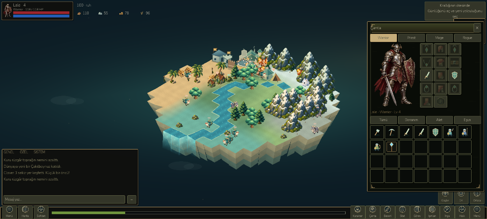
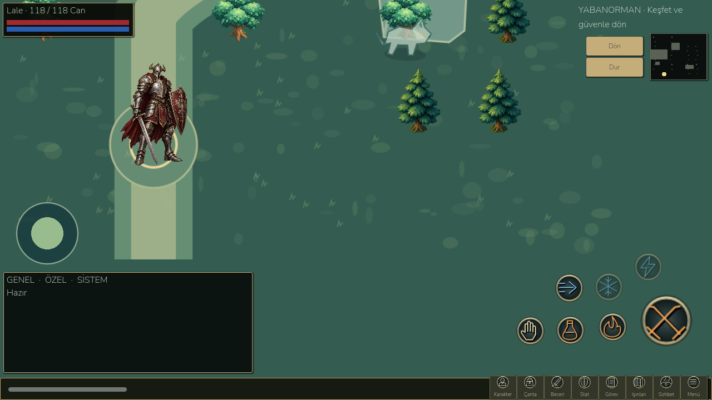

# Mobile RPG interface proportions

The previous full-width dashboard has been replaced. This pass concerns the playable UI; it does not claim completion of the earlier character-animation or online-chat milestones.

## Visual references actually inspected

- [Mobile client development screenshots](https://www.r10.net/android-ios-uygulama-gelistirme/4330537-knight-online-mobil-gelistirme-serisi-part-11-a.html): browser-rendered gameplay, character and inventory pictures inspected. The source inventory picture is 1048×577. The inventory is a narrow right-side window; the character/stat window is a separate left-side window. The bottom uses small circular icons and an experience strip. These are community mobile-client references, not a claim about an official NTTGame mobile release.
- [Additional mobile-client gameplay examples](https://www.r10.net/oyun-dunyasi/4904134-knight-online-mobile-surum-mobileko-world-test-sunucu-bu-aksam-aciliyor-16-10-2026-saat-21-00-a.html): research context for inventory/character/quest behavior.
- The user's supplied 597×335 gameplay screenshot and earlier inventory examples remain primary references for placement and density.

The image CDN refused direct HTTP downloads. Images were successfully viewed through their normal containing webpage; no third-party textures were downloaded into the game.

## Implemented layout

- A 1280×720 composition scales with available landscape height. At that size, inventory is **384×560**, anchored at **(886,70)**: 30% of the display width. It previously occupied almost the entire screen.
- Main navigation is a **40-pixel strip** with 24-pixel visible icon artwork, short labels and a central XP bar. It does not stretch each icon into a large card.
- Identity/HP/MP is a **235×61** compact upper-left frame. Resource counters use a single small row.
- Chat uses **448×185** at 1280×720, matching the roughly 35%-wide lower-left chat area in the supplied gameplay reference. The joystick sits above it in combat; touching chat cannot engage movement.
- Inventory has a 14-position equipment grid beside the same actual hero art, seven bag columns and 28 visible bag cells. Empty equipment uses subdued silhouettes. Selected item details open in a separate **265×420** scrolling comparison window beside the bag.
- Stat, skill, quest, forge, map and other menus use small floating windows. The visible world and HUD remain behind them without a full-screen dimming sheet. Modal use still blocks movement.
- Combat uses a **100-pixel circular main attack**, **57-pixel auxiliary circles**, a left joystick and the same compact navigation. Existing real cooldowns, mana, class restrictions and safe return are retained.
- Twenty original metal-rimmed vector control icons were drawn for this layout, generated reproducibly by `devtools/create_classic_icons.py`. Their size, density and material treatment follow the reference; they are not extracted Knight Online assets.

## Verification

Actual Godot captures and measured bounds are saved under `docs/screenshots/classic-ui/` and `docs/benchmarks/classic-ui/verification.json`, covering 960×540, 1280×720, 1600×720 and 1920×1080. The tests check proportions, world visibility, seven bag columns, comparison-window bounds, circular controls, joystick input, chat input isolation and save compatibility. The existing landscape UI suite also checks six sizes and Turkish/English routes.

Results: **98/98** layout/render/input checks, **270/270** retained landscape UI checks, **14/14** RPG interaction checks and the complete **822/822** campaign chain pass. The 98 checks include four aspect ratios, item comparison, chat touch isolation, a single HUD while using inventory during combat, and resuming afterward.

The new APK installs and starts in `LittleGod_Test` as the isolated package `org.littlegod.livinguniverse.rpgqa`; seven emulator fixture/class/save/adventure checks pass. Production save and backup byte hashes are preserved. Native ADB taps separately opened inventory, selected an item and Warrior, closed the window, opened Skills and minimized/restored chat. All resulting screenshots were viewed. Exact build and input evidence: `docs/benchmarks/classic-ui/delivery.json` and `native-input.json`.

Build: **`D:/LittleGod/builds/android/LittleGod-Classic-Mobile-debug.apk`**. Launcher: `D:/LittleGod/Launch LittleGod.cmd`. Runtime: `D:/LittleGod/tools/godot/Godot_v4.7.2-stable_win64.exe`. The production export preset and earlier RPG APK remain preserved.

Remaining limits: emulator-only, no physical-device testing or multitouch/keyboard/OEM safe-area certification. A cold shader-cache miss recompiles successfully. Engine shutdown resource warnings remain. In the sampled paused home scene, the emulator measured **12.77 FPS** at a 60 cap and **16.87 FPS** at a 30 cap, with approximately **41.46 MB** static memory and **29.62 MB** textures. Cold Android Activity launch was **2572 ms**. These are measurements, not a performance success claim. Earlier RPG animation/chat limitations remain open.

