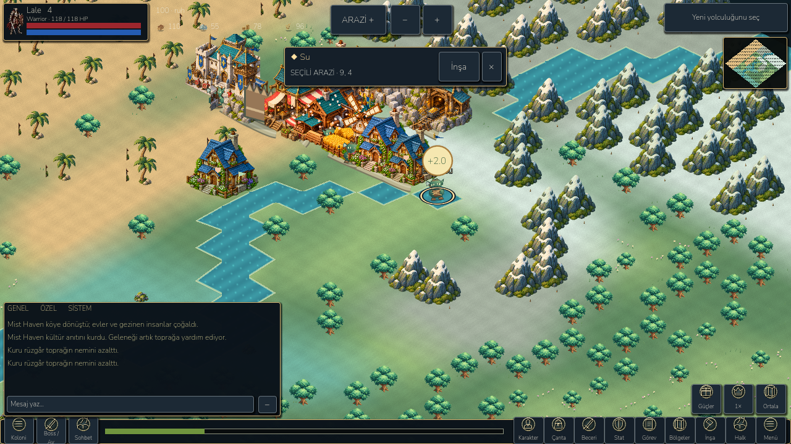
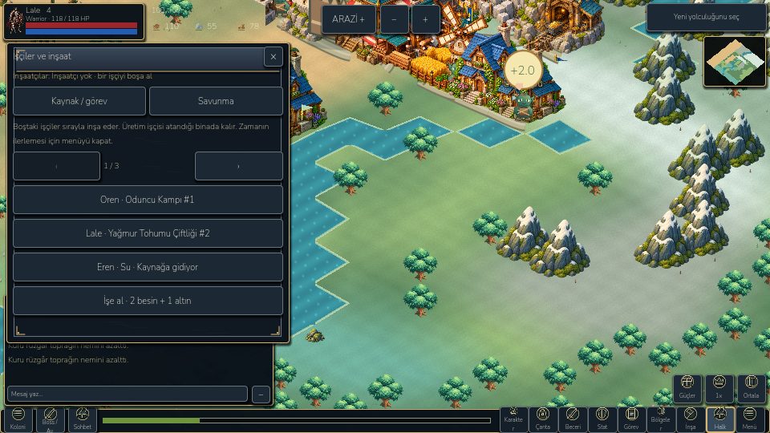
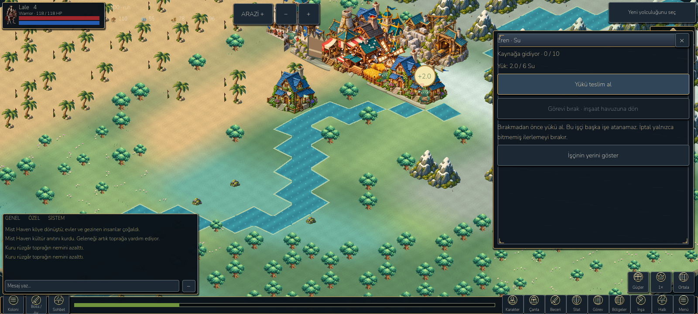

# Ocakbağı: colony workers and settlement defense

27 October 2026. Continue the existing game; no project recreation or player-save reset.

## Playable changes

The Hearthkin (Ocaklılar) are earthbound craft creatures serving the player's settlement. The hero ventures beyond their home and brings existing expedition loot back; the Hearthkin supply the settlement and its defenses. The bottom-left **Koloni** opens buildings, workers, resources, defense and the existing hero/boss routes. **Halk** shows named workers and their actual duties, including building ID, construction queue, gathering, military or caravan reservation. Three rows per page avoid a long scrolling roster.

The panel header's X now closes the whole modal, instead of navigating to the previous panel. Hardware Back retains navigation history. Combat modal closing still resumes the previous combat state. Native Godot mouse input and Android ADB tap are tested separately from emitted button signals.

New colony saves use an additive private `colony` v1 extension. Existing worker IDs, skills, assigned buildings, military/caravan reservations, hero equipment, chapter progress and resource stocks remain authoritative. A production worker must explicitly leave the current assignment before choosing another. A gathering worker is excluded from construction, production and army recruitment; army/caravan workers cannot start gathering. Construction uses the existing shared builder queue: free builders work on its first unfinished site. The roster identifies that site. Moving a builder into gathering removes that builder from the queue; no second simultaneous worker is created.

## Resource algorithm

Eight gathering duties are playable: wood, stone, gold, copper, silver, clay, water and fish. Each uses the nearest compatible **real terrain cell**, measured from the home settlement: forest for wood, mountain for stone/metals, grass/wetland for clay, water for water/fish. A ten-tick trip (20 seconds at normal simulation speed) yields at most two units. One worker carries at most six. Outbound, gathering and return phases position the original Hearthkin sprite between home and the source. Full workers wait at home. Worker names and resources are drawn above them. A tappable cargo bubble transfers real output, plays the existing chime/haptic feedback and displays a floating reward.

Wood/stone consume the existing cell resources. Each metal/clay source has a private finite 12-unit deposit; exhausted jobs search for another compatible cell on the next cycle. Water and fish renew. This is a deliberately small first economy; quantities are LittleGod balancing, not copied MMO values. Ordinary wood/stone/gold go to the existing warehouse. Copper/silver/clay/water/fish have a 60-unit cap each. Overflow stays with the worker; partial collection and partial refilling never exceed the six-unit cargo cap. Wood/stone actually delivered also advance existing gathering objectives, without awarding duplicate resources.

Two fish plus one water produce four settlement food, only when there is room under the existing food cap. A finished watchtower and wall unlock three fortification tiers. Tier n costs 2n copper, 2n clay, n silver and 3n ordinary stone; each tier adds two actual defense to soldiers **in settlement-defense combat**. Existing wall/tower bonuses, formations, equipment and raids remain. Materials are consumed atomically by the model command. No fabricated PvP rating or opponent is displayed.

Menus and hero/army expeditions retain the existing home-pause behavior. Each worker is processed once per simulation tick; offline replay uses that same tick path and stops at the cargo cap. Absence does not destroy cargo, penalize workers or trigger automatic raids. Cargo must be delivered before releasing a worker; a full warehouse may require spending resources first. Cancelling an empty worker abandons only unfinished trip progress. This restriction prevents silently losing completed work, but needs a more flexible overflow store in a later economy pass.

## Pet replacement and compatibility

The six old ambient pet species, pet selection/hearts, ambient human walkers and wildlife-spawn shortcut are removed from the current world presentation. `assets/estate/hearthkin.svg` is an original code-authored vector used by the existing worker renderer. It has ear, tunic, pack and tool silhouettes and procedural work/walk motion; it is **not** a full profession-specific directional animation set. No downloaded reference artwork is shipped.

Old creature arrays, ecology simulation, historical memories and legacy APIs are retained privately for save/test compatibility; this is not destructive deletion of old save data. Pet-related messages are filtered from the current system feed. Some advanced legacy history/cosmetic screens still describe the old wildlife. They are not a new pet gameplay promise. Original worker names are preserved, rather than generating duplicate creatures on every load.

## Research and adaptation

Official sources inspected for this implementation:

- [Black Desert Mobile: Camp](https://www.world.blackdesertm.com/Ocean/Wiki?wikiNo=41): worker roster and explicit gathering/building/crafting duties, settlement resources and food. Adapted the single-duty roster and material loop; did not copy paid completion or worker fatigue.
- [Supercell: Builders](https://support.supercell.com/clash-of-clans/en/articles/builders-4.html): scarce builders tie settlement growth to visible jobs; defense has an actual structure role. Adapted shared construction availability and real defensive effects; no gem purchases or paid worker slots.
- [Albion Online: Labourers](https://albiononline.com/news/albion-online-labourers) and [official labourer guide](https://albiononline.com/news/laborers-in-albion-online-a-guide): profession-specific material outputs connected to home infrastructure. Adapted resource specialization and a home/adventure relationship; no 22-hour artificial return timer or copied journals/happiness system.

These sources inform the UX and responsibilities. LittleGod retains its own story, isometric settlement, finite expedition maps, deterministic tick model, original art, save schema and combat rules.

## Validation and limitations

Machine-readable reports: `docs/benchmarks/colony/model.json` and `ui.json`; Android evidence is copied alongside them after the final build. New model coverage includes eight terrain sources, exclusive duties, idempotent ticks/collection, inventory caps/partial overflow, food consumption, actual defending-stat bonuses, offline replay, read-only protection, invalid jobs, save/load and preserved legacy data. Rendered coverage includes 960×540, 1280×720 and 1600×720 in Turkish/English, no-scroll main colony pages, real X click, worker source position, cargo feedback and reservation release.

Screenshots under `docs/screenshots/colony/` come from real Godot desktop and Android emulator renders. They include controlled, paused private test fixtures; they are not concept art or proof of human playtesting. Old dense settlement layouts still overlap in places. Shutdown ObjectDB/resource-in-use warnings remain. No physical Android device is connected. Emulator performance is reported separately and does not establish mid-range phone performance or stable 60 FPS.

Final results: retained 822 campaign, 270 landscape UI, 98 compact HUD, 142 playbook, 61 native mouse navigation and 14 control recovery checks passed. New 93 model, 100 rendered UI and 23 Android checks passed. A navigation run during concurrent exports initially missed two clicks at 960×540; an isolated repeat passed all 61, so native hit testing remains timing-sensitive under host load. The first Android test used synthetic screen-touch events, which did not emulate GUI mouse input; final validation instead uses an actual ADB tap, maps natural portrait `wm size` into the current landscape viewport, and waits for the resulting modal closure. The final APK was installed and tested after all model changes.

Final emulator paused-home sample: 32.35 FPS at 60 cap / 30.11 at battery 30; both p95 34.64 ms. Draw calls 385 / 317; texture memory 45.83 MiB; static memory 54.73 / 54.59 MiB. World-update CPU p95 0.83 / 0.95 ms; whole-process p95 38.96 / 32.11 ms. ADB cold activity startup 1,059 ms. Earlier emulator runs under concurrent desktop work ranged down to 8–12 FPS; these samples are environment-sensitive and not evidence of a stable phone frame rate. Production player-save/backup/settings hashes match before/after, and the final emulator log has no SCRIPT ERROR or fatal exception. APK SHA-256: `eedd308f1cffec812145c0c673976e3235a676dd508f1182883222f7d92216c3` (77,567,993 bytes).

**Online territory PvP is not implemented.** Existing local defense works. A safe next multiplayer milestone requires server-owned world revisions, authenticated attacker/defender snapshots, inventory/worker reservations, deterministic combat validation, replay protection, atomic reward delivery and reconnect tests with two actual clients. Public neighbor showcases are not authoritative battle state. No paid hosting, public deployment or security bypass was attempted.

## Launch/build

- Desktop: `D:/LittleGod/Launch LittleGod.cmd`.
- Verified engine: `D:/LittleGod/tools/godot/Godot_v4.7.2-stable_win64_console.exe`.
- Android debug: `D:/LittleGod/builds/android/LittleGod-Colony-debug.apk`, version code 103, isolated `org.littlegod.livinguniverse.rpgqa` package; production export settings are restored after export.
- Export manifest: `D:/LittleGod/builds/colony-apk.json`.
- Validation commands: `python -X utf8 devtools/verify_sanctuary.py`; verified engine `--headless --path . --script tests/colony.gd`; engine `--path . --script tests/colony_ui.gd`; `python -X utf8 devtools/android_rpg_validate.py --phase colony --apk LittleGod-Colony-debug.apk --output colony-android --screenshots colony`.
