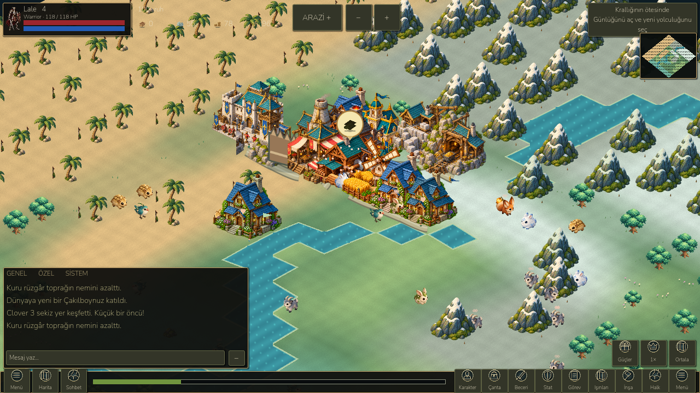
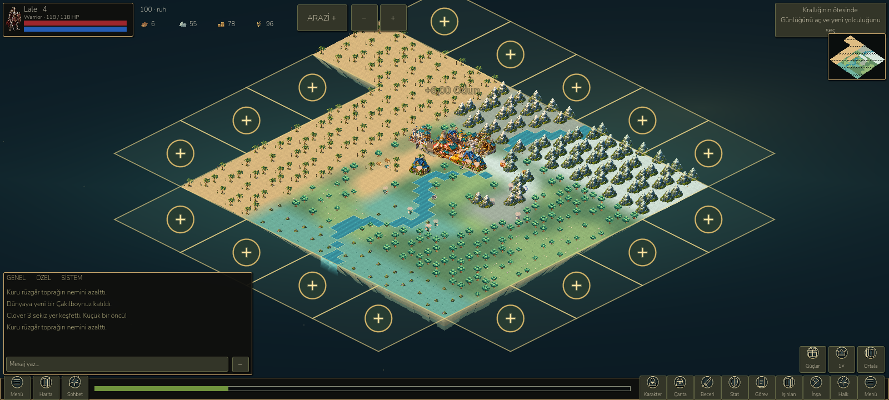
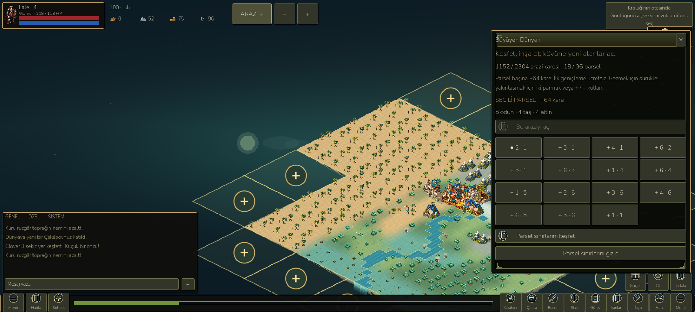

# Growing world and village collection — 26 October 2026

Implemented in the existing project, preserving the earlier RPG, campaign and save data. The home world now starts at **1,024 playable tiles**, with sixteen 8×8 parcels. Twenty adjacent expansions bring it to **2,304 tiles / 36 parcels**. `ARAZİ + / LAND +` opens the selector; optional border signs can also be tapped. First expansion is free. Subsequent expansions cost ordinary wood, stone and gold, with the next cost shown before purchase. There are no timers, paid currency or paid services in this feature.

The approach was informed by Zynga's [FarmVille 2 expansion guide](https://zyngasupport.helpshift.com/hc/en/10-farmville-2/faq/481-how-do-i-expand-my-farm-1687940364/), [FarmVille 3 adjacent-land guide](https://zyngasupport.helpshift.com/hc/en/91-farmville-3/faq/15161-how-do-i-expand-my-farm/) and [getting-started/harvest help](https://zyngasupport.helpshift.com/hc/en/91-farmville-3/section/1074-getting-started/). LittleGod uses its existing simulation, resources and construction rules; these are references for interaction, not imported game assets.

## Actual changes

- Twelve original painted building sprites in two 1536×1024 RGBA atlases: cottage, farm/windmill, lumbermill, storage, townhall, forge, quarry, mine, furnace, barracks, watchtower and market. Buildings render around 140 pixels wide at level one, versus the earlier roughly 70. Settlement houses use the same artwork. Wall and scaffold retain existing vector art. Provenance: [asset notes](../assets/estate/README.md).
- Broader isometric spacing, procedural paths joining nearby real buildings, clear spaces around structures, sparse peripheral decorations, camera panning and .25–2× zoom, plus visible zoom buttons. Minimap fits the actual expanded land.
- Tappable roof regions open the existing building details. Completion and harvest bubbles have a stable 48-pixel visual diameter / 52-pixel hit diameter in game coordinates, independent of world zoom. Topmost buildings and bubbles win selection over creatures and terrain.
- Farm/lumber/quarry/mine/furnace output accumulates in a per-building buffer, capped at 20 units per level. Inputs and natural resources are consumed by real production. Tap the bubble or the building's Collect button to transfer the output; warehouse overflow remains safely buffered. Quest production credit is awarded on collection. Worker and settlement simulation remain active.
- Construction/upgrade completion has a one-time acknowledgement bubble. Completed forge jobs remain in their reserved queue slots with original item IDs until collected into inventory. No free duplicate output is granted. Audio, optional mobile vibration and a floating quantity confirm collection.
- New land is immediately usable by construction. New placement requires a little clearance around buildings. Existing layouts and indices are not moved. Existing building count/type limits remain.
- Read-only visits, active adventure and active battle cannot buy land or collect home output.

## Saves and public previews

Private `estate` version 1 stores ordered owned parcels, integer production buffers, acknowledged building levels and ready forge job IDs. Migration appends cells without changing any existing cell, creature, settlement, building or item index. It preserves RNG state and acknowledges already finished buildings. Migration is idempotent. A legacy save receives its existing offline simulation before migration; subsequent offline replay fills bounded buffers without spoiling goods. Save/load validates parcel adjacency, duplicate coordinates, resource types, capacity and queue ownership.

Public inert showcase v3 carries up to 2,304 cells and appearance; it excludes private estate, inventories and production data. v1/v2 retain their 400-cell validation. Client file/HTTP and server request limits are bounded for v3. Local encode/parse/read-only import passes; server code compiles with zero warnings/errors. Live online v3 exchange is **not verified**; the earlier Windows App Control limitation for the local server is not bypassed.

## Verification and performance

All **822 retained campaign checks**, **270 landscape UI checks**, **98 compact UI checks** and **14 RPG interaction checks** pass unchanged. New suite: **44/44** save migration, land purchase, invalid state, exact collection, forge ownership, read-only preview, 720 simulation ticks and 480 offline ticks. New rendered suite: **13/13** captures, panel bounds and actual world-icon dispatch across 960×540, 1280×720 and 1600×720. Evidence: [benchmarks](benchmarks/estate/).

The verified Godot runtime was launched through Godot MCP. A real MCP mouse click on the wood bubble transferred 6.00 wood, removed the bubble and left a valid world. The LAND button was clicked and the rendered selector inspected. Desktop screenshots were also captured from the real running scene. Sampled expanded home with ambient animation: **60.11 FPS**, **16.69 ms p95**, **0.88 ms world-update CPU p95**, approximately **52.37 MB static / 44.05 MB texture memory**, **633 reported draw calls**. This is a short desktop RTX 4070 sample, not mid-range Android certification. Cached terrain meshes, coordinate occupancy lookup, offscreen prop visibility and reduced battery-mode vegetation limit extra work.

Final APK installs and starts in the `LittleGod_Test` emulator. **6/6** Android fixture, large world, collection, expansion and save/load checks pass. Production save, backup and settings hashes are unchanged. Native ADB taps separately opened LAND, purchased a paid parcel and reopened the panel: the displayed count advanced **1,088 → 1,152**, wood **6 → 0**, stone/gold each decreased by 3. Native taps were inspected through screenshots; QA session native actions intentionally do not autosave. Save/load is separately checked by the harness.

Latest emulator sample at 60 cap: **17.77 FPS / 62.35 ms p95**; battery mode at 30 cap: **21.33 FPS / 53.18 ms p95**. Texture memory ~45.60 MB; static ~52 MB. Rendering/engine time dominates the ~1.0 ms world CPU update in this sample. These remain poor emulator results. No physical Android device was connected or tested; physical performance, native multitouch and device-specific safe areas remain unverified. A cold shader-cache warning and existing Godot shutdown resource-leak warnings remain. Dense legacy building clusters can still overlap visually; migration deliberately preserves their positions. Roads are decorative paths, not simulated pathfinding or river bridges. Earlier unfinished animation/chat work remains unfinished.

## Launch and build

- Desktop launcher: `D:/LittleGod/Launch LittleGod.cmd`
- Verified runtime: `D:/LittleGod/tools/godot/Godot_v4.7.2-stable_win64.exe`
- Android debug APK: `D:/LittleGod/builds/android/LittleGod-Growing-World-debug.apk`
- Isolated package: `org.littlegod.livinguniverse.rpgqa` (version code 96); production export preset preserved.
- SHA-256: `9a0e7d69daeaa6ab387c3690b534c46815c8bd62db972fa1ea0c6471f206e083`.
- APK export: `python -X utf8 devtools/build_rpg_qa.py --output LittleGod-Growing-World-debug.apk --manifest estate-apk.json --version-code 96`
- Android QA: `python -X utf8 devtools/android_rpg_validate.py --phase estate --apk LittleGod-Growing-World-debug.apk --output estate-android --screenshots estate`
- Core/render suites: Godot `--script tests/estate.gd` (headless) and `--script tests/estate_visual.gd` (rendered).

