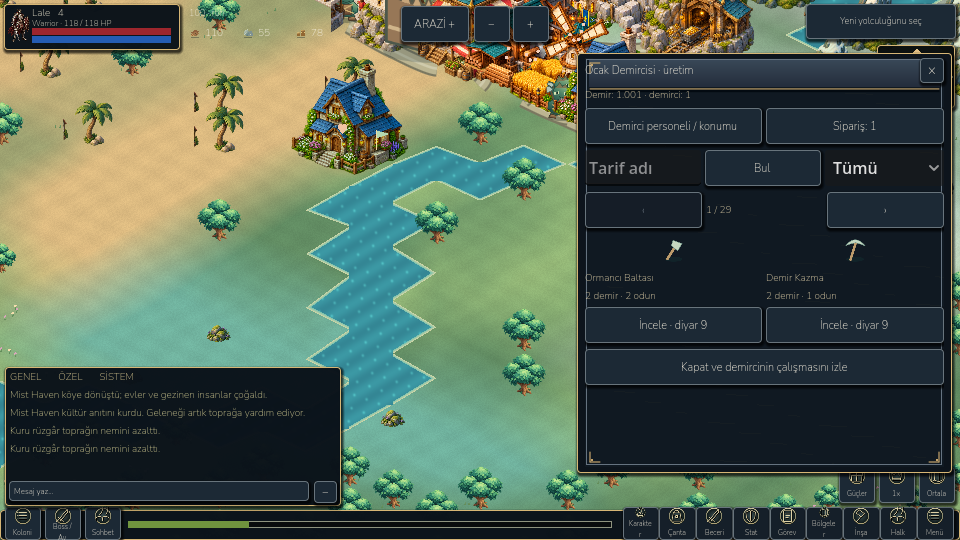
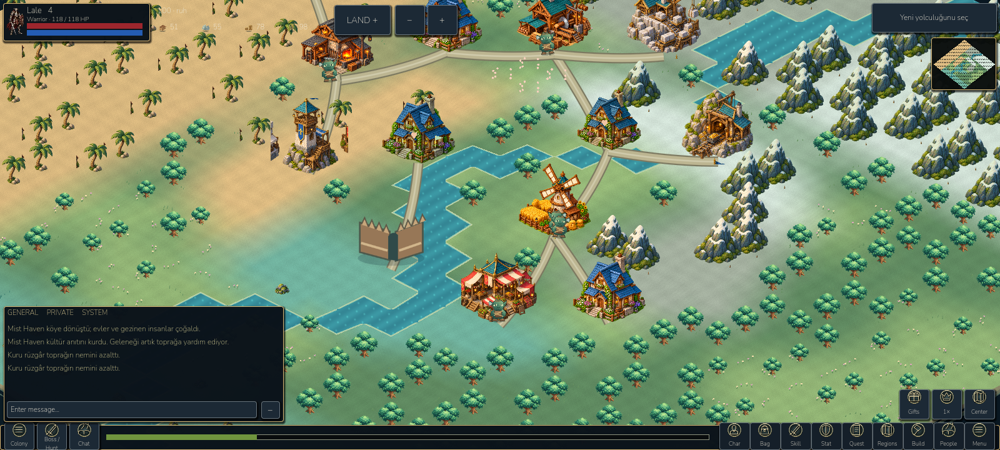

# Journey and settlement continuity

27 October 2026. Extends the existing project, save format and tested commands.

## Changes implemented

- **Chapter transitions:** completed chapters 5/10/15/20 now offer modern Iron Age / hero / army / trade continuation. `journey.gd` derives the offer from actual completed quests and calls the existing enable commands. No unlocking by UI-only counters, automatic reward, campaign reset or duplicate transition. The prior legacy-menu detour is removed from the primary flow.
- **Recruitment bug:** the generic route guard previously blocked the Hero screen when the system was unlocked but no hero had been recruited. It now distinguishes unlocked recruitment from stat/skill screens that need an existing hero. A compact name/cost screen calls `Hero.recruit` exactly once for five food and three gold, initializes the existing four-hero extension and keeps old item IDs.
- **Arin's next action:** colony advice points to ready output, cargo, blocked construction, recruitment or the current quest. Its overview connects staffing/resources, equipment, boss expeditions and defense. Home pause is explicit; Resume is a deliberate player action and closes the menu. Normal menus/expeditions retain their existing home-pause semantics.
- **Building staffing:** direct per-building roster, actual production slots, named jobs and explicit release for busy workers. Unfinished sites explain the shared builder queue. The gathering shortcut remembers the selected available worker instead of silently assigning a different person. Every actual assignment uses the existing model reservation checks.
- **Drop guide:** twelve unique monsters across four actual regions, searchable in English/Turkish by monster, material or the active class weapon. It derives XP/stats/material quantities and weighted probabilities from the running game's definitions, and spawn membership from current map constructors. The guardian's one-time reward and extra class-weapon conditions are distinguished. Rows of random materials are alternatives; these are LittleGod rates, not claimed KO server rates. Direct destination links retain normal unlock requirements.
- **Compact contracts/forge:** contracts have one objective per page and direct action links. The forge has recipe search, tool/equipment/scroll filters, two recipes per page, order tracking, direct staffing and ingredient source navigation. Recipe availability probes the real queue command on a private clone, so displayed eligibility and actual command cannot diverge through separately copied rules. Missing iron explains mine → furnace → collect; materials can open the relevant gathering or monster-drop screen. No missing material or crafting worker is silently granted.
- **Settlement spacing:** a conservative 168×148 isometric art footprint prevents overlapping new placements in colony estates. An optional preview proposes relocations nearest the old positions; applying validates the complete plan on a clone and changes only cells, preserving building order/IDs/levels/progress, workers, pending output and stocks. Stale, malformed, read-only and expedition plans are rejected. Active-caravan markets remain fixed; a legacy market that overlaps another settlement can require ending/collecting that caravan before a complete plan fits. No automatic relocation on load. Roads use the existing path renderer and can still cross water without proper bridge art.
- **Gathering tools and visuals:** existing axe/pick multipliers now affect suitable field-gathering jobs as well as building production; tools do not grant a fishing bonus. Cargo/source caps still apply. Source travel interpolates through simulation time; fishing rods/ripples and chopping/mining tools/small dust cues are procedural original graphics. They are not a complete directional profession animation set. Placement shows forest cover, soil moisture or deposit stock before confirmation.

## Verification

`tests/journey.gd`: **224 checks**, including read-only advice; four real chapter migrations; no replay; true recruitment payment; roster initialization; twelve drop definitions/region filters; a fresh founding → six wood → first reward → lumber camp → two assigned workers → collected wood → second reward loop; compact TR/EN screens at 960×540 / 1280×720 / 1600×720; complete spacing plan and identity preservation; active market protection; and real axe output. These are controlled automated gameplay actions, not proof of first-time human comprehension.

Existing campaign **822**, landscape UI **270**, compact HUD **98**, playbook **142**, colony model **94**, colony UI **100**, native navigation **61**, control recovery **14** and armory visual **46** checks pass. The colony model test explicitly unequips its fixture's pre-existing pick to retain its original base-yield assertions; separate new tests verify the real equipped-axe bonus. The landscape context test now asserts direct staffing for the selected farm rather than a generic worker list. Armory captures support a fresh output folder to avoid Windows importer locks; spell assertions wait up to 750 ms for the real 50 ms simulation tick instead of assuming two rendering frames always include a combat tick. No assertion was removed to make a failure pass.

Screenshots: `docs/screenshots/journey/` (real Godot renders). Model/UI evidence: `docs/benchmarks/journey/verification.json`; retained test logs: `builds/journey-*.log`. Android final evidence and native close tap results are saved alongside the final APK manifest. Original production player files are hash-checked separately from the QA package. No physical-phone verification is claimed.

Final APK: 77,605,974 bytes; SHA-256 `36d24842deaaec8fae3e28fa96c08c38c79cb4d489f4a2104e1c06586f3a21de`. Final Android **30/30** checks pass with no script errors/fatal exceptions in the captured process log and identical production-file hashes. The harness first confirmed the iron-sword action was blocked by missing iron, assigned a worker to the real furnace, simulated its output, collected iron, queued the sword with exact two-iron/one-wood cost, completed its work with the existing smith and collected the same item ID once. Model navigation is programmatic; only the close-button check is a native ADB tap. Separate desktop MCP clicks recruited Lale and assigned Ivo to the actual forge; four classes and valid state were verified.

Final paused-home emulator sample: **33.71 FPS / p95 34.13 ms** at a 60 cap; **30.09 FPS / p95 34.82 ms** in battery mode. Draw calls 390 / 306; texture memory 45.63 MiB; static memory 53.23 / 53.09 MiB; world CPU p95 0.63 / 0.74 ms. ADB cold Activity startup is recorded in `docs/benchmarks/journey/startup.txt`. This is not an active-battle or physical-phone benchmark, nor a controlled optimization comparison. Stable 60 FPS remains unresolved.

## Remaining scope

This is a usable continuity/settlement checkpoint, not completion of the full requested MMORPG. The complete ordered ledger is [DEVELOPMENT_BACKLOG.md](DEVELOPMENT_BACKLOG.md). In particular, full layered directional class art, NPC quest chains, all wiki item families, advanced element balance, live two-client chat and online region warfare remain unfinished. Shutdown ObjectDB/resource warnings remain. The new layout is conservative and can need more land; it does not add a full wall/gate editor or road pathfinding. Some advanced legacy panels still scroll and retain wildlife history.

Reference research remains in [COLONY_WORKFORCE.md](COLONY_WORKFORCE.md), [ARMORY_REFERENCE_IMPLEMENTATION.md](ARMORY_REFERENCE_IMPLEMENTATION.md) and `docs/research/`. The implementation uses original game art and actual LittleGod definitions rather than inventing missing reference probabilities.

## Launch and build

- Desktop: `D:/LittleGod/Launch LittleGod.cmd`.
- Verified Godot: `D:/LittleGod/tools/godot/Godot_v4.7.2-stable_win64_console.exe`.
- Android: `D:/LittleGod/builds/android/LittleGod-Journey-debug.apk`, isolated `org.littlegod.livinguniverse.rpgqa`, version code 104.
- Rebuild: `python -X utf8 devtools/build_rpg_qa.py --output LittleGod-Journey-debug.apk --manifest journey-apk.json --version-code 104`.
- Android QA: `python -X utf8 devtools/android_rpg_validate.py --phase journey --apk LittleGod-Journey-debug.apk --output journey-android --screenshots journey`.

