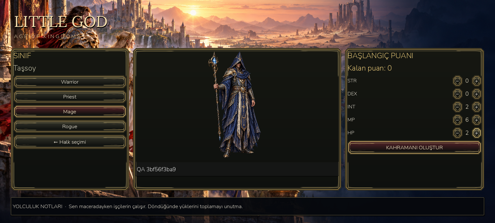
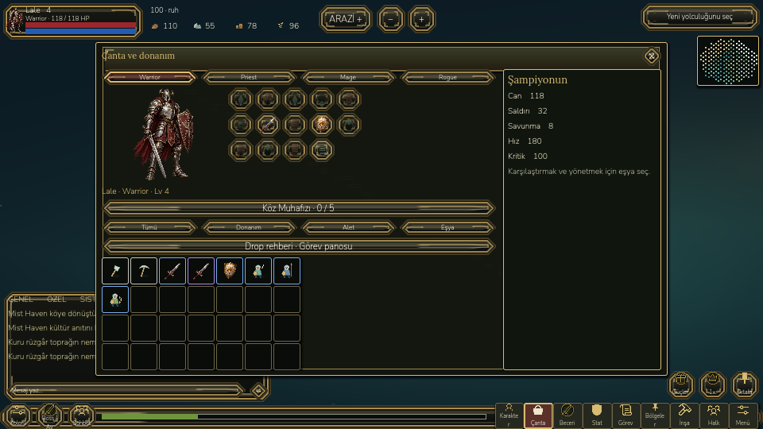
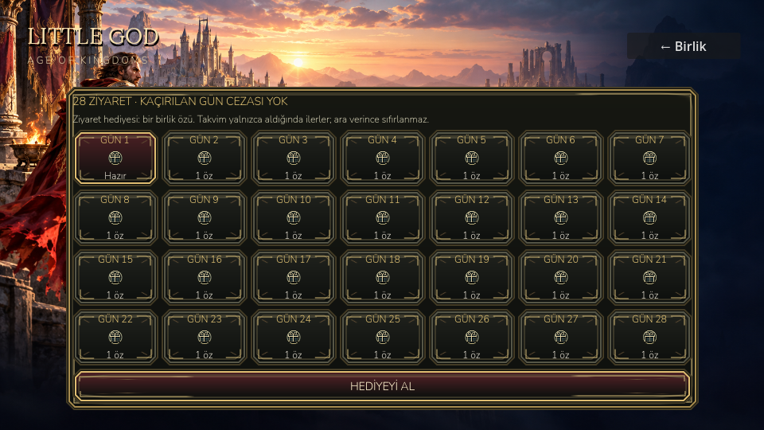

# LittleGod — Kingdom UI delivery

28 October 2026. Implemented in the existing Godot project, using the owner's nine reference images for layout. No reference-game screenshots or paid UI kit were inserted into gameplay.

## What changed

- One visual system: charcoal/olive surfaces, antique gold borders, burgundy selection, cream text, teal heraldry. Original SVG nine-slice frames and two race crests; existing original character and lobby art retained. Buttons have normal, hover, pressed and disabled states. Existing licensed LibreKO icons remain attributed.
- Account → real server selection/Connect → people → class/name/ten starting points → company/city/shared hunt. Dawnkin and Stoneborn are original cosmetic identities with equal starting strength. Warrior, Priest, Mage and Rogue use existing game artwork. Existing characters skip creation; legacy device saves remain separate and available.
- Character creation: classes on the left, large character/name in the middle, STR/DEX/INT/MP/HP allocation on the right. Exactly ten points are required, with no negative/extra allocations. Class descriptions are tooltips. Server validates race and allocation; values persist and affect actual shared combat health, mana and class attack. Additive local save data applies starting bonuses without consuming earned level points. Legacy callers without allocation remain accepted at their old power.
- City/campaign HUD inherits the common theme. Shared hunt now has compact upper-left HP/MP/XP/name/class/level, upper-right region/minimap, lower-left chat, bottom icon strip, and lower-right attack/skill/target/dodge. General chat polls the real API and deduplicates message IDs; System reads game events; Private/Write opens the existing full chat interface. Polls stop during suspension and modal use.
- Inventory/character window is now centered and wide: character/equipment at left, item grid below, permanent summary/item comparison at right. Starting 28-slot grid fits without scrolling at 960×540 and 1600×720. Larger inventories still scroll. Existing equip, lock, protected discard, upgrade and rebirth behavior is retained.
- Settings use Game/Sound/Display/Controls tabs and an explicit Apply operation. Draft changes do not immediately change saved preferences. Existing sound, haptics, 30-FPS battery mode, contrast, reduced motion and text scale settings are retained.
- Calendar: 28 visits, one company essence per claim, once per UTC day; no reset for skipped days or absence penalty. Authenticated ownership checks, database row/advisory locks and concurrent request tests prevent double claims. Claiming requires leaving the shared hunt. This is the implemented visit reward, not an invented premium or scheduled seasonal event.
- Shared-hunt menus stop local movement/actions while snapshots continue. Native X closes the menu and restores input. UI layer resets on leaving the hunt. Disconnect warnings remain visible and disable attacks instead of being overwritten by stale snapshot labels.

## Verification

| Check | Result |
|---|---|
| Existing campaign | 822 passed |
| Existing parallel city/adventure | 67 passed |
| Existing native navigation | 61 passed |
| Existing RPG interactions/travel | 14 passed |
| .NET unit tests | 66 passed |
| Rendered entry/creation/calendar/shared hunt | 59 passed |
| Rendered panels at 960×540 and 1600×720 | 45 passed |
| Public HTTPS identity/daily claims | 15 passed, including two simultaneous claims and foreign ownership denial |
| Public two-peer cooperative WSS | 26 passed |
| Android emulator | 17 passed, 10 external ADB taps, 3 fresh-process restore checks |

Screenshots are actual Godot gameplay and emulator captures. Inspected login, people, class creation at both desktop sizes, calendar at 960×540, inventory/settings at 960×540 and the shared hunt including an open inventory. The small calendar's overlapping tip strip was removed. Existing player files in both Android packages were hash checked and preserved. No script error/FATAL EXCEPTION in the final Android run. Existing Godot resource/ObjectDB cleanup warnings remain at shutdown.

Final emulator cold activity start: **6347 ms** in the final `am start -W` sample (an earlier sample was 2876 ms); this is Android activity launch latency, not a full-world readiness or FPS benchmark. No new sustained rendering, battery or physical-device performance claim. Phone was not connected. Tests use a separate QA package; production package was exported from the same source, not installed over the owner's phone.

Raw reports: [benchmarks/kingdom-ui](benchmarks/kingdom-ui). Reproduce with `tests/entry_flow.gd`, `tests/kingdom_ui.gd`, `devtools/test_identity.py` and `devtools/android_entry_validate.py`.

## Builds and deployed service

- Desktop launcher: `D:/LittleGod/Launch LittleGod.cmd`.
- Verified runtime: `D:/LittleGod/tools/godot/Godot_v4.7.2-stable_win64_console.exe`.
- Main debug APK v112: `D:/LittleGod/builds/android/LittleGod-Kingdom-UI-debug.apk`.
- Isolated QA debug APK v112: `D:/LittleGod/builds/android/LittleGod-Kingdom-UI-QA-debug.apk`.
- Public [Android APK](https://31.42.127.79:8443/downloads/LittleGod-Kingdom-UI-debug.apk); existing `LittleGod-Online-debug.apk` download is updated too.
- API: `https://31.42.127.79:8443`; deployed release `C:/LittleGodBeta/releases/kingdom-ui-20261028114501`. Database backup verified before additive migration. Existing data-protection keys/configuration retained. Update script rolls the release pointer back on health failure. Health uses the trusted loopback proxy HTTPS header; direct cleartext remains rejected.
- Main SHA-256: `7e491556de2afabdebaca7fdd2775dcfb6909f1f8c12347aa33d7d58d8fa7d1b` (82,049,060 bytes). Metadata in [apk.json](benchmarks/kingdom-ui/apk.json).

## Actual rendered views

## Remaining limits

The shared realm is still the cooperative beta clearing, not a complete MMO/PvP or server-authoritative city economy. Campaign equipment and earned skill/stat progression remain local; their inventory display in the shared scene does not make them trusted online combat inputs. Race choice is cosmetic. Existing character portraits/sprites are retained; no new production directional/layered animation or 3D character editor is claimed. The reference calendar's varied premium prizes and full seasonal event scheduling are not implemented. Fixed HUDs rebuild on scene entry; arbitrary desktop resize during combat needs re-entry. Physical phone density, safe areas, haptic feel, multitouch comfort, sustained FPS and human usability testing remain. Further UI tuning should use player feedback from this working version.
