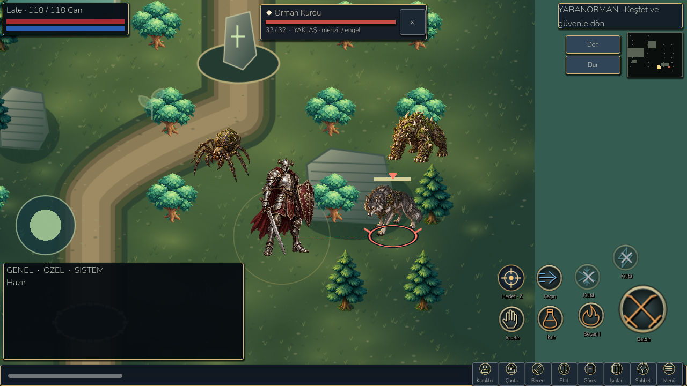

# MMORPG HUD, target clarity and forest presentation — 27 October 2026

## Research and applied structure

The actual Godot game was launched and inspected through Godot Forge before and after the changes. The audit found an absent persistent enemy target bar, faint home-world selection, ambiguous selected inventory items, unlabelled combat icons and flat forest/enemy art beside the detailed hero. This checkpoint implements the target/selection conventions in the existing playable simulation.

| Reference | Verified pattern | LittleGod implementation |
| --- | --- | --- |
| [Knight Online official interface guide](https://www.nttgame.com/knight/en/guide/installation) | Separate status, minimap, chat, shortcuts, equipment preview and selected monster name/HP | Existing corner HUD retained; top-center enemy bar, explicit selection and bottom shortcuts |
| [Knight Online official gameplay guide](https://www.nttgame.com/knight/en/guide/enjoy) | Selecting a monster precedes attack; loot and equipment have their own actions | First click/tap selects; repeat desktop click attacks; attack button uses chosen target |
| [Albion official mobile targeting patch](https://forum.albiononline.com/index.php/Thread/223406-29-June-2026-Radiant-Wilds-Patch-3/) | Mobile targeting line and range visible by default | Target line, basic attack radius and truthful range/obstruction text |
| [Black Desert Mobile official controller guide](https://www.world.blackdesertm.com/Ocean/Wiki?wikiNo=100) | Explicit target-lock action separate from skills | Target-cycle button and Z/Tab; clearing target is a distinct action |

Official indexed KO guide text was readable through search; direct opens sometimes returned 403. Image search also exposed an unofficial KO mobile development preview and Black Desert Mobile community screenshots on official forums. Those visual references informed spatial comparison, not a claim that an unofficial client is an official product. Third-party images were not placed in the game. The implementation preserves LittleGod combat, economy and unlock rules rather than importing unverified KO numeric values.

At the 1280×720 reference viewport, the retained status card is 235×61, chat 448×185, bottom strip 40 high, primary attack 100 diameter, and new enemy target card 310×67. Inventory remains 384 wide with its separate item comparison. The layout scales to 960×540 and wide 1600×720 without enlarging panels to cover the world. These are logical canvas dimensions; no claim of physical-device touch certification is made.

## Implemented behavior

- Slate metal panels, restrained gold edges, brighter text, consistent button hover/pressed states and readable title strips replace the low-contrast olive/beige treatment.
- A selected enemy shows its localized name, real HP, range/obstacle state, a strong ground ring, pointer and targeting line. It clears on death and can be explicitly cancelled.
- Desktop first click selects without attacking. Clicking the same enemy again attacks. Mobile taps select without automatically firing. A target-cycle button and Z/Tab move through visible living enemies.
- The selected ID is passed as transient combat input. A single-target ranged basic attack hits that enemy rather than the first enemy in array order. Existing damage, cooldown, mana, area attacks, line-of-sight and range checks remain authoritative. Selection does not permit attacks through walls or beyond range.
- Attacking a locked out-of-range target explains that the player must approach, instead of silently spending a basic attack. No forced camera snap or automatic walking was added.
- Incoming strikes and low health have a separate visible warning above gameplay, outside chat. Defeat points to safe return. Combat buttons have short localized captions, cooldown arcs and explicit locked/low-mana skill labels.
- A selected building, settlement, creature or land tile shows a persistent context card with a relevant real action. Building rings are larger and have a pointer; stale creature selection is cleared when choosing a building or land. Selection cards hide during menus, placement and god powers.
- Active navigation buttons, selected inventory items and equipment slots have contrasting borders/checkmarks. Selecting an empty slot removes stale details and shows the chosen slot.
- The Wildwood floor has richer moss, grass, dirt paths, shore, water and stone details. It is an original static vector texture aligned with existing collision, landmark and start positions. Simulation and path collision are unchanged.
- Three original painted transparent sprites replace the forest wolf, thorn beast and spider during real play. Existing movement, warning, hit/death presentation and combat bodies use them. Other enemy families and the boss keep their prior art.

Selection is intentionally transient. No target fields were added to saves, public showcases, inventories or accounts. Existing quests, enhancements/rebirth, equipment ownership, class restrictions, growing world and offline progression are retained.

## Original asset production

Built-in image generation was used through the **imagegen** skill, not CLI/API fallback. The three outputs were inspected, copied into the project and connected through `adventure_scene.gd`. Exact prompts are saved in `docs/research/targeting-art-prompts.json`.

Final project assets:

- `D:/LittleGod/assets/adventure/wolf-painted-v2.png`
- `D:/LittleGod/assets/adventure/thorn-painted-v2.png`
- `D:/LittleGod/assets/adventure/spider-painted-v2.png`
- `D:/LittleGod/assets/adventure/wildwood-ground-premium.svg`
- `D:/LittleGod/assets/ui_classic/target.svg`

Painted source images retain their generated alpha. Godot import caps each creature texture at 512 pixels and generates mipmaps. Tests verify the runtime texture limits and transparent corners. Existing SVG creatures remain as fallbacks. The floor is reproducible with `python devtools/generate_forest_floor.py`; its detail is rasterized at import time, not redrawn thousands of times per frame.

## Verification and delivery

The retained 822 campaign checks pass, including chapter progression for three seeds. The 270 landscape UI, 98 compact HUD, 142 playbook, 41 class combat and 14 RPG interaction checks pass. The new rendered targeting suite passes **66 checks**: first/repeat click, multiple target cycling, target death, real ranged damage priority, range and wall rejection, context actions, selected item/slot feedback, navigation state, save/load and three viewport sizes. Six checks cover mobile texture size/alpha. Screenshots are saved by asserted write operations.

Three existing classic screenshot paths rejected writes on Windows. The classic test now accepts an optional artifact directory; the full original 98 assertions and image-save checks then passed in a fresh directory. No gameplay assertion was removed or relaxed. A new wall test initially used the fixture's Iron Hills geometry with a Wildwood obstacle; the fixture was corrected to enter Wildwood explicitly, and the wall rejection passed.

Android debug package: `D:/LittleGod/builds/android/LittleGod-Targeting-debug.apk`, version code 100, isolated QA package `org.littlegod.livinguniverse.rpgqa`. Installation, startup, actual rendering and programmatic touch were validated in the emulator with **13 checks**, no script errors, and unchanged production save/backup/settings hashes. The harness uses QA slots and controlled fixture positions; this is not a claim of human touch or physical-device testing. No physical device was connected.

Measured emulator paused-home sample: **26.11 FPS / 42.18 ms p95** at the 60 cap, **30.14 FPS / 34.83 ms p95** in battery mode. World-update CPU p95 **1.12 / 1.22 ms**, **448 / 357** draw calls, about **55.4 MB** static memory and **60.0 MB** texture memory. These are short samples on the current host, not a controlled before/after performance claim or 60 FPS certification. Earlier checkpoints varied substantially with host conditions.

Evidence: `docs/benchmarks/targeting/`; before/after and Android images: `docs/screenshots/targeting/`. APK size/hash: `docs/benchmarks/targeting/apk.json`. Launcher: `D:/LittleGod/Launch LittleGod.cmd`. Runtime: `D:/LittleGod/tools/godot/Godot_v4.7.2-stable_win64_console.exe`.

Reproduce the targeted checks:

```powershell
& tools/godot/Godot_v4.7.2-stable_win64_console.exe --path . --script tests/targeting_ui.gd
$env:LITTLEGOD_CLASSIC_CAPTURES='res://builds/targeting/classic-captures'
& tools/godot/Godot_v4.7.2-stable_win64_console.exe --path . --script tests/classic_ui.gd
Remove-Item Env:LITTLEGOD_CLASSIC_CAPTURES
python -X utf8 devtools/android_rpg_validate.py --phase targeting --apk LittleGod-Targeting-debug.apk --output targeting-android --screenshots targeting
```

## Remaining limits

This is a working HUD/targeting/art checkpoint within the existing 2D game. A complete 3D Knight Online world, every MMO system, full NPC quest database and directional skeletal character animation have not been implemented. The new enemies use detailed poses with existing procedural motion, not a new multi-frame animation library. Advanced menus can still scroll, older village buildings can overlap, and shutdown resource warnings remain. Normal emulator mode does not hold 60 FPS; physical performance remains unverified. These limits are not hidden by the new UI.

Godot MCP mouse input also selected an actual wolf with unchanged HP and no attack on first click. The encounter preview below uses the running scene with controlled QA enemy positions and frozen physics to inspect all three new sprites together.


