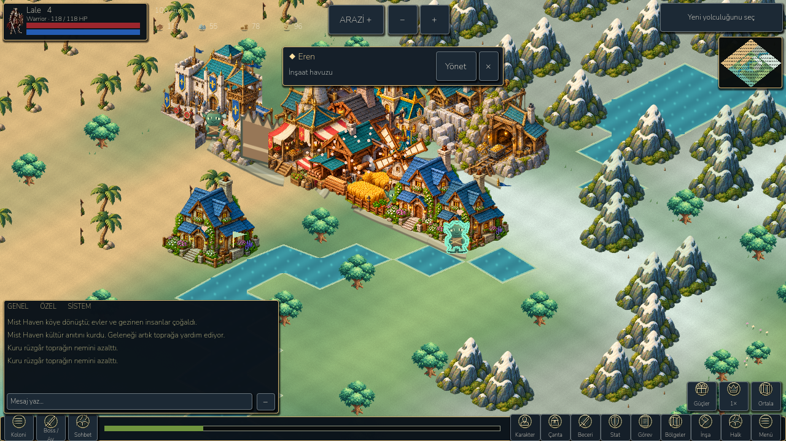
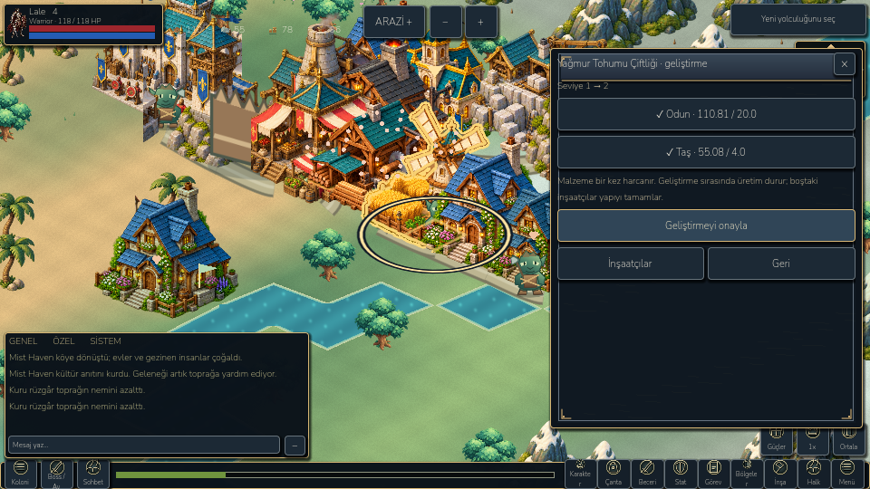
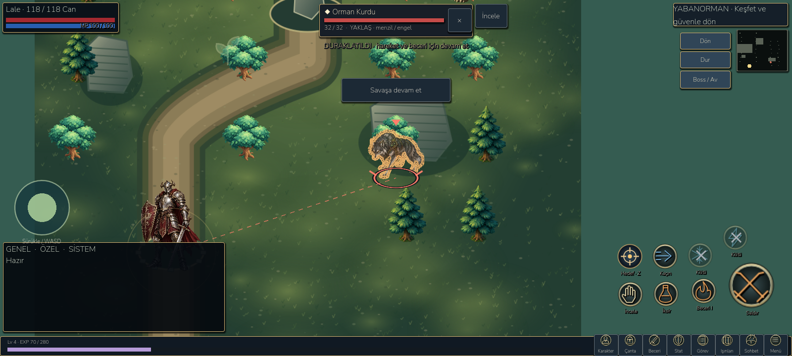

# Object selection and contextual actions

27 October 2026. Existing LittleGod project and saves preserved.

## Player experience

- **Selected buildings:** a gold contour follows the actual transparent building art, with the existing ground marker and persistent name/level context. Selecting another object clears the previous contour. Atlas bounds keep adjacent building sprites from bleeding into the outline. Original materials return on deselection.
- **Selected workers:** mint contour, actual worker identity and job, plus the existing individual assignment/cargo controls. Worker selection is exclusive with building/terrain/legacy-creature selection. Clicking a cargo icon selects the worker while delivering real output; selecting a building's output identifies the building.
- **Selected terrain/resources:** terrain context includes coordinates, live remaining deposit and moisture. Visible resource props at that cell receive a green contour. Forest, mountain and shore expose suitable gathering duties. The player chooses an available worker; the assignment uses **the selected cell**, validates biome/depletion/bounds, and preserves all reservation checks. Water offers water/fish instead of construction. Empty land offers building selection; its placement remains a separate suitability/confirmation step. Hidden legacy pets no longer intercept ordinary colony terrain inspection.
- **Selected enemies:** contour follows the actual enemy sprite, while the existing HP/name/range card, ring, attack warnings and target priority remain. The adjacent Inspect action opens the selected enemy's actual HP/attack/defense/XP and a drop-guide link. Inspection pauses combat and restores the prior pause state on close. Enemy death/clear removes selection. Sprite alpha hit testing supplements the existing forgiving mobile hit radius.
- **Original settlements:** selected original settlement art is highlighted and has a dedicated context with population, food, current objective, workers/housing and defense. Its development remains governed by existing simulation/story rules; there is no fake building-upgrade payment.

## Building upgrade / relocation

The building panel shows its level, actual production/construction status and only relevant building operations: staffing, locate, forge orders, barracks or market as applicable. Upgrade opens a dedicated review: current → next level, **owned / required** resources, source links and an explicit confirmation. Missing supplies, active construction, active-caravan reservations, read-only worlds and max level are explained/blocked. Confirmation checks the same building ID and reviewed level before calling the existing upgrade command; materials are consumed once. Source navigation returns to the original upgrade review instead of a random crafting recipe.

Relocate starts the preview at the original building rather than silently jumping to the first legal tile. The original building stays in place until confirmation. The existing ghost and valid/invalid placement feedback show the proposed destination; the label explains free movement, tapping new ground, confirmation and cancellation. Cancel leaves the saved cell unchanged. Confirm uses existing biome/spacing/reservation validation, spends no resources, selects the new cell and returns to the moved building's panel. Levels, progress, workers, item ownership and pending output remain unchanged.

## Implementation and safeguards

`selection_outline.gd` / `assets/selection_outline.gdshader` use a reusable canvas shader applied only to selected sprites. Bounded alpha sampling follows silhouettes without exporting concept art or duplicating textures. The shader preserves vertex tint/opacity and stores/restores original materials. A named sampler avoids a Godot headless shader-compiler error observed with sampler function arguments. Nature-prop selection updates only when the selected cell or cached props change. Pixel hit tests reject transparent sprite areas; existing forgiving enemy hit radii remain for small touches. These visual changes do not award resources, modify enemy stats or bypass collision/range.

Selection IDs are transient view state, not save fields. Worker selection resets on world changes. Source-specific gathering adds an optional cell parameter to the existing command; callers without that parameter retain nearest-source behavior.

## Verification and outputs

- **97 new checks** in `tests/object_selection.gd`: building/worker/enemy outline assignment and restoration, atlas bounds, opaque/transparent hit testing, exclusive identity/context, exact terrain source assignment and invalid nodes, no-mutation previews, four context panels at 960×540 / 1280×720 / 1600×720 in TR/EN, real viewport mouse upgrade confirmation, exact payment, ongoing-upgrade rejection, relocation preview/cancel/commit, free movement, correct post-move panel, save/load and native enemy Inspect/close pause restoration.
- Retained **822 campaign**, **270 landscape UI**, **98 compact HUD**, **142 playbook**, **224 journey**, **94 colony model**, **66 targeting**, **61 native navigation** and **14 control recovery** checks pass. The new capture suite supports `LITTLEGOD_SELECTION_CAPTURES` to avoid Windows editor-import locks while retaining screenshot-write assertions; the final rerun writes to `builds/selection/final-captures`.
- **24 Android checks** pass on the emulator: actual selected-building/enemy rendering, context layout, read-only previews, native ADB upgrade confirmation with exact resource cost, move/cancel-related state and free commit, save/load. The enemy fixture explicitly revives one previously defeated wolf to inspect its contour; it does not award another victory. Other model actions are programmatic, not claimed as human touch playtesting. Production player save/backup/settings hashes remain identical; captured Android process log has no script errors/fatal exception. No physical device connected. No new performance gain is claimed.
- Separate Godot MCP real clicks opened the farm upgrade review, confirmed level 1 → 2, verified wood 110,808 → 90,808 and valid state, then opened relocation at the original cell and cancelled. The MCP error ledger contains a historical automation-snippet parse error from an earlier task; the fresh game clicks did not produce a new gameplay error.

Desktop launcher: `D:/LittleGod/Launch LittleGod.cmd`. Verified runtime: `D:/LittleGod/tools/godot/Godot_v4.7.2-stable_win64_console.exe`. Android: `D:/LittleGod/builds/android/LittleGod-Selection-debug.apk`, version code 105, isolated `org.littlegod.livinguniverse.rpgqa` package. Exact APK hash/size and startup timing are in `docs/benchmarks/selection/apk.json` / `startup.txt`. Real desktop/emulator screenshots: `docs/screenshots/selection/`. Machine reports: `docs/benchmarks/selection/`.

## Remaining limitations

Dense legacy buildings can still visually occlude part of a selected building until the existing optional spacious layout is applied. Alpha contours include fine interior details in the art as well as the outer silhouette; they are not a custom polygon collision editor. Some advanced legacy screens still scroll. Collection bubbles intentionally take priority over roofs. The move preview uses existing isometric ground validity and ghost art, not drag-and-drop. Existing shutdown ObjectDB/resource warnings and unverified physical-phone performance remain. Broader unfinished MMORPG work stays tracked in [DEVELOPMENT_BACKLOG.md](DEVELOPMENT_BACKLOG.md).

