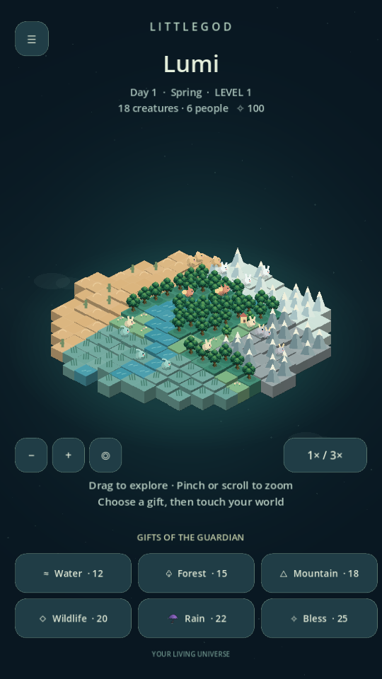
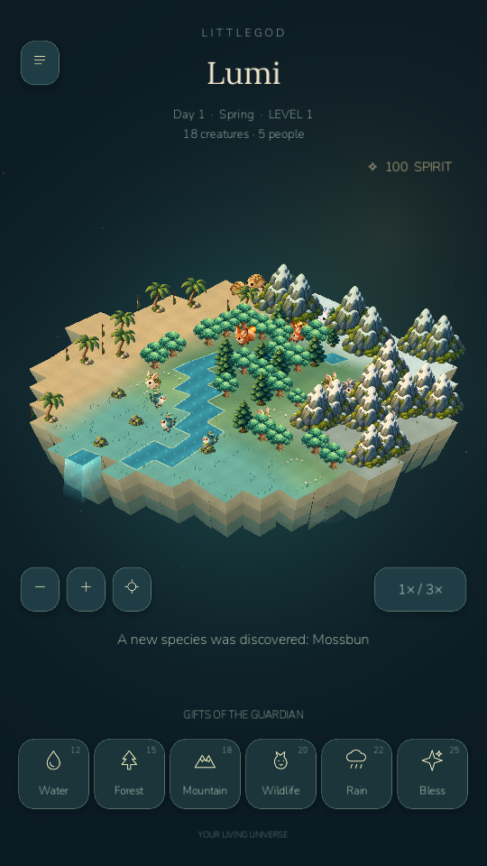
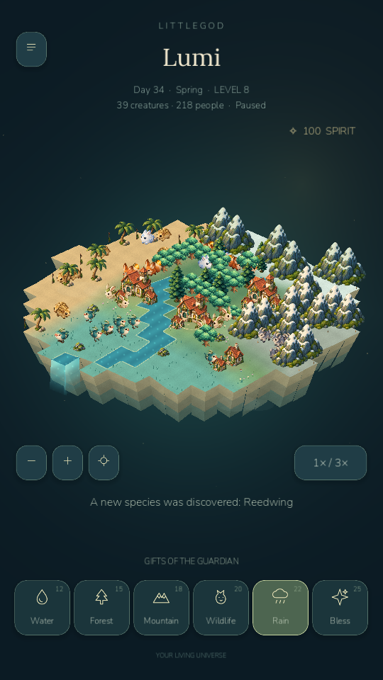
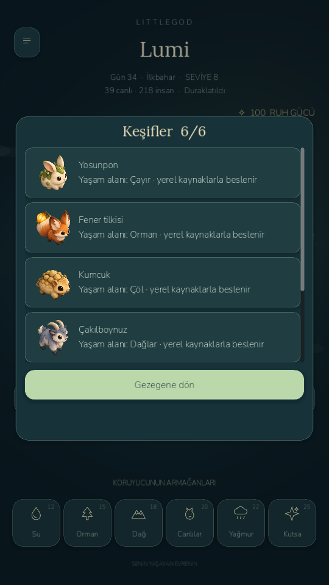

# Phase 2 — visual polish and mobile performance

Implemented in the existing project on 22 October 2026. The six biomes, six species, world generation, civilization, powers, achievements, offline progression, localization and version-one save format remain in place.

## Visual changes inspected in the running game

- Connected terrain replaces individual stacked tile blocks. Shared corners, blended land colors, fine shader grain, narrow river banks, tapered cliff strata, wildflowers and settlement paths give the island a continuous surface.
- Original painted Mossbun, Lanternfox, Duneling, Pebblehorn, Frostpuff and Reedwing sprites replace the primitive silhouettes. Rounded mountains, pines, palms, mossy boulders, cottages and guildhalls share their art style. All use one 1024×1024 atlas.
- Shader-driven water glints, a falling river outlet, subtle foliage sway, warm atmospheric light, clouds, rain splashes, discovery sparkles and color-specific gift rings animate actual gameplay.
- Creature movement now interpolates with elapsed time, changes direction, pauses to graze when fed, breathes/bobs, gives birds a distinct hover, and tucks toward local cover during rain. Habitat/hunger/migration and population rules are retained.
- Camps, villages and towns show different buildings, visible clearings and paths, wandering villagers tied to population/stage, and chimney smoke. A screenshot of towns was taken after 1,000 actual accelerated simulation ticks, not by painting fictional settlements into a picture.
- Licensed Nunito/Lora fonts, eleven original SVG icons, a six-gift dock, clearer spirit display, illustrated discovery cards, popup fades, a branded boot emblem and explicit sound/vibration states replace the inconsistent glyph-heavy interface.
- Tall portrait screens fill the display rather than letterboxing. Camera pan/zoom is smoothed; zoom stays anchored beneath the gesture. Two-finger release cannot trigger a gift accidentally. Selecting an individual creature highlights it and shows its real hunger and habitat.
- Gifts retain their original costs and simulation effects, with immediate visual updates, audio and optional short haptics. Actual physical vibration has not been felt or verified; the emulator has no physical actuator.

Assets: `assets/phase2/world-atlas.png`, three new world shaders, eleven SVG icons, Nunito and Lora font files with OFL licenses, two precomputed ambient loops and a PNG boot emblem. Two original transparent imagegen sheets supplied twelve sprites; the existing original tree remains in the atlas. Camp/villager/icons are original procedural/vector artwork. No paid API, account sign-in or publishing was used.

## Engineering changes and a real persistence fix

The four-Hz full-island SubViewport redraw was removed. Retained land/water/detail meshes rebuild only on simulation changes or gifts; atlas sprites and shader motion animate without rebuilding that surface. Trees, creatures and buildings use depth ordering. Audio no longer synthesizes 66,150 samples in GDScript during startup; local loops and cached effects load instead.

Battery saver caps at 30 FPS, reduces particles, disables foliage sway and uses a smaller mobile internal viewport. Smooth mode targets 60 FPS. Both keep the same intended two-second simulation clock. Monotonic elapsed time avoids Godot's bounded frame delta slowing the live world on very slow frames; suspension still uses the existing bounded offline simulation.

The new legacy-save test uncovered an existing problem: JSON numbers restore as floats, but the ecosystem/civilization clock used integer modulo. A file could pass the old round-trip tests yet fail to evolve after loading. Integer fields are now normalized after validation, and clock arithmetic explicitly handles loaded values. The save version and checksum envelope remain version one. The test now verifies population growth and discoveries after loading a real phase-one fixture. Optional `last_gift` render metadata ensures a planted forest or raised mountain has a visible prop even on sparse decorative cells.

## Measured results

Godot 4.7.2 Compatibility renderer. Android measurements are from the API-35 x86_64 `LittleGod_Test` emulator using the laptop NVIDIA host GPU. No physical Android device appeared in `adb devices -l`.

| Case | Duration | Average FPS | Frame p95 | Draw calls at end | Static / video memory |
|---|---:|---:|---:|---:|---:|
| Desktop smooth, 18 creatures, rain | 15 s | 60.04 | 16.75 ms | 131 | 43.0 / 18.9 MB |
| Desktop battery saver | 15 s | 30.12 | 33.41 ms | 86 | 43.0 / 18.8 MB |
| Android blank control | 12 s | 60.17 | 18.31 ms | 0 | 42.3 / 27.5 MB |
| Android smooth, 18 creatures, rain | 30 s | 57.61 | 20.07 ms | 126 | 45.5 / 35.8 MB |
| Android stress, 70 creatures, rain | 12 s | 59.30 | 18.34 ms | 142 | 50.8 / 40.4 MB |
| Android battery saver, 18 creatures, rain | 30 s | 29.97 | 34.96 ms | 87 | 42.7 / 24.1 MB |

Normal Android simulation averaged 0.95 ms per tick, maximum 1.25 ms in the 30-second run. The 70-creature case averaged 2.09 ms, maximum 3.54 ms. Terrain rebuilds cost about 10–17 ms on ticks. The first measured Godot frame arrived around 2.0–2.5 seconds on the emulator. Host launch-to-profile completion was about 33.1 seconds for a 30-second profile, including launch and polling overhead.

The desktop baseline capture had 287 draw calls and about 23.9 ms process time; the first new capture had 118 calls and 2.0 ms. Profiles record startup/refresh spikes: peak process time was 91–191 ms in Android runs even though p95 frame times were much lower. This is not a promise of hitch-free sustained 60 FPS or physical-device performance.

The blank control shows that this emulator can present around 60 FPS. It does not prove exactly which previous issue caused the phase-one 2 FPS observation; the old package lacked matched profiling instrumentation. Repeated offscreen redraw, runtime audio synthesis, slow-frame clock handling and restored-world arithmetic were concrete game-side issues addressed here. Physical CPU/GPU, thermal and battery testing remain necessary.

The final-package smooth rerun is shown in the table. An earlier 30-second iteration averaged 59.14 FPS with a 19.26 ms p95; the final rerun averaged 57.61 FPS with a 20.07 ms p95. These host-GPU emulator measurements vary with the development host and include initialization/refresh hitches. The result is a substantial improvement over the previous observation, rather than a sustained-60-FPS certification. Copies of the final raw reports are included under `docs/benchmarks/`.

Raw local evidence: `builds/phase2/profile-*.json`, `android-*.json`, `gameplay-regression.log`, `tests.log`, `runtime.log`, `interaction-and-stress.log`. The profiler disables saving during its test session and compares the player-save bytes before/after; every recorded Android case reports `player_save_unchanged: true`. It writes local files only, has no network permission, and is enabled only in debug builds.

## Testing and Android package

All **51 original checks pass**, plus **15 phase-two checks** and the original real-scene clock integration test: **67 checks in total**. New coverage includes connected mesh creation, all rendered species, picking/projection agreement, zoom-anchor preservation, interpolation, accidental pinch-cast prevention, intentional power input, quality budgets, slow-frame clock progression, legacy-save continuation, and a 10,000-tick bounded simulation. The extended run completed in approximately 14–16 seconds on this computer.

Godot MCP exercised the real editor/game and reported no runtime error entries after input regression. Plus changed target zoom to 0.9856, dragging changed pan to (40,20), rain changed weather to 1 and spirit from 100 to 78. Individual selection, illustrated Turkish discoveries, and evolved town art were inspected through actual renderer captures. Windows Computer Use brought the Godot game forward and confirmed the completed journal layout; no OS security setting was changed.

The version-code-2 Android debug APK exports, installs over the previous package, and starts on the emulator. The package remains `org.littlegod.livinguniverse`, ARM64 plus x86_64, minimum API 24, target API 36. Internet permission remains disabled; vibration permission supports the optional haptics setting. Debug signing is not release signing. Windows source play uses the existing official runtime; Windows App Control was not bypassed and no new Windows-package launch is claimed.

## Real screenshots

| Before | Phase-two gameplay |
|---|---|
|  |  |

These are real game captures. Original full-size Android captures and profile screenshots remain in `builds/phase2/`.
