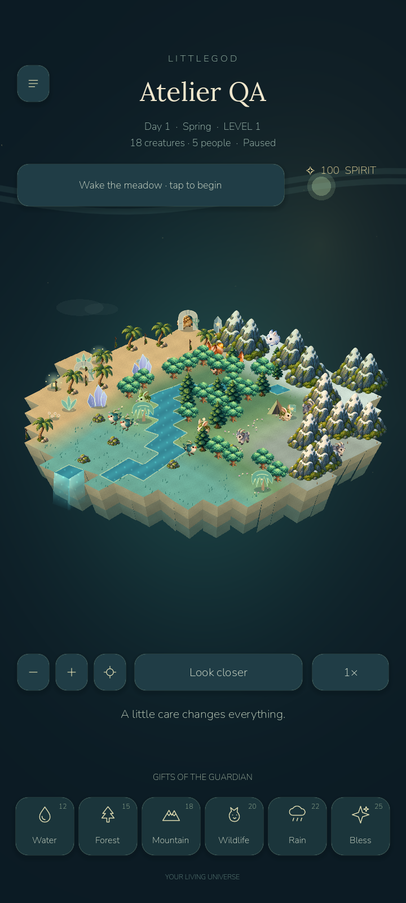
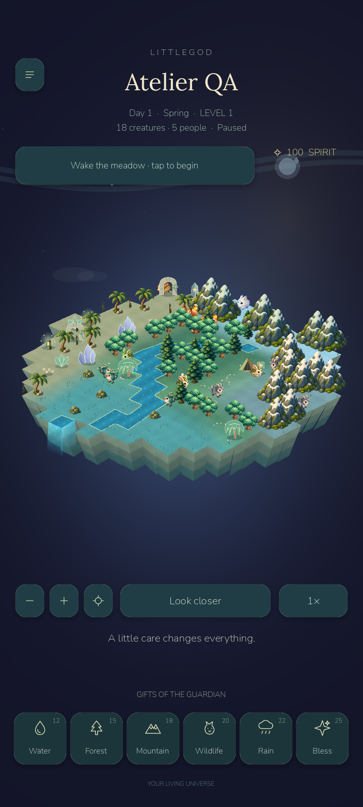
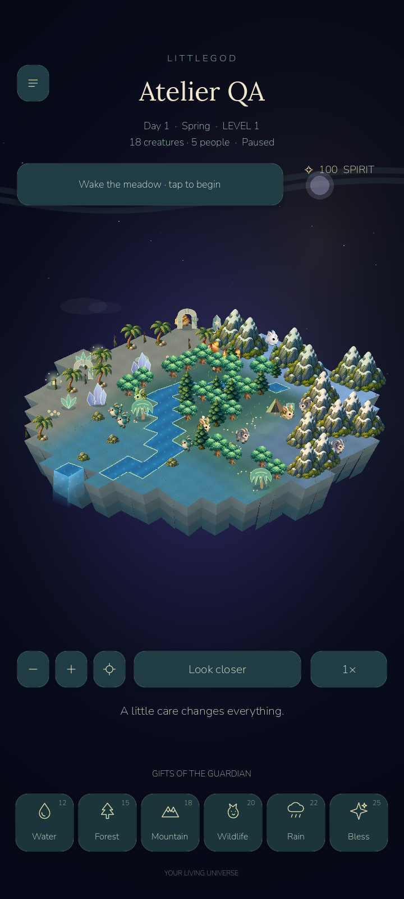
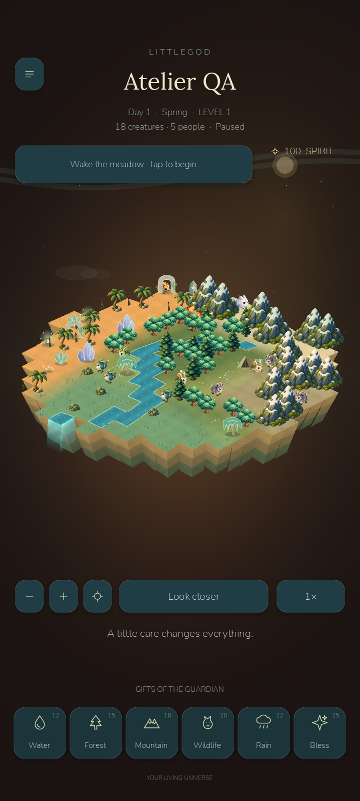
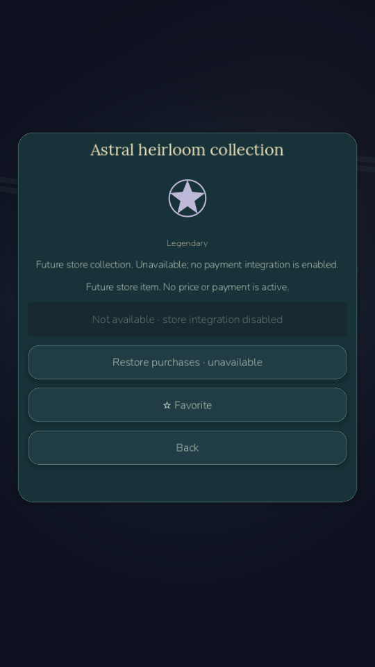

# Phase eight implementation and validation

0.8 continues the completed 0.7 checkpoint, preserving all existing game systems, saved-world format, art and optional online client. The initial real 65-check API rerun passed before backend changes. Safe Git tag `phase8-base-0.7` identifies the starting state. `littlegod-0.8` is the local playable checkpoint; it does not assert that all external/runtime prerequisites are resolved.

## Player experience delivered

The atelier turns real observation and caring milestones into a finite, understandable cosmetic collection. Two reusable starter pieces are immediately available. Themes, community ornaments, vegetation, sky/frame and individual creature looks are previewed and explicitly unlocked/equipped. No gameplay advantage, paid randomness, subscription, currency sale or absence penalty exists. The original favorite/rename/history tools now connect to individual wardrobes and appearances persist by identity; departed creature looks are pruned during reconciliation. Theme/placement changes chime, optionally request a short haptic and show a confirmation/ring without blocking normal play.

The editor pauses and restores the previous pause state, keeps camera gestures, validates tile/cap/settlement/water boundaries and shows matching size/facing ghost previews. Move/store retain ownership; bounded undo/redo affects layout only. Terraforming never deletes functional terrain through the editor. Placement geometry is checked when edited; later systemic terrain changes may leave decorative items visually misplaced, so players can move/store them rather than losing a save. There is no automatic terrain mutation to accommodate decor.

24 original reusable SVG designs, four themed sky/terrain/water/settlement palettes and procedural ambient graphics retain the original painted art. Shared 768×512 atlas and batched glints/stars were added after actual profiling showed excessive submissions. See COSMETIC_CATALOG.md for every item and generator. No image-generation or paid asset service was required for this vector/code-native addition.

## Sharing and purchase boundary

Version 2 of the existing inert snapshot adds only appearance. Client validation, local JSON export/import, read-only decorated visits and exact home return pass. Appearance never grants wallet/ownership or exposes ledger/favorites/tokens. Server validation, shared catalog, migration and owner-bound fail-closed purchase service are implemented, but Windows App Control blocked the updated native API executable and final Release test assembly; source compilation succeeds, but new v2 HTTP publishing/entitlement routes and EF receipt concurrency have no final live integration result. No bypass or security change was attempted. The pre-change 65 real HTTP/PostgreSQL checks are a 0.7 baseline. Updated SQL migration/idempotency and database constraints pass separately. Payments remain disabled and native billing adapters/store restore/refund feeds are not implemented. No public deployment, paid service, store publication, physical phone or human beta occurred.

## Tests and visual inspection

356 game checks = all prior 295 + 61 new. Thirty economy scenarios test finite income, buy idempotency, prices, ledger consistency and save/load. Forty retained extended simulation scenarios pass. Twenty desktop and 22 Android rendered customization checks pass. Separate Android regression/native/offline results are 26/3/5. Actual ADB touches place a piece, then checked storage restores it. Godot MCP opens the running crystal world, shop and premium screen and reports no runtime errors. Screenshots were visually examined; oversized clustered props, hidden HUD overlap, facing preview mismatch and a malformed-version comparison exception were corrected. Themes reuse terrain and sprite instances, asserted in rendered QA. No legitimate test was deleted; the old future-version test now uses version99 because v2 is supported.

Desktop cosmetic QA now uses an explicitly simulated diagnostic slot. Earlier cosmetic test iterations inherited the default diagnostic destination; existing ambiguous diagnostic history was not erased, and no diagnostic data is used as human engagement evidence. Automated fixtures, milestone unlocks and testimonials are not represented as players. Human testers/demand/retention verification: zero. CUSTOMIZATION_FEEDBACK.md and BETA_TEST_PLAN.md prepare an optional test; no invitations were sent.

| Emulator scenario, 20 seconds | FPS | p95 ms | First frame ms | Draw calls / peak | Static / video MiB | Simulation avg ms |
|---|---:|---:|---:|---:|---:|---:|
| Normal, 18 creatures | 14.70 | 93.38 | 7691 | 143 / 172 | 43.3 / 24.8 | 1.55 |
| 32 decorations, Celestial Night | 13.04 | 105.72 | 6522 | 189 / 217 | 43.5 / 24.9 | 3.10 |
| 32 decorations, battery saver | 17.05 | 87.05 | 8257 | 150 / 171 | 43.5 / 24.8 | 1.34 |
| 32 decorations, 70 creatures | 11.42 | 124.70 | 8436 | 244 / 260 | 43.8 / 24.9 | 2.68 |

The same host's original 0.7 APK measured 13.76 FPS / 119.31 ms p95 in a matched late control; it was restored to 0.8 after checking all four save/settings files. The initial 0.7 baseline earlier in the session was 31.77 FPS / 36.37 ms p95. This large variation also affects startup and CPU time; it is emulator/host evidence, not phone performance. The pre-batching decorated candidate measured 7.15 FPS and 270 draw calls; the final equivalent decorated scene measured 189 draw calls. Common atlas + batched glints reduce render submissions; FPS comparisons are not isolated laboratory causal measurements. Normal and 30-FPS saver caps remain; stable 60 on phones and stable 30 under this slow emulator host are not established.

Original world atlas stays 1024×1024; the shared cosmetic atlas is 768×512 (24 cells of 128×128), with individual SVG previews retained. At most 32 placed sprites are retained, reused across theme changes; glints/stars use packed line batches. Effects are bounded and lower in saver. Theme changes no longer rebuild terrain or recreate placed sprites, verified in rendered QA. Final decorated cosmetic draw CPU average: 3.329 ms; last appearance sync 2.430 ms. Scene/world generation CPU: 66.60/1.97 ms.

Android instrumented theme/capture-loop post-draw intervals: 101.6, 121.8, 100.9, 97.4 ms. They include render scheduling/readback/cache/host effects, not pure shader cost or touch-to-photon latency; hitches remain. Shop construction CPU 58.60 ms, atomic checkpoint 23.28 ms, checked load/migration 8.77 ms. Desktop theme intervals: 18.3, 3.8, 3.2, 3.4 ms; desktop checkpoint/load 10.18/2.40 ms. Android post-customization session PSS/RSS: 182753 / 274276 KiB (android-customization/memory.txt) and is not interchangeable with Godot's static/video counters. Emulator shader-cache recompile warnings and old Godot shutdown resource/ObjectDB warnings remain. No physical thermals, energy or OEM input measurements.

## Packaging and limits

Player APK `D:\LittleGod\builds\android\LittleGod-0.8-debug.apk` (59543381 bytes), SHA256 `8d15d42f4fac7727557716785fc1668987eab081b94dd87f23c4e8e175e9cf0c`, debug v2/v3 signature, version0.8.0/code8; installation/startup and save bytes checked. Launcher `D:/LittleGod/Launch LittleGod.cmd` uses the existing verified runtime. Source archive/tag and manifest are produced after preflight; archive excludes SDKs, local credentials/database, generated binaries and test-only mocks from the APK. Raw logs and JSON are in docs/benchmarks/phase8; previous Phase7 documents are in docs/archive. Runtime server/API and phone performance must be verified before a wider release. Store integration remains architecture preparation, not live monetization.

