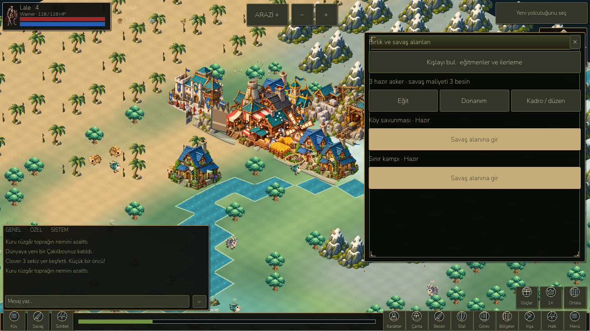
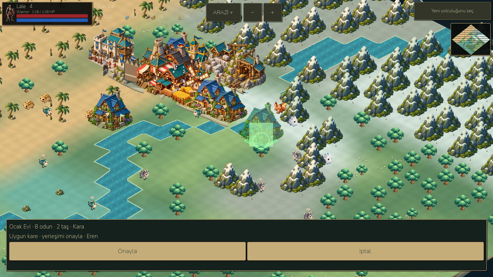

# LittleGod — gameplay clarity checkpoint, 26 October 2026

## Audit and design decisions

The real Godot game was launched through the verified 4.7.2 runtime and inspected through Godot Forge. A separate new-player save (`user://journey-audit.json`) exposed a long introductory popup, vague world objective, separate feature menus, an unlimited chapter-history list and construction workers whose automatic assignment was never made visible. Existing workers/building pages also grew vertically with the world. The simulation pauses in menus, making unlabelled progress especially confusing.

Research patterns were adapted to the existing rules:

| Source | Relevant observation | Applied here |
| --- | --- | --- |
| [Albion Journal, official developer article](https://albiononline.com/news/dev-talk-albion-journal) | Selected mission progress in the HUD; journal categories and direct rewards | Current objective with contextual action, separate history and hunts, reward in the same short page |
| [Black Desert Mobile Workers, official guide](https://www.world.blackdesertm.com/Ocean/Wiki?wikiNo=9) | Worker list and individual worker management; construction, crafting and gathering are different jobs | Named builder pool, individual assignment, production occupancy and explicit work status |
| [Knight Online official gameplay guide](https://www.nttgame.com/knight/en/guide/enjoy) | Distinct inventory, hunting, equipment requirements, enhancement and previews | Preserve real equipment/crafting/enhancement and separate hero preparation from the village army |
| [KO Bugda quests](https://kobugda.com/quests) | Quest, NPC, level and reward information grouped together | Specific destination, real progress, contextual instructions, visible reward; existing chapter locks retained |

The KO Rehberi quest-category request could not be retrieved (cache miss). KO Bugda's interactive quest rows returned only a loading shell; this work does not claim to have extracted its complete quest database. Albion's direct page returned 403, while search supplied the official indexed article content. These limitations are independent of the local implementation. No reference images or numeric combat balance were copied in this checkpoint.

Implementation order: first objective and village navigation; then construction/worker clarity; then short region/army pages; finally rendered checks, Android validation and delivery. The plan was implemented in the existing project, without changing its save schema.

## Implemented behavior

- Short first-village introduction with a visible founding action and original Arin portrait. Existing one-time founding supplies are unchanged.
- Current chapter shows progress and a short explanation for gathering, construction, staffing and expeditions. The HUD advances to an unfinished objective, or asks the player to claim the reward.
- A construction objective with an already queued building opens that actual site instead of asking for a duplicate building.
- Current missions, paginated completed chapters and hunting contracts have separate destinations. Long history no longer pushes the current reward down the screen.
- Bottom-left **Köy** opens a village directory; clicking a listed building shows its real position and management actions. **Savaş** opens the army/battlefield page. Bottom navigation calls regions **Bölgeler** rather than implying an immediate teleport.
- Directory links distinguish solo hero expeditions from citizen-army battles, and show chapter 10/15 progression gates before those systems are enabled.
- Worker list is paginated. Each person shows their real job; reserved soldiers/caravan workers stay protected. Assignment uses the existing `Kingdom.assign` command, never silently steals a worker from production.
- Builders are the existing unassigned civilian pool. Names, queue rank and actual progress are shown. A construction with no builder says so. Ready production shows assigned names and reasons such as missing input, full output or absent order. Barracks describe instructors rather than falsely reporting production failure.
- Building panels expose collection, locate, staffing, upgrade cost and relocation directly. No extra legacy details page is necessary for those core actions.
- Construction catalogue uses three buildings per page, shows prices and lock reasons, and links to existing buildings and staffing.
- Placement has a green/red world preview, appropriate terrain hint, cost, builder names, a readable compact bottom tray and a disabled confirmation on invalid land. Costs are still charged only by the authoritative command.
- Unfinished buildings show queue/worker labels and progress bars in the rendered world. Existing ready-product bubbles continue to collect real output once.
- Regions display one destination at a time. Their compact detail page retains existing entry conditions, safe return, and the cleared Wildwood revisit action.
- Army hub links to the actual barracks, instructor assignment, trainee/kit selection, paginated roster, formations and two real battle scenes. Training still requires an available citizen, real kit, finished staffed barracks, 3 food and 2 gold. No artificial unlock or instant army was added.
- The main menu is a compact three-column grid with the existing six accessibility shortcuts retained.

`scripts/playbook_ui.gd` is a presentation adapter over the existing Kingdom, Industry, Military, Trade and Hero models. Ownership, old item IDs, migration, quests and combat formulas remain model-owned. No new persistent private fields were introduced. Original atlases and existing enhancement effects are preserved. This checkpoint adds procedural placement/queue feedback, not a replacement combat animation library.

## Validation

- Existing campaign: **822 checks** pass, including legal chapter 1–23 progression for seeds 7, 42 and 2026.
- Existing landscape UI: **270 checks** pass, including real sanctuary objective navigation, Android back, real building selection, duplicate crafting protection and six sizes in two languages.
- Existing compact HUD: **98 checks** pass, including combat touch/chat isolation and save compatibility.
- Estate: **44 checks**; armory: **45 checks**; scrolls/sets: **48 checks**, all pass. Estate includes 720 simulation ticks plus offline/load/collection consistency.
- New rendered playbook suite: **142 checks**, including 19 screenshot saves, first-village flow, safe worker/build entry before founding, real objective targeting, queued-site navigation, explicit worker reassignment, actual construction progress, invalid-site confirmation, no world mutation from navigation and save/load.
- The new suite verifies no vertical scrolling at default text size for quest, workers, catalogue, directory, army, region list, roster and menu at **960×540, 1280×720 and 1600×720**, in Turkish and English. Building panels are also checked. This is not a claim that every advanced screen or enlarged accessibility text fits without scrolling.
- A transient PNG write failure was found; screenshot success is now asserted and the full rerun passed. An Android-only test harness compile error was corrected before the final successful build validation. Tests were not weakened.

Machine-readable evidence and exact Android measurements: `docs/benchmarks/playbook/`. Rendered before/after and Android screenshots: `docs/screenshots/playbook/`. Tests use QA slots; no player progress was intentionally modified.

Final Android validation passes **40 checks** at a real emulator game viewport of 1600×720; the install/start succeeds and SHA-256 comparisons preserve the production save, backup and settings. The validator also rejects runtime script errors and Android fatal exceptions. Cold activity launch: **2,134 ms**. A sample with desktop tests closed measured **8.58 FPS / 140.67 ms p95 frame** at the 60 cap and **11.44 FPS / 126.17 ms p95** at the battery 30 cap. World-update CPU p95 was **2.91 / 2.68 ms**, draw calls **425 / 346**, static memory about **46.9 MB**, texture memory **45.1 MB**. This remains poor performance; the sample does not establish the cause or certify physical hardware. A concurrent measurement is archived separately, and no improvement over the previous build is inferred from non-controlled samples.

## Deliverables and remaining scope

Launcher: `D:/LittleGod/Launch LittleGod.cmd`. Verified runtime: `D:/LittleGod/tools/godot/Godot_v4.7.2-stable_win64_console.exe`. Android debug APK: `D:/LittleGod/builds/android/LittleGod-Playbook-debug.apk`, isolated package `org.littlegod.livinguniverse.rpgqa`, version code 99. This deliberately does not replace the production app's saves. Build hash and size are recorded in `docs/benchmarks/playbook/apk.json`.

No physical Android device was connected. Emulator results must not be represented as physical performance. A prior concurrent sample is preserved separately; no 60 FPS mobile improvement is claimed. Existing Godot shutdown resource warnings remain. Dense older village layouts can still overlap visually; old buildings are not automatically moved. Advanced forge, soldier details, trade, gifts and accessibility-expanded pages may still use scrolling. Construction still pauses while menus are open, now explicitly explained. Full MMO NPC quest chains, a complete KO database, online server deployment and new directional character animation are outside this completed UX checkpoint. These remain work to do, not features implied by the navigation redesign.

Reproduce with the verified runtime:

```powershell
python -X utf8 devtools/verify_sanctuary.py
& tools/godot/Godot_v4.7.2-stable_win64_console.exe --path . --script tests/ui_rebirth.gd
& tools/godot/Godot_v4.7.2-stable_win64_console.exe --path . --script tests/classic_ui.gd
& tools/godot/Godot_v4.7.2-stable_win64_console.exe --path . --script tests/playbook_ui.gd
python -X utf8 devtools/build_rpg_qa.py --output LittleGod-Playbook-debug.apk --manifest playbook-apk.json --version-code 99
python -X utf8 devtools/android_rpg_validate.py --phase playbook --apk LittleGod-Playbook-debug.apk --output playbook-android --screenshots playbook
```




