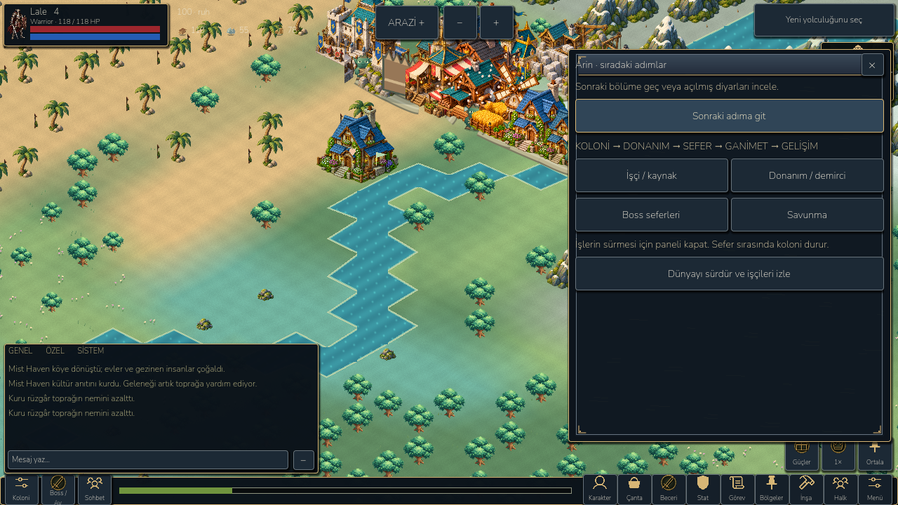
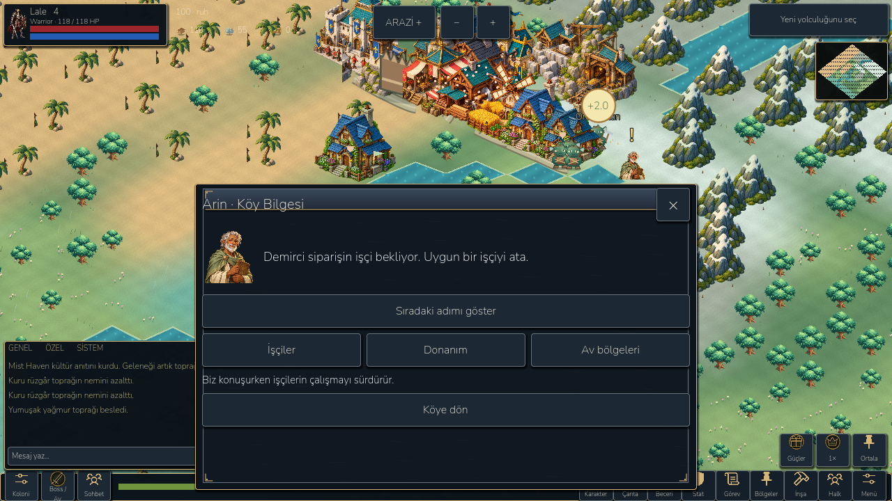
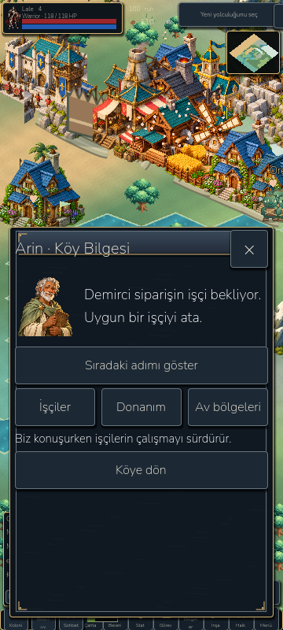

# R1/R2 rendered evidence

These are actual Godot renders of private regression fixtures. They demonstrate
the dialogue/clock change, not a full first-time-player or human usability test.

Before: compact Arin panel, economy held at tick 386 by `in_menu` despite no
SceneTree/user pause.

After: larger portrait-led dialogue; live main clock progressed from 386 to
402 and produced a real 2-unit mining buffer while the window remained open.

Portrait dialogue at 360×800, Turkish. Background HUD is still the old landscape
composition and visibly needs R5; this is not a finished portrait-game screenshot.

Android: actual wall-clock worker cycle and native X closing are in
`screenshots/reforge/reforge-android-dialogue.png` and
`screenshots/reforge/reforge-android-world.png`. Numerical and lifecycle evidence
is in `benchmarks/reforge/`. No fabricated external tester feedback.
