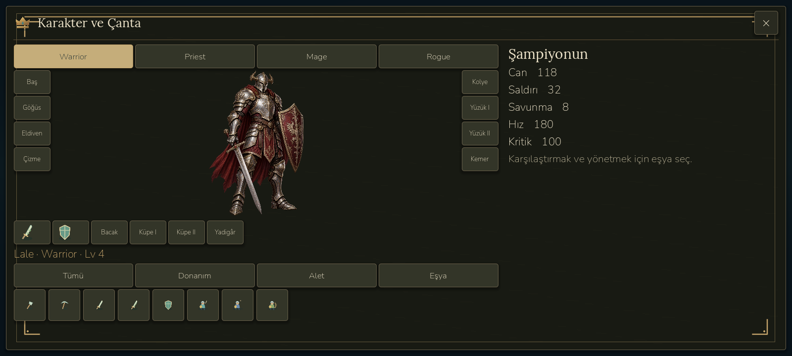

# RPG interface implementation checkpoint — 25 October 2026

Historical checkpoint at `51f02ab`. The subsequent [compact mobile UI pass](CLASSIC_MOBILE_UI.md) replaces these wide panel layouts; its screenshots and Android evidence are separate. The APK path and hashes below describe this older checkpoint.

This is a working implementation checkpoint, **not completion of the entire accepted RPG plan**.

## Implemented and connected to the game

- Landscape HUD: compact identity/resources at the top, a lower-left chat launcher, bottom icon navigation, objective tracking, a world minimap, gifts and simulation speed. Wide side rails are removed. Accessibility shortcuts are in More.
- Original charcoal/aged-gold presentation, deterministic leather grain, four original generated class illustrations. The inventory illustration has subtle breathing and respects reduced motion.
- Combined character/inventory view: four-class selector, fourteen equipment positions, lower item grid, filters, hover/tap detail, true equipment comparison, equip/unequip, locking, confirmed discard and existing healing-item use. Protected artifacts, worker tools, military reservations and other heroes' equipment cannot be discarded. Upgrade/sale remain explicitly pending.
- A version-one additive `rpg` save extension keeps the old active hero API. Warrior identity/XP/equipment are preserved; the other three heroes are added without copying owned gear. Class starter weapons are granted once, within the existing item-capacity limit. Extra armor/accessory slots contribute actual stats.
- Player-allocated attributes, a preview before confirmation, six trainable abilities per class, three assignment positions, free home reset, Rogue Archer/Assassin selection. Class/gear/progression changes are blocked during expeditions. Mage/Priest/Archer use real ranged hit tests with obstacle checks; abilities spend mana and use saved cooldowns. Class effects include healing, protection, charges, area damage and armor piercing.
- Adventure HUD: bottom navigation, separated movement/attack controls, health/mana bars, minimap, and paused modal interaction. Existing campaign input/control paths remain available for the isolated V4 preview.
- Follow-up interaction fixes: minimized chat can be reopened; the HUD portrait follows the selected class. Gear filters include all extra slots, pinned item details survive pointer movement, class restrictions disable incompatible equip actions, and Turkish stat/skill names are shown. Unlearned non-starter abilities cannot be cast; hotbar buttons show actual skill names/cooldowns. Travel checks nearby enemies, banks cargo through the existing return-home operation, and opens the destination map safely.
- Authenticated server chat source: general/private endpoints, accepted-friend restriction, block filtering, database-serialized two-second send limit, 300-character validation, 50-message cursor windows, seven-day cleanup, independent report copies. Godot UI connects through the existing account transport, supports general/private/system channels, older messages, reporting and blocking; polling stops when hidden or suspended. Failed sends are not retried automatically.

## Research and assets

All five root-category pages and 31 category links were read. Root enumeration produced **877 unique names**, while the cached root page advertised 876. All 877 individual URLs were read successfully after five retries; **492** returned numeric property rows. `docs/research/item-detail-audit.json` preserves provenance and source rows. Returned web windows may omit additional upgrade tables: this is not a complete verified statistics database. No missing data was invented.

`assets/rpg/equipment.json` contains **28 original starter equipment definitions**, generated with original SVG icons by `devtools/create_rpg_equipment.py`. This is not an implementation of all 877 reference items. The four class illustrations were produced with the built-in ImageGen tool; exact prompts are in `assets/rpg/provenance.json`. Reference screenshots are not shipped as art.

## Validation

- Full retained campaign chain: **822/822** pass, including legal seeds 7, 42 and 2026.
- New progression checks: **21** pass. New class combat checks: **41** pass. Additional UI/travel interaction checks: **14** pass, including chat visibility after closing a modal and closing inventory after a class change.
- Landscape UI suite: **270** checks pass, including 84 screenshot-write checks. Accessibility lookup now checks its new More location. Captures go to ignored build artifacts to avoid editor-import locks while writing tracked PNGs.
- Actual rendered screens are under `docs/screenshots/rpg/`: home, inventory, class variants, stat/skill screens, chat and Mage adventure.
- Native ADB taps on the emulator separately exercise bottom-bar inventory access, Warrior selection, closing after class change and opening Skills. Screenshots are inspected visually; this is a limited smoke test, not multitouch/keyboard/safe-area certification. Exact evidence is in `docs/benchmarks/rpg/native-smoke.json`.
- API and test projects compile with zero warnings/errors. **Backend tests and live two-client chat are not verified:** Windows App Control rejects loading the locally built API DLL (0x800711C7). No security bypass was attempted. The manually authored chat migration/snapshot remains unexecuted.
- Android QA package installs and starts in `LittleGod_Test`; seven real-emulator checks cover landscape, fixture loading, inventory, class selection, save/restore and adventure entry. Model navigation is programmatic; it is not native-touch verification. Player save/backup byte hashes are checked separately from the isolated QA package. No physical device was connected.
- Software-emulator graphics produced shader-uniform errors and invalid rendering metrics. A session-only `-gpu host` launch restored NVIDIA translation and removed those shader errors. Emulator frame rates vary substantially across sessions; neither stable 60 FPS nor universal 30 FPS is verified. The latest test samples a paused home scene with ambient animation, not sustained combat. Exact frame times, CPU samples, draw calls, memory and provenance are retained in `docs/benchmarks/rpg/verification.json`; launch timing is in `builds/rpg-android/startup.txt`.

## Remaining work before declaring the plan complete

- Full numerical audit and original adaptation of every reference family; the catalogue must distinguish absent tables from incomplete returned windows.
- Production four-direction frame animations for every class, separate Assassin visual, layered weapons/armor that actually change the detailed character art. Current combat uses class illustrations with the existing generic motion; it does not satisfy the promised complete animation pipeline.
- Complete distinct per-skill artwork/effects, richer localized descriptions/class tooltips and balance across all campaign levels.
- Rogue currently shares six ability definitions between Archer/Assassin; the specialization changes attack range and behavior, but separate complete specialization trees and a distinct dagger loadout are still outstanding.
- Native Android touch/keyboard/safe-area coverage and further 60-FPS profiling. The existing forgiving death/loot behavior is retained.
- Live server/database migration and two-client authorization, pagination, block/report, retention and concurrency tests in an environment that permits the API to run. No public server was deployed.
- Travel opens destination selection after safely banking the current expedition. It does not teleport directly between two combat scenes without passing through the home state.

## Exact paths

- Launcher: `D:/LittleGod/Launch LittleGod.cmd`
- Verified runtime: `D:/LittleGod/tools/godot/Godot_v4.7.2-stable_win64.exe`
- Isolated APK: `D:/LittleGod/builds/android/LittleGod-RPG-interface-qa-debug.apk`
- QA package: `org.littlegod.livinguniverse.rpgqa` (separate from the player package)
- Build manifest: `D:/LittleGod/builds/rpg-apk.json`
- Source catalogue: `D:/LittleGod/docs/research/item-detail-audit.json`

