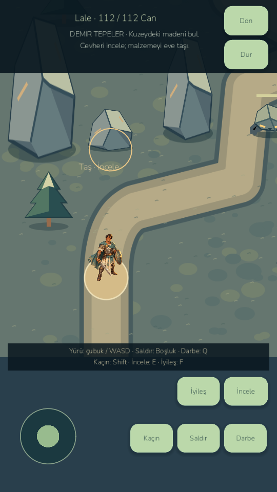
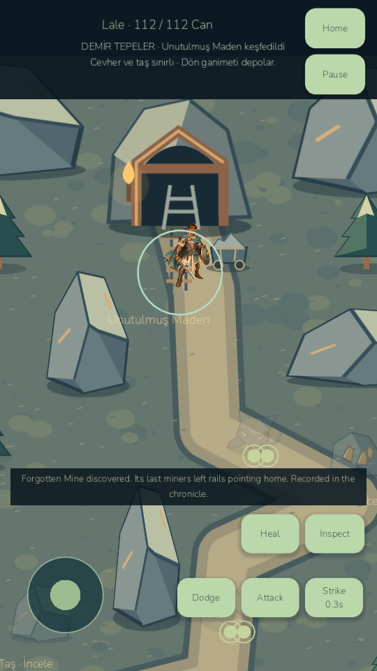

# LittleGod — E2A/E2B: Beyond the Kingdom

Current build: **0.8.5-devE2B / Android code90**. Playable Iron Hills and expanded world map are implemented and verified. **E2 remains partial: Ashen Desert and quest22 are not implemented. Realm campaign remains1–21.** No full E2/E/0.9 tag is claimed.

Explore a real mountain map with the existing Warrior controls, collision, two distinct fighting enemies, finite ore/stone deposits, Forgotten Mine discovery/history and safe material banking. Original Wildwood, E1 trade posts/caravans, military, equipment, saves and artwork remain. Mine/deposit persistence prevents reloading for free resources. Warehouse capacity is checked before depleting a node.

**689 game assertions pass:**639 retained plus50 regional/combat. Six legal1–21-plus-mountains seeds,13 rendered desktop checks, Turkish Godot MCP inspection and26 native/restart Android checks per60/30 cap pass. Native ADB touches and bot navigation are explicitly distinguished. Player save/settings files remain byte-identical during isolated QA. The connected phone was unauthorized during E2B verification; results are emulator-only.

Measured final Iron Hills samples (different scene from E1 route watch):

| Scene / cap | FPS | p95 ms | Model step µs |
|---|---:|---:|---:|
|Emulator 60 cap · Active mountain encounters|59.69|21.13|152|
|Emulator 60 cap · Cleared Forgotten Mine|59.83|18.94|142|
|Emulator 30 cap · Active mountain encounters|30.22|38.90|137|
|Emulator 30 cap · Cleared Forgotten Mine|30.22|36.44|163|

Exact measurements, degraded-session observations, memory and limits: PERFORMANCE_MILESTONE_E2.md and benchmarks/phase085e2.

- Launch: `D:/LittleGod/Launch LittleGod.cmd`.
- Runtime: `D:/LittleGod/tools/godot/Godot_v4.7.2-stable_win64.exe`.
- Player APK: `D:/LittleGod/builds/android/LittleGod-0.8.5-milestone-E2B-debug.apk`.
- Isolated QA APK: `D:/LittleGod/builds/android/LittleGod-0.8.5-milestone-E2B-qa-debug.apk`.
- Source archive: `D:/LittleGod/builds/LittleGod-0.8.5-milestone-E2B-source.zip`.
- Baseline tag: `age085-e2-base-e1`; partial release tag: `age085-e2b-iron-hills`.
- APK SHA256: `8e816d4ff84a321dc85106d3f2b9eb34f86bf94403571390ef13f6d277b6f969`.
- Exact commit/archive hashes: `D:/LittleGod/builds/phase085e2/checkpoint-manifest.json`.

After real quest21, use Hero Hall → world map → Iron Hills → Enter. Inspect mineral rings within reach, dodge warnings and inspect the northern mine. Home banks cargo; ore feeds your furnace/forge and stone pays construction. Deposits/enemies do not refresh in E2B. The Ashen Desert card explicitly says it is unavailable.

See AGE085_E2_REPORT.md, REGIONAL_ADVENTURE_ARCHITECTURE.md, REGIONAL_ENEMIES.md, SAVE_MIGRATION_MILESTONE_E2.md, QUEST_22_DESIGN.md, KNOWN_ISSUES.md and MILESTONE_E_CONTINUATION.md. Historical E1 status/issues are preserved under docs/history. No publishing or paid service occurred.

