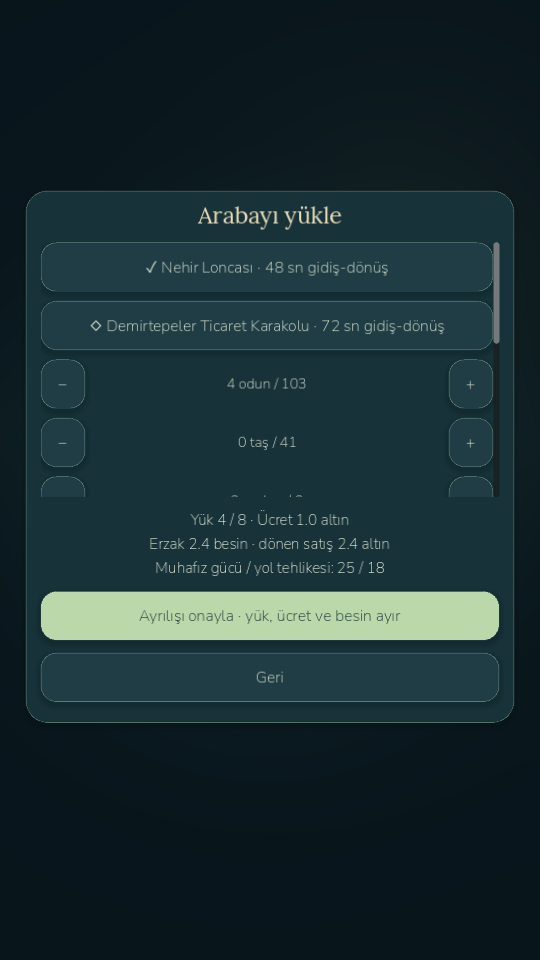
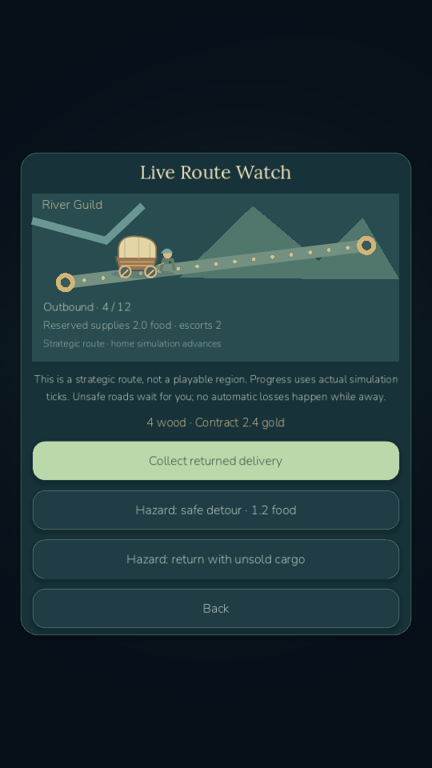
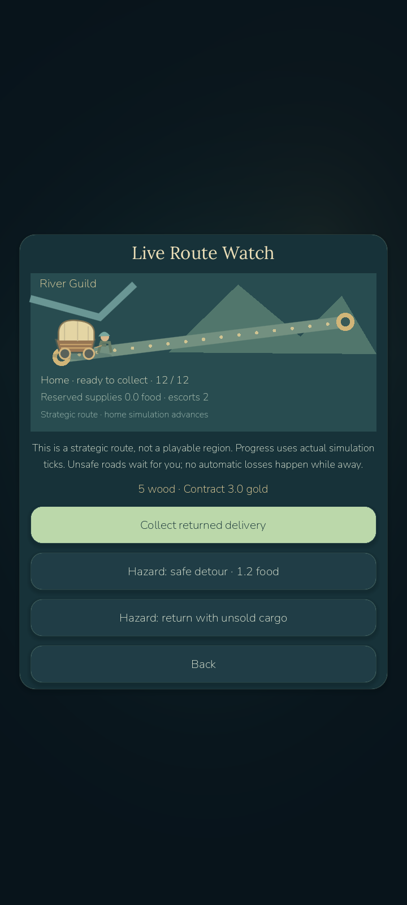

# LittleGod — E1: The First Trade Road

Current build: **0.8.5-devE1 / Android code89**, campaign1–21. **Milestone E is partial: E1 is verified; E2–E6 are not implemented.** No `age085-milestone-e` tag is claimed. The audit found D absent at C; critical D was implemented first at `38c7f0d` / `age085-d-critical`. Existing C/D saves, artwork, hero gear and pending jobs remain.

E1 adds the Lantern Marketplace, real merchant jobs, six ordinary trade goods, local buy/sell and regional price comparisons, two strategic trade routes, capacity/supply/cargo/escort reservations, animated wagon monitoring, exactly-once returns and quest21. Weak escorts meet a safe decision gate: pay for a longer detour or return the actual cargo. Offline absence cannot destroy the caravan. Unused-item salvage also works at a staffed forge before E1, so inventory32 cannot block military crafting; equipped gear, army kits and artifacts are protected.

**639 game assertions pass**:539 retained,44 military and56 E1. Separate runtime smoke,12 legal1–20 and8 legal1–21 seed scenarios pass. Actual rendered/MCP gameplay, native Android cargo/dispatch/collection/detour and genuine external-process restart pass at60/30 caps. Player planet/backups/settings were byte-compared through package updates/startup. No physical phone was connected; no phone performance claim is made.

Final emulator live-route samples:60-cap **59.80FPS / p95 19.38ms**,30-cap **30.00FPS / p95 34.88ms**. Home simulation averaged1.48ms/tick, peak1.79ms. The covered planet renderer is suspended during route watch while simulation continues. Fresh-session visibility comparisons are in the performance report; initial degraded-session results are retained, not treated as phone measurements.

- Launch: `D:/LittleGod/Launch LittleGod.cmd`.
- Verified runtime: `D:/LittleGod/tools/godot/Godot_v4.7.2-stable_win64.exe`.
- Player APK: `D:/LittleGod/builds/android/LittleGod-0.8.5-milestone-E1-debug.apk`.
- Isolated QA APK: `D:/LittleGod/builds/android/LittleGod-0.8.5-milestone-E1-qa-debug.apk`.
- Source: `D:/LittleGod/builds/LittleGod-0.8.5-milestone-E1-source.zip`.
- Checkpoint: `age085-e1-trade`; exact commit/hashes: `D:/LittleGod/builds/phase085e1/checkpoint-manifest.json`.
- APK SHA256: `ae6384a4a227bf55ccfd95c2d85cb6ed4729454849b7b5c8a1ae861c090d8e68` (60620621bytes).

After quest20, choose **Begin Chapter V**, build the marketplace, assign a merchant and inspect prices. Prepare1–8 units plus up to two escorts, review the fixed quote, then confirm departure. Live Route Watch advances the home simulation even from a paused village, preserving the prior pause setting on exit. Collect at home to finish21. Safe routes may complete offline into escrow; unsafe routes await a decision. The Iron Hills trading post is a strategic destination, **not yet a playable hero region**.

See [E1 report](AGE085_E1_REPORT.md), [trade/caravans](TRADE_SYSTEM.md), [performance](PERFORMANCE_MILESTONE_E1.md), [known issues](KNOWN_ISSUES.md), [D report](AGE085_D_PREREQUISITE_REPORT.md), [military](MILITARY_SYSTEM.md) and [exact E continuation](MILESTONE_E_CONTINUATION.md). Historical C/D status is archived. All older builds/tags remain. No paid service, publishing, security change or App Control bypass occurred.

