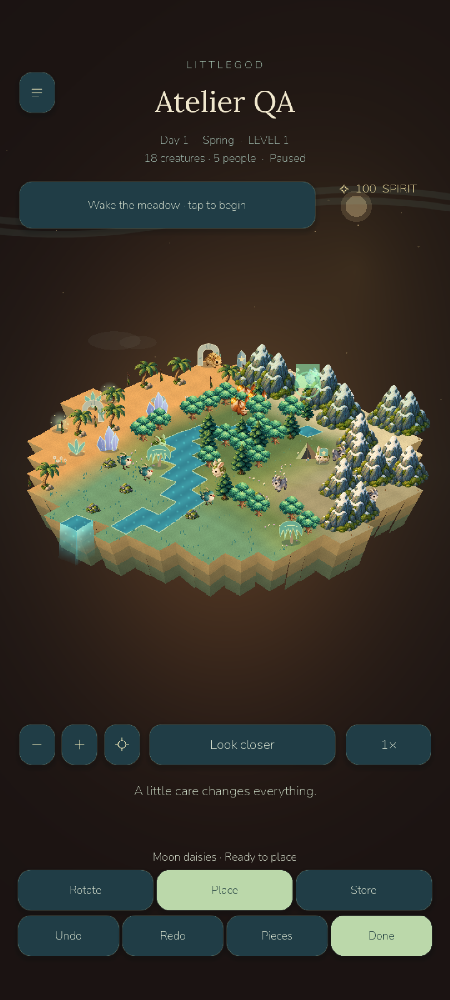
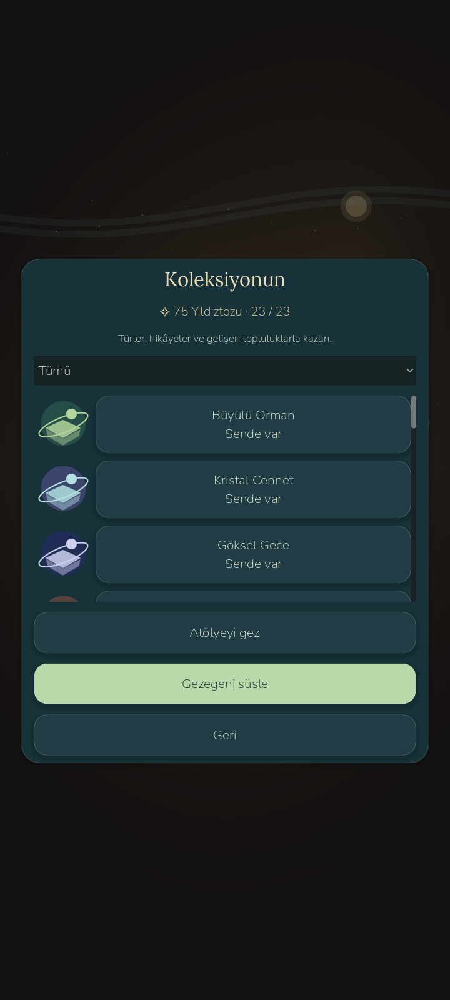

# LittleGod 0.8 — playable customization checkpoint

Verified locally 2026-10-23. Built on `littlegod-0.7` commit 0e74f508b3d0e29c9ef4b9c2f2b2889ed72c05ad, with safe base tag `phase8-base-0.7`. The `littlegod-0.8` tag is a local source checkpoint with the limits below, not store/online production approval.

Implemented: four coordinated original presentation themes; 24 reusable cosmetic illustrations and a shared atlas; depth-sorted magical vegetation, crystals, ruins, statues, banners, lanterns and compatible waterfalls; creature tints/accessory/idle looks; skies/frame; EN/TR inventory, categories/featured/favorites/rarity/previews/requirements, owned counts, explicit unlock confirmation and unavailable premium preview. Decoration mode supports validated ghost placement, movement, four isometric facings, storing, 20-step undo/redo, pan/pinch, pause-state restoration and saving, capped at 32 pieces. The normal living simulation, powers, original artwork, stories, communities and existing favorite/name/history tools remain.

Stardust rewards durable discoveries/restoration/community milestones once, with 525 available against 450 total catalog cost, no paid currency or daily pressure. Save schema v1 retains an optional strict wardrobe v1 extension; actual old 0.7/0.5 fixtures, offline rewards, backup and interrupted-write recovery pass. Cosmetic showcase v2 strips private economy data and reconstructs a read-only decorated visit; plain v1 examples still work. Backend v2 validation and closed purchase interfaces compile, with migration constraints verified on PostgreSQL.

Windows App Control blocked the updated native API executable and final Release test assembly; source compilation succeeds, but new v2 HTTP publishing/entitlement routes and EF receipt concurrency have no final live integration result. No bypass or security change was attempted. The pre-change 65 real HTTP/PostgreSQL checks are a 0.7 baseline. Updated SQL migration/idempotency and database constraints pass separately. Payments remain disabled and native billing adapters/store restore/refund feeds are not implemented. No public deployment, paid service, store publication, physical phone or human beta occurred.

Verification: **356 game checks**, including all prior 295 and 61 additions; 30 economy and 40 extended live/offline balance scenarios, no failures. **20** desktop rendered checks and **22** Android customization checks pass, including actual external ADB tile/Place taps and persisted result. Prior 26 Android interaction/lifecycle checks, three native JSON Save/Open checks and five server-unreachable offline checks pass. .NET source has 42 cases; the final blocked attempt is not counted as passing. All four player save/settings files survived Android updates and the temporary old-APK performance control.

| Emulator scenario, 20 seconds | FPS | p95 ms | First frame ms | Draw calls / peak | Static / video MiB | Simulation avg ms |
|---|---:|---:|---:|---:|---:|---:|
| Normal, 18 creatures | 14.70 | 93.38 | 7691 | 143 / 172 | 43.3 / 24.8 | 1.55 |
| 32 decorations, Celestial Night | 13.04 | 105.72 | 6522 | 189 / 217 | 43.5 / 24.9 | 3.10 |
| 32 decorations, battery saver | 17.05 | 87.05 | 8257 | 150 / 171 | 43.5 / 24.8 | 1.34 |
| 32 decorations, 70 creatures | 11.42 | 124.70 | 8436 | 244 / 260 | 43.8 / 24.9 | 2.68 |

The same host's original 0.7 APK measured 13.76 FPS / 119.31 ms p95 in a matched late control; it was restored to 0.8 after checking all four save/settings files. The initial 0.7 baseline earlier in the session was 31.77 FPS / 36.37 ms p95. This large variation also affects startup and CPU time; it is emulator/host evidence, not phone performance. The pre-batching decorated candidate measured 7.15 FPS and 270 draw calls; the final equivalent decorated scene measured 189 draw calls. Common atlas + batched glints reduce render submissions; FPS comparisons are not isolated laboratory causal measurements. Normal and 30-FPS saver caps remain; stable 60 on phones and stable 30 under this slow emulator host are not established.

Original world atlas stays 1024×1024; the shared cosmetic atlas is 768×512 (24 cells of 128×128), with individual SVG previews retained. At most 32 placed sprites are retained, reused across theme changes; glints/stars use packed line batches. Effects are bounded and lower in saver. Theme changes no longer rebuild terrain or recreate placed sprites, verified in rendered QA. Final decorated cosmetic draw CPU average: 3.329 ms; last appearance sync 2.430 ms. Scene/world generation CPU: 66.60/1.97 ms.

Android instrumented theme/capture-loop post-draw intervals: 101.6, 121.8, 100.9, 97.4 ms. They include render scheduling/readback/cache/host effects, not pure shader cost or touch-to-photon latency; hitches remain. Shop construction CPU 58.60 ms, atomic checkpoint 23.28 ms, checked load/migration 8.77 ms. Desktop theme intervals: 18.3, 3.8, 3.2, 3.4 ms; desktop checkpoint/load 10.18/2.40 ms. Android post-customization session PSS/RSS: 182753 / 274276 KiB (android-customization/memory.txt) and is not interchangeable with Godot's static/video counters. Emulator shader-cache recompile warnings and old Godot shutdown resource/ObjectDB warnings remain. No physical thermals, energy or OEM input measurements.

## Launch and outputs

- Play: `D:/LittleGod/Launch LittleGod.cmd`, verified runtime `D:/LittleGod/tools/godot/Godot_v4.7.2-stable_win64.exe`.
- Player Android: `D:/LittleGod/builds/android/LittleGod-0.8-debug.apk`, version 0.8.0/code 8, 59543381 bytes, ARM64/x86_64, min API24/target36. Signature v2/v3 and installation/startup verified. SHA256 `8d15d42f4fac7727557716785fc1668987eab081b94dd87f23c4e8e175e9cf0c`.
- QA only: `D:/LittleGod/builds/android/LittleGod-0.8-qa-debug.apk`, separate disposable package; never clears the player package.
- Source: `D:/LittleGod/builds/LittleGod-0.8-source.zip`, generated from the clean local tag after documentation/preflight. Its verified manifest is `D:/LittleGod/builds/phase8/release-manifest.json`. Prior 0.7 APK/archive remain.
- Local API launcher: `D:/LittleGod/Launch Online Server.cmd`, currently blocked by App Control; do not bypass it. Existing loopback PG55437 and connection configuration are retained.

Open ☰ → Atelier & collection → Decorate planet. Choose an owned piece, tap a clear tile and confirm; drag/pinch navigate. Store a piece before exceeding 32. Creature cards open their wardrobe. Shop premium content is unavailable; every shipped theme is earnable. See PHASE8_REPORT.md, ECONOMY_DESIGN.md, COSMETIC_CATALOG.md, MONETIZATION_ARCHITECTURE.md, ANDROID_TEST_REPORT.md and CUSTOMIZATION_FEEDBACK.md.

Actual Android gameplay, controlled cosmetic QA fixture (not human progress):

