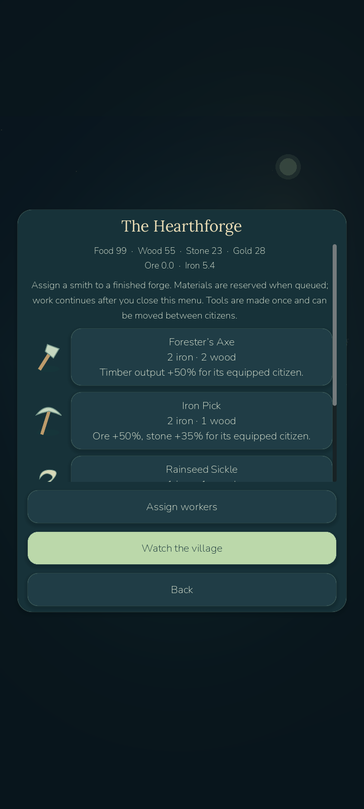
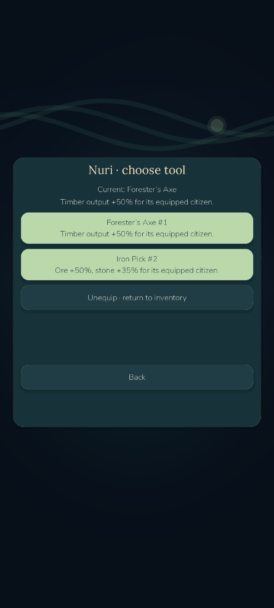
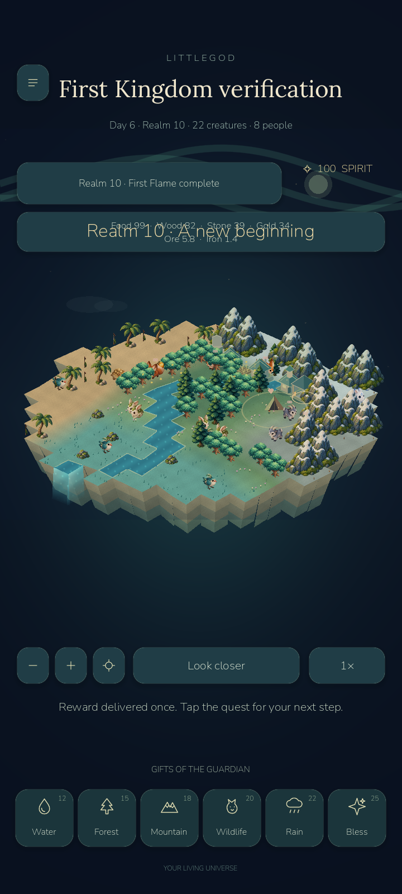

# Road to LittleGod 0.9 — verified Iron Age prerequisite

**Current playable version:0.8.5-devB, Age of Kingdoms milestones A+B. The complete0.8.5 campaign and0.9 are not finished.** The0.9 request explicitly requires repairing critical0.8.5 systems first; audit found only realm1–5 and the first village. This checkpoint adds the next coherent playable slice, not levels31–50 on an unfinished game. Base `phase09-base-first-kingdom` = `fabe135231750ab30aef16233c58819cc178648c`. Verified continuation checkpoint `age085-milestone-b`. No `littlegod-0.9` or final `littlegod-0.8.5` tag was created. Prior tags/builds/source remain.

Implemented now: optional ChapterII, realm6–10 and five additional EN/TR main quests; stone quarry, iron mine, furnace and forge; ore/iron balances; assigned stonecutters/miners/smelters/smiths; exact two-ore/one-wood→one-iron conversion; paid-material crafting queue; unique owned tool instances; citizen equipment, comparison/unequip/transfer; four usable crafted tools. Axe increases its citizen's actual wood output50%, pick increases ore50%/stone35%, sickle increases food35%, hammer increases stone/builder labor25%. A tool can only belong to one citizen; no item is duplicated by moving it. All recipes consume real inputs and need smith labor. Offline work uses the original bounded simulation clock and cannot mint repeated completions.

The first chapter and its406checks remain unchanged. Old campaign-v1 saves remain realm5 until the player chooses ChapterII; that explicit transition preserves XP600, citizens, buildings, wardrobe, old balances and claims, adds zero ore/iron, and opens realm6 without re-awarding quests. Private campaign-v2/industry-v1 validation extends the original checksum/atomic save envelope. Public visits/export strip private campaign/inventory data. The original online source and disabled purchases remain untouched.

New original vector art: four isometric production structures plus shared768×192atlas and four tool icons. Original terrain/creature/cosmetic atlases, Arin and font licenses remain. Active forge/furnace warmth and workplace movement follow actual available work. Empty inputs/full storage stop production and active animation. Construction remains citizen labor, not a timer-only menu. Bounds24plots/12citizens/32items/4queued jobs; catalog limits leave room for all mandatory B structures.

Verification: **406 retained + 53 new = 459 passing game checks**, plus the retained50first-chapter and50new ten-quest/eight-hour offline scenarios. 13 actual desktop rendered industry checks; Android16 industry checks including external ADB unequip/equip/persistence, 15 first-kingdom checks including external house placement, 26 retained interaction/lifecycle/visit checks and 3 native JSON Save/Open checks. Godot MCP rendered the eight-building village, selected the actual forge roof and opened its workshop, with an empty runtime error list. Automation is not human beta evidence.

| 20-second emulator scenario | FPS | p50 / p95 ms | First frame ms | Draw / peak | Static / video MiB | Simulation avg / peak ms |
|---|---:|---:|---:|---:|---:|---:|
| Same ecosystem, campaign removed | 22.28 | 44.05 / 51.13 | 2619 | 181 / 211 | 44.9 / 26.8 | 0.96 / 1.56 |
| Eight buildings, four citizens, two equipped tools | 22.07 | 44.37 / 52.66 | 2641 | 195 / 226 | 45.0 / 26.8 | 1.22 / 1.83 |
| Same industry fixture, battery saver | 26.14 | 37.22 / 45.29 | 2958 | 135 / 162 | 45.0 / 26.7 | 1.37 / 1.80 |

Emulator-5554/API35/x86_64,1080×2400 portrait,720×1600 world viewport, Godot4.7.2 GL Compatibility. No physical device. Hidden control removes the optional campaign logic/rendering/HUD in memory from the same starting ecosystem; it is not isolated GPU-only testing. Host/cache variation remains; these samples do not establish stable60/30 or phone performance. Normal/saver caps60/30 remain. Original player save bytes and absent temp/settings slots survived updates; performance uses a separate validated benchmark save and never overwrites the player planet. Raw evidence: `docs/benchmarks/phase09`.

## Launch and files

- Play: `D:/LittleGod/Launch LittleGod.cmd`, verified runtime `D:/LittleGod/tools/godot/Godot_v4.7.2-stable_win64.exe`.
- Player APK: `D:/LittleGod/builds/android/LittleGod-0.8.5-milestone-B-debug.apk`, version0.8.5-devB/code86, 59999004bytes, ARM64/x86_64, minAPI24/target36, debug signaturev2/v3. SHA256 `e5cdead6e91ce285b9d262ebdf452860d7985a1bc6407579e9abbd6c48ad92df`. Installed and started with player data retained.
- Isolated QA APK: `D:/LittleGod/builds/android/LittleGod-0.8.5-milestone-B-qa-debug.apk`. Only this disposable package was cleared.
- Source: `D:/LittleGod/builds/LittleGod-0.8.5-milestone-B-source.zip`; CRC/commit/hash manifest `D:/LittleGod/builds/phase09/checkpoint-manifest.json`.
- Exact continuation: `D:/LittleGod/docs/PHASE09_REPORT.md`. Earlier A documents are retained under `docs/archive/first-kingdom-a`;0.8 and A builds/tags are preserved.

Play ☰→First Kingdom, finish the first five quests and choose **Begin ChapterII · the Iron Age**. Tap current objectives for build/job guidance. Quarry stone, mine ore, assign a smelter to a furnace, then build a forge. Assign a smith, queue an axe and pick, close menus to let work advance, and equip citizens through Inventory. Keep a free builder; recruit more citizens to run concurrent workplaces. The recipe and inventory screens explain actual effects and reserved costs. After quest10, free construction/crafting continues and the UI explicitly states that adventures/armies/levels11–50 remain unavailable.

Remaining prerequisites:0.8.5C–H, including an actual playable adventure, hero/combat/loot, levels11–30, army/formations/regions/finale and side content. Then the requested0.9A–G technology/diplomacy/31–50/tactical conquest/siege/dungeons/legendary gear/guild fallback can begin. Existing API/.NET runtime remains blocked by Windows App Control; no bypass/security change. No paid service, live purchase, public deployment or store publication.

