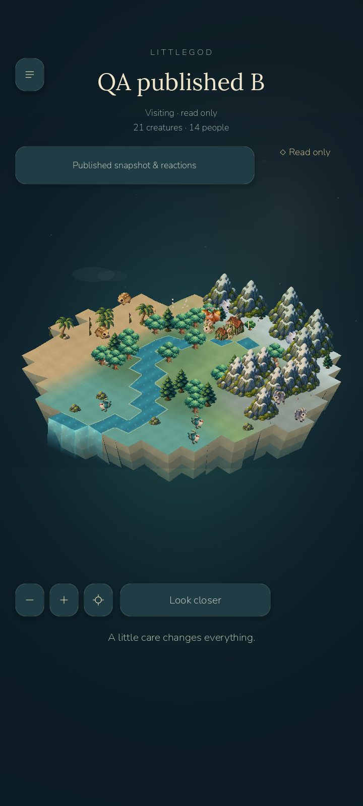
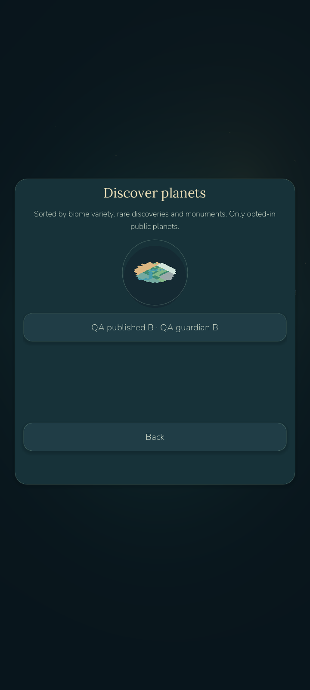
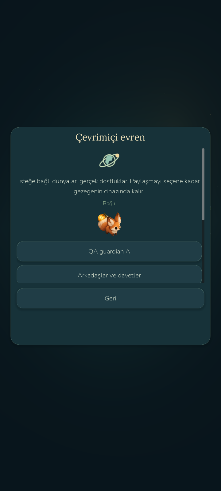

# LittleGod 0.7 — locally tested optional online universe

Verified 2026-10-23. Phase 0.6 was completed and checkpointed as `littlegod-0.6` before online changes. The 0.7 release checkpoint/tag is `littlegod-0.7`, created only after verification. Hosting is **local development only**, with real ASP.NET Core + PostgreSQL and actual desktop/Android HTTP clients. No public deployment, paid service, store publication or human beta is claimed.

## Implemented

- Offline creation, artwork, animations, creatures, civilizations, stories, discoveries, local showcases, saves, localization and battery saver remain. No account/network request is needed to launch, simulate, use powers or save.
- Optional Identity accounts, in-memory access/renewal sessions, server-side logout revocation and account deletion. Existing local worlds link through an explicit reviewed Publish action; there is no silent upload. Local beta uses private usernames, not email; OAuth/email recovery remain pending.
- EN/TR guardian profiles, six retained creature avatars, explicit profile/showcase visibility, exact invitation codes, real requests/accept/reject/remove/block/unblock, friend snapshot profiles and visits, four delivered reactions, opt-in discovery with actual terrain previews and a persisted activity inbox.
- Exact inert v1 snapshot validation in both server and client, revision/hash/update metadata, three retained versions, bounded private memory cache and reauthorization on each visit. The existing read-only boundary preserves the home world and save. Snapshot visits are not real-time multiplayer.
- .NET 10 LTS modular monolith, EF Core/PostgreSQL migration and idempotent SQL, OpenAPI, strict DTOs, request limits, rate limiting, Identity lockout and Data Protection. Docker Compose/API Dockerfile/health checks are included; native PostgreSQL was actually run because Docker Desktop failed during its Inference manager startup.
- New original online SVG and procedural public-terrain preview; existing painted assets retained. Rendered Android/desktop screenshots were examined; stale local-reaction text, duplicate portraits, tiny selectors and preview alignment were corrected.

## Verification

295 game checks (all 280 prior checks plus 15 online transport/session checks); 40 seeded balance scenarios, no failures. 21 .NET validation tests; 65 real HTTP/PostgreSQL integration checks; 6 real lockout/throttling checks. Two independent disposable users complete 34 actual Godot-to-server checks on Windows and 34 on the Android emulator. A third account tests privacy boundaries in the API suite. QA names are development fixtures, not human activity.

The API was then stopped and its listener absence verified: all 5 Android offline simulation/power/save/load/connectivity checks pass. The prior 26 Android interaction/lifecycle checks and 3 native JSON file checks also pass on the final APK. Physical devices: **0**. Human beta testers: **0**. Save/backup/temp/settings bytes all survived the player-package update. Actual old-save fixtures through 0.5 remain covered. No test was removed; the version assertion now checks project version instead of hardcoding 0.6.

| Scenario | Average FPS | p95 frame ms | First engine frame ms |
|---|---:|---:|---:|
| Windows source, 15 s | 60.09 | 16.88 | 1564 |
| Android emulator normal, 30 s | 33.87 | 35.11 | 2392 |
| Android emulator saver, 20 s | 29.97 | 35.07 | 2440 |
| Android emulator 70 creatures, 20 s | 29.38 | 42.36 | 2340 |

These are emulator/desktop samples, not phone performance or a causal comparison. Phase 0.6 clean-host emulator normal was 58.05 FPS; host/editor load and startup caches materially affect results. No background polling or startup networking was added. A real published snapshot response was 61520 bytes; observed fetch completion was 1014.3 ms in the Android emulator and 80.8 ms in the rendered Windows test. Local API request median/p95 across the integration suite: 24.19/93.79 ms (includes auth/hash requests). Android post-social-session PSS was 188986 KiB, RSS 277460 KiB; this is a different process state than the earlier 0.6 memory sample, not an isolated memory regression measurement. Real battery/thermals remain unmeasured.

## Launch and outputs

- Game: `D:/LittleGod/Launch LittleGod.cmd`, verified runtime `D:/LittleGod/tools/godot/Godot_v4.7.2-stable_win64.exe`.
- Local API: `D:/LittleGod/Launch Online Server.cmd`; native PostgreSQL loopback 55437, API loopback 5087. Game → Online universe → Connection settings; desktop `http://127.0.0.1:5087`, Android emulator `http://10.0.2.2:5087`. Sign in is optional. Default visibility is private; choose Friends before friend visits.
- Player APK: `D:/LittleGod/builds/android/LittleGod-0.7-debug.apk` — version 0.7.0/code 7, 59250614 bytes. v2/v3 signature verification and installation/startup pass. SHA256 `875aaad0597de7d2ac7a487ffa07c756cdca99c00effdd909aca47f5996af05c`. Existing package ID retained; ARM64/x86_64, min API24/target36.
- Source: `D:/LittleGod/builds/LittleGod-0.7-source.zip`, from verified release tag. Backend/migrations/Compose/tests included; local credentials, database, runtimes and generated builds excluded. Existing 0.6 APK/source archive retained.

Read PHASE7_REPORT.md, ONLINE_ARCHITECTURE.md, API_DOCUMENTATION.md, SECURITY_REVIEW.md, ANDROID_TEST_REPORT.md and KNOWN_ISSUES.md. Public-hosting prerequisites remain; Docker execution, OAuth/recovery, physical-phone performance and independent security/human review are not complete. Shutdown ObjectDB/resource warnings remain from earlier milestones. Native Windows Computer Use was unavailable; real Godot rendering/MCP and Android ADB supplied inspection.

Late repeated profiles slowed despite no active editor/test game. A preserved 0.6 APK installed with -r -d then measured 33.14 FPS / 35.32 ms p95; restoring the final 0.7 APK measured 33.87 / 35.11. Both benchmark runs preserve the player save, and the final 0.7 update preserves all four files. An earlier 0.7 candidate measured 57.61 FPS (21.995 ms p95), saver 30.00 and stress 47.09 before the final navigation guard; that earlier APK is not substituted for the release measurements. This matched late control does not show an online-feature FPS regression, and does not isolate the host/emulator slowdown. NVIDIA was observed in P8/210 MHz during the late control; no power/security setting was changed and no causal claim is made from that observation. Stable normal/max-population 60 FPS remains unresolved in this late host state. Battery saver stays near 30.
