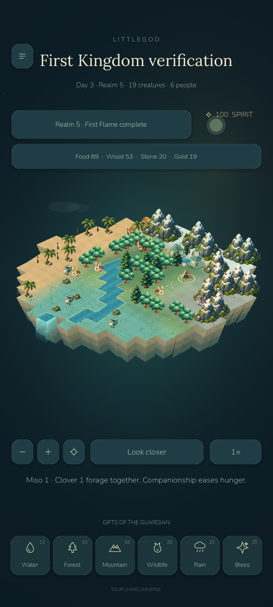
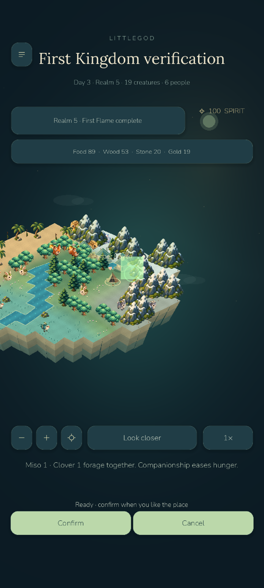
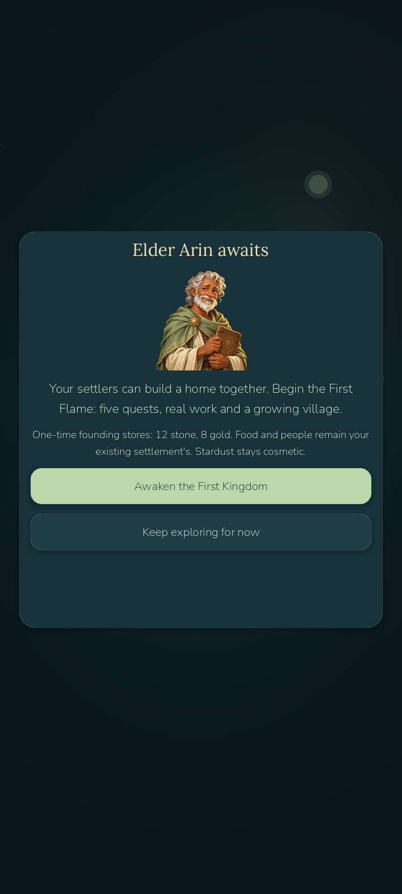

# LittleGod 0.8.5-devA — First Kingdom, verified milestone A

Local checkpoint: `age085-milestone-a`, based on `littlegod-0.8` (`f9420527e58f2fd6a1a70b7b538c8f9f079aaaab`), with safe base tag `age085-base-0.8`. Verified 2026-10-23. **This is the completed first playable vertical slice, not the finished Age of Kingdoms expansion.** The final `littlegod-0.8.5` release tag has deliberately not been created. Milestones B–H remain.

Implemented: optional bilingual Elder Arin introduction, five data-driven primary quests, realm levels 1–5, verified one-time rewards, real timber/stone gathering, working lumber camps/farms, named paid citizens, job assignment and skill growth, trust/food upkeep, idle-citizen construction, housing/storage/council hall, material costs, level 1–3 building upgrades, relocation, derived village tier 2, bounded history and offline work. Food and population use the original settlement; Stardust/cosmetic ownership remain separate. Existing worlds opt in through the menu and retain their terrain, people and wardrobe.

New original assets: transparent generated Arin portrait (`assets/kingdom/arin.png`, runtime384²), six procedural SVG building/scaffold images and shared576×384 atlas. Original painted terrain, creatures, plants, cosmetic art, typography, sound and online sources remain. Buildings/scaffolds are depth sorted with existing scenery; actual workers visibly move/sway at their assigned workplace. Building roof selection takes priority over overlapping wildlife. Long planet titles now fit their header.

Verification: **356 retained game checks + 50 new campaign checks = 406 passing**, 50 legal progression / eight-hour offline scenarios, 12 desktop rendered checks, 15 Android kingdom checks including external ADB placement/Confirm taps, 26 retained Android interaction/lifecycle checks and 3 native JSON Save/Open checks. Actual tagged0.7/0.8 saves, exact campaign round-trip, corrupt-primary backup recovery, duplicate rewards/offline replay, read-only visits and real player-save preservation pass. Godot MCP rendered the completed village and selected an actual building; its runtime error list was empty. Automated scenarios are not human playtests.

| Emulator scenario, 20 seconds | FPS | p50 / p95 ms | First frame ms | Draw / peak | Static / video MiB | Sim avg / peak ms |
|---|---:|---:|---:|---:|---:|---:|
| Same fixture, kingdom removed | 18.32 | 53.21 / 66.31 | 3566 | 164 / 183 | 44.6 / 26.6 | 1.50 / 2.17 |
| Five structures / four citizens | 18.09 | 53.95 / 65.95 | 3396 | 177 / 195 | 44.6 / 26.6 | 1.59 / 2.25 |
| Same kingdom, battery saver | 22.23 | 43.27 / 56.62 | 3570 | 128 / 140 | 44.6 / 26.6 | 1.64 / 2.69 |

Measurements are from emulator-5554, API35/x86_64,1080×2400 portrait with720×1600 internal viewport, Godot4.7.2 GL Compatibility. No physical Android device was available. The hidden comparison removes the entire optional campaign extension in memory, including its work simulation and HUD; it is not an isolated GPU-only experiment. Both runs start from the same saved ecosystem fixture. Host/emulator/shader-cache variance is substantial, so these samples do not establish a causal FPS gain, stable60 or physical-device performance. Battery-saver still caps at30, normal at60. First-frame counters include engine startup; they are not pure world-generation CPU or touch latency. Raw counters and actual APK SHA are in `benchmarks/phase085`.

## Play and outputs

- Launcher: `D:/LittleGod/Launch LittleGod.cmd`; verified runtime `D:/LittleGod/tools/godot/Godot_v4.7.2-stable_win64.exe`.
- Player APK: `D:/LittleGod/builds/android/LittleGod-0.8.5-milestone-A-debug.apk`, version0.8.5-devA/code85, 59881873 bytes, ARM64/x86_64, minAPI24/target36, debug signed. SHA256 `0ce5ff344f96cdf81f4073a982ec24078d5f68b21a3082887b418af44de2594a`. Installation/update/startup validated; original planet/backup/temp/settings files preserved.
- QA APK: `D:/LittleGod/builds/android/LittleGod-0.8.5-milestone-A-qa-debug.apk`, separate disposable package. Only this package was cleared.
- Source checkpoint archive: `D:/LittleGod/builds/LittleGod-0.8.5-milestone-A-source.zip`; commit/hash/CRC manifest: `D:/LittleGod/builds/phase085/checkpoint-manifest.json`.
- Prior0.8 APK/archive and tags remain intact. This is not a store release, public server deployment or payment integration.

Open ☰ → First Kingdom → Awaken the First Kingdom. Tap objectives for location/build guidance. Meet settlers, gather six timber, claim reward, build a lumber camp and assign a citizen. Close menus to let work advance. Then build/assign a farm, add housing/recruit a fourth citizen, and raise the council hall. Keep an idle citizen for construction. Tap a building's roof to inspect/upgrade/move it. The resource bar opens the campaign. Advisor help can be hidden/replayed. After quest5 free building/upgrading continues with an explicit chapter-complete message.

## Continuation boundary

Next is **milestone B**, levels6–10: quarry, mine, furnace, forge, inventory, crafting and equipment foundations. None is claimed implemented. Then C must provide a separate playable Wildwood adventure with movement/combat/AI/loot/boss; D armies/formations/raids; E regions/trade; F finale; G30side quests/optional captive policies/expeditions; H final polish. No fake adventure buttons, simulated battles, placeholder30quest list or unverified completion tag were added. See `PHASE085_REPORT.md` for exact code entry points and acceptance steps.

Known limitations include incomplete B–H, bounded early construction, flatter vector buildings beside retained painted scenery, emulator frame/startup variance and lack of physical/human beta evidence. Existing online API/.NET execution remains blocked by Windows App Control; no bypass attempted. Payments remain disabled. Read `KNOWN_ISSUES.md` and historical `STATUS_08.md`.

Actual Android gameplay, progressed by legal automated actions:

