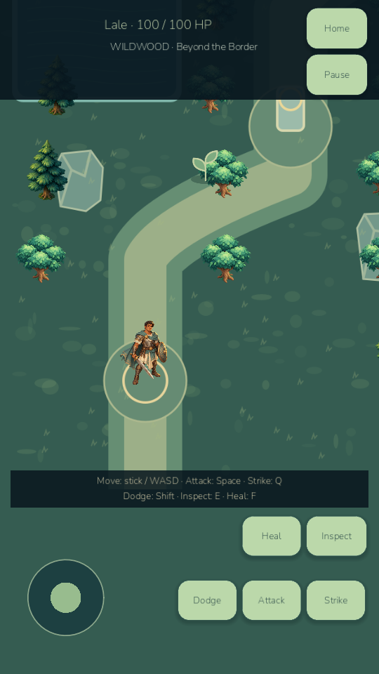
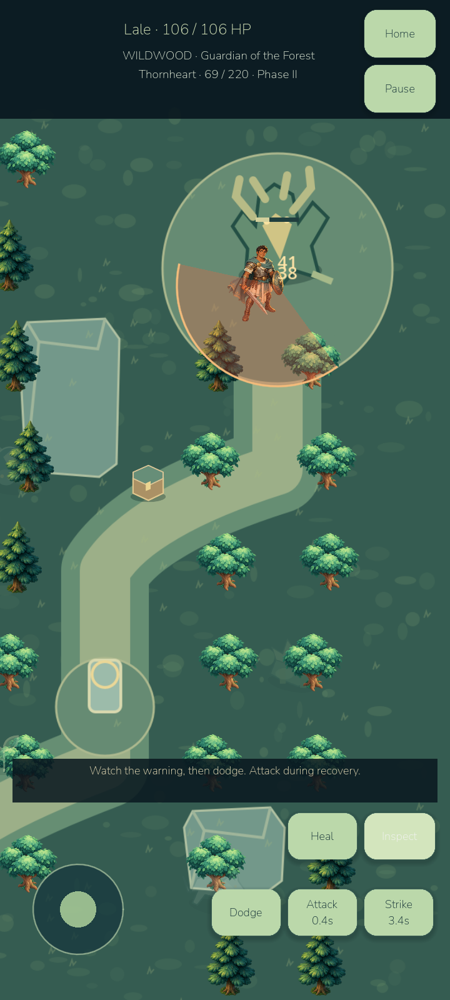
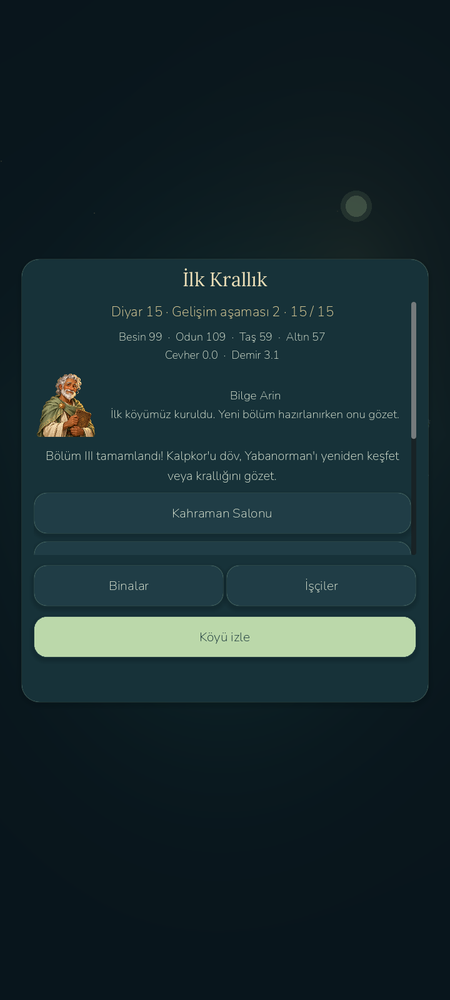

# LittleGod — Age of Kingdoms C

Current playable version: **0.8.5-devC**, Android version code87. Milestones A, B and the first real adventure C extend the retained living planet. The full Age of Kingdoms campaign and0.9 are not complete. Military Milestone D was not started.

Chapter III now adds a named Warrior, independent hero XP/health/stats, real equipment, a playable Wildwood scene with collision/touch controls, three enemies that attack back, dodge/healing, persistent weighted loot, six worker-crafted combat recipes, Sunstone/chest/plants, and the phased Thornheart boss. Five new EN/TR quests complete realm11–15. Boss defeat and the actual living-heart return gate the final reward. Home deposits cargo, recovers the hero and resumes the same kingdom. Active adventures pause home/offline simulation; saves restore enemies, warnings, RNG, pickups and equipment without regenerating rewards.

All **459 retained +80 new =539 game checks pass**. The separate runtime smoke test,50 retained first-village scenarios,50 Iron Age/offline scenarios and20 new legal1–15 campaigns also pass. Actual rendered desktop traversal, enemy hit-back/loot and phase-II boss victory pass. Godot MCP inspected Hero Hall, world map and the real adventure with an empty runtime error list. Android adds14 adventure checks,3 actual process-reopen checks and16 retained industry checks; all33 pass. Historical A/B save fixtures, pending forge work and old civilian ownership are preserved. Tests are automated gameplay evidence, not human beta results.

See [Milestone C report](AGE085_MILESTONE_C_REPORT.md), [performance](PERFORMANCE_MILESTONE_C.md), [hero](HERO_SYSTEM.md), [adventure](ADVENTURE_SYSTEM.md), [combat](COMBAT_SYSTEM.md), [loot/equipment](LOOT_EQUIPMENT.md) and [quests](QUESTS_11_15.md). Historical B status and known issues are retained in `docs/archive/iron-age-b/`.

## Launch and deliverables

- Desktop launcher: `D:/LittleGod/Launch LittleGod.cmd`.
- Verified Godot runtime: `D:/LittleGod/tools/godot/Godot_v4.7.2-stable_win64.exe`.
- Player debug APK: `D:/LittleGod/builds/android/LittleGod-0.8.5-milestone-C-debug.apk`.
- Isolated test APK: `D:/LittleGod/builds/android/LittleGod-0.8.5-milestone-C-qa-debug.apk`.
- Source archive: `D:/LittleGod/builds/LittleGod-0.8.5-milestone-C-source.zip`.
- Verified checkpoint: `age085-milestone-c`; exact commit, archive CRC and APK/source SHA256 are recorded in `D:/LittleGod/builds/phase085c/checkpoint-manifest.json`.
- Reproducible model tests: `devtools/verify_adventure.py`; rendered tests: `tests/adventure_playtest.gd`, `tests/combat_playtest.gd`, `tests/boss_playtest.gd`; Android: `devtools/android_adventure_validate.py`.

Play First Kingdom through its original ten quests, choose **Begin Chapter III**, recruit/name the Warrior, forge and equip the Iron Sword, claim quest11 and enter Wildwood from Hero Hall. Inspect Sunstone, return to Arin, harvest herbs and hunt. Bring materials home to forge/equip the Thornhide Blade. Claim quest14 to open the guardian roots; dodge Thornheart's warnings, collect its heart and return for quest15. Menus pause smith labor: close them to let work advance.

Latest emulator samples: guardian fight57.76FPS/20.11ms p95; postbattle60.00FPS,30-cap30.00FPS. Occasional hitches and host-session variability remain. APK SHA256 `5d35e8dd97f7664c0932bfbda837099b5876f9c5b83c661b75bcbcbdafc8d602`,60406912bytes, ARM64/x86_64, minAPI24/target36.

No physical Android phone was connected. Emulator measurements and remaining performance limits are reported separately; stable60/30 on phones is not established. No system security changes, paid service purchase, store publication or public deployment occurred. All earlier builds/tags/source archives remain.

