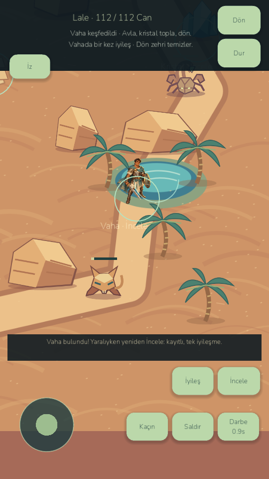
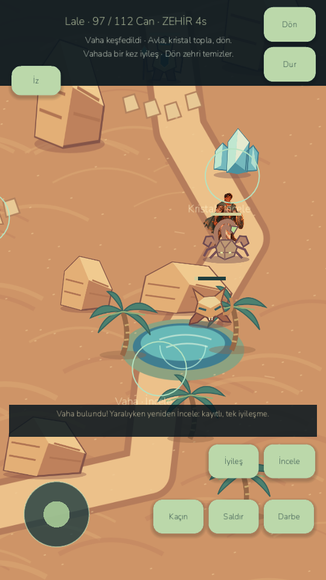
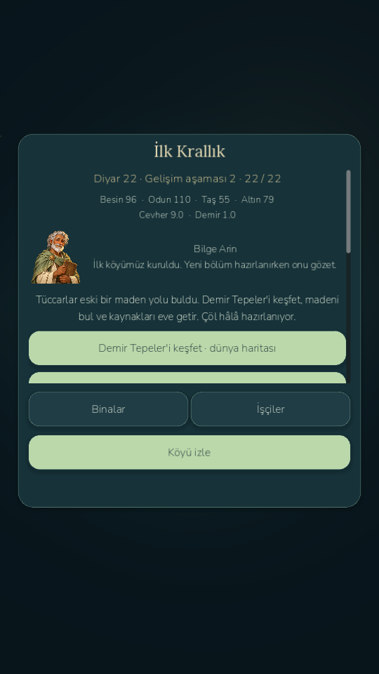

# LittleGod — E2: Beyond the Kingdom; E3 prerequisites

Current verified release: **0.8.5-devE2 / Android code91**, realm campaign1–22. The E3 audit correctly found the previous E2B checkpoint incomplete. This run completed the missing critical E2 gameplay before starting any dungeon. **E3 Sunken Sanctuary, puzzles, elites, Sun Relic, advanced equipment and quest23 are not implemented.** No E3 completion tag is claimed.

Wildwood, playable Iron Hills and playable Ashen Desert now share the existing hero/combat/camera/input/loot architecture. The desert adds original terrain/props/palms, oasis discovery with one saved recovery, ancient road lore, three distinct fighting enemies, four-second non-stacking poison, finite crystals, a useful staffed-forge purification tonic, safe return and real quest22 crystal registration. Existing trade posts, caravans/escrow/guards, workers, industry, military, heroes/gear, old regions, bosses and planet saves remain.

**745 game checks pass:689 retained unchanged +56 new.** Three legal1–22 campaign seeds pass without XP/quest/resource injection.15 actual rendered desktop checks pass, including real sting/poison and quest22. Godot MCP inspection is recorded separately. Android has21 native/restart checks at each60/30 cap, including force-stop with active poison and exact restoration, real joystick/attack/dodge/inspect/home/register/claim input. Current E2 APK also passes26 retained native mountain/restart checks. Bot navigation is explicitly distinguished from external touchscreen input.

| Scene | FPS | p95 ms |
|---|---:|---:|
|Emulator 60 · Desert encounters|60.22|19.37|
|Emulator 60 · Cleared ancient road|60.15|18.99|
|Emulator 30 · Desert encounters|30.25|39.15|
|Emulator 30 · Cleared ancient road|30.19|36.89|

Desktop desert: 60.50FPS / p9516.98ms. No physical E2 device verification: connected phone is ADB unauthorized. Emulator samples do not establish phone thermals, battery or haptics. Player update/startup and v2/v3 signature verification pass; private test slots/marker preserve primary, backup, temp and settings bytes.

- Desktop: `D:/LittleGod/Launch LittleGod.cmd`.
- Verified runtime: `D:/LittleGod/tools/godot/Godot_v4.7.2-stable_win64.exe`.
- Player APK: `D:/LittleGod/builds/android/LittleGod-0.8.5-milestone-E2-debug.apk`.
- QA APK: `D:/LittleGod/builds/android/LittleGod-0.8.5-milestone-E2-qa-debug.apk` (`.betaqa`).
- Source: `D:/LittleGod/builds/LittleGod-0.8.5-milestone-E2-source.zip`.
- Git: `age085-e2-regions`; exact commit/build/archive hashes: `D:/LittleGod/builds/phase085e2full/checkpoint-manifest.json`.
- APK SHA256: `293eabf8ac640ce0e0c989f835d21d46059eb76aab7b669f2d22d61986123f90`.

After real quest21, discover the northern Forgotten Mine in Iron Hills and return home. Choose Ashen Desert in the world map; this opt-in activates22. Discover the oasis, defeat a desert enemy, inspect crystals and return. Use Arin's desert report to register one actual crystal, then claim22. Spare crystals plus herbs/gold become purification tonics through real forge labor. One required crystal is protected until registration. In the desert, Heal uses a tonic first and clears poison; Home also clears poison safely.

See AGE085_E2_REPORT.md, AGE085_E3_REPORT.md (explicitly partial), QUEST_22_DESIGN.md, REGIONAL_ADVENTURE_ARCHITECTURE.md, REGIONAL_ENEMIES.md, SAVE_MIGRATION_MILESTONE_E2.md, PERFORMANCE_MILESTONE_E2.md and MILESTONE_E_CONTINUATION.md. Previous E2B reports remain in docs/history. No paid infrastructure, public publishing or security change occurred.

