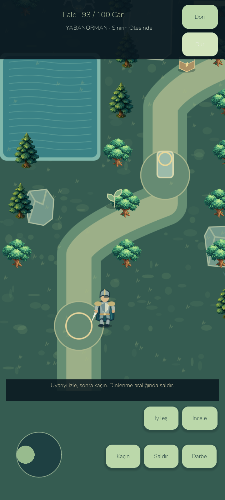
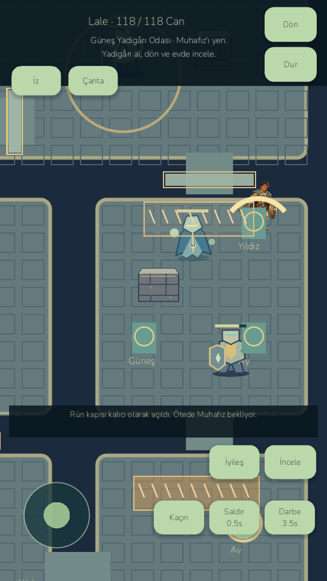
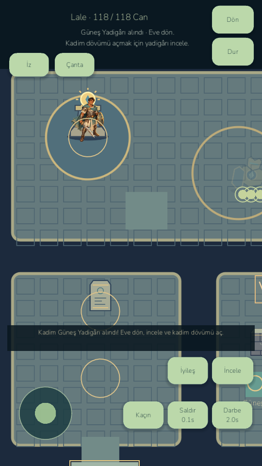
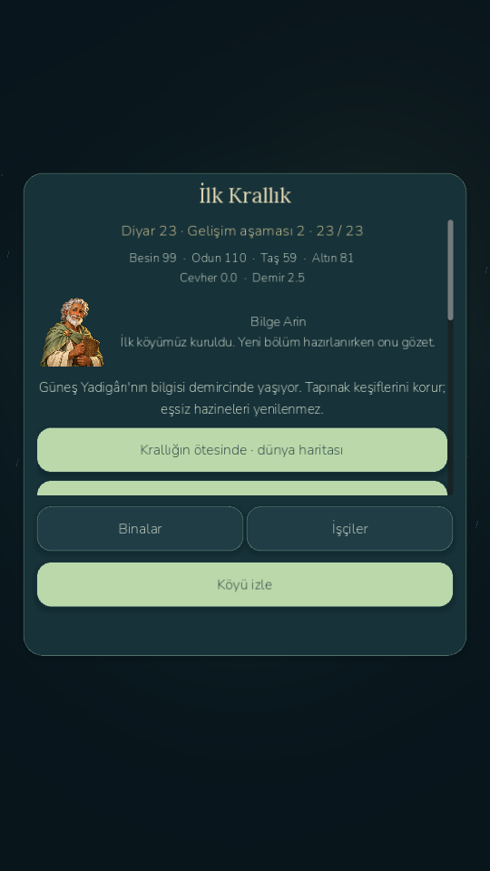

# LittleGod — RPG interface checkpoint / E3 gameplay baseline

## MMORPG target clarity, HUD materials and forest art — 27 October 2026

Implemented explicit enemy name/HP targeting, visible ground rings/pointers, range/obstruction feedback, target cycling, first-tap selection, selected-enemy ranged basics, warnings outside chat, cooldown arcs, localized action/locked/mana captions, persistent home-world context actions, selected inventory/equipment/nav feedback and stale-selection cleanup. Slate metal/gold surfaces improve contrast at the retained compact proportions. Added three original painted forest enemies (built-in image generation, transparent, imported at 512 px) and a richer original vector Wildwood floor aligned with existing collision and landmarks. Saved worlds and item ownership remain compatible.

Validation: **822 campaign, 270 landscape UI, 98 compact HUD, 142 playbook, 41 class combat and 14 RPG interaction checks** retained; **66 new rendered targeting/art checks** pass. Android emulator **13 checks** pass with production files preserved and no script errors. Short paused-home sample ~26.11 FPS at 60 cap / 30.14 at battery 30 cap; this does not establish physical performance or a controlled optimization gain. No physical device connected. Full 3D KO/MMO recreation and directional animation remain unfinished; the existing 2D systems are extended.

APK: `D:/LittleGod/builds/android/LittleGod-Targeting-debug.apk` (QA package, version 100). Launcher: `D:/LittleGod/Launch LittleGod.cmd`. Research, measurements, screenshots, exact generated assets/prompts, checks and limitations: [MMORPG_TARGETING.md](MMORPG_TARGETING.md). Evidence: `docs/benchmarks/targeting/`; screenshots: `docs/screenshots/targeting/`.

## Gameplay clarity and compact playbook — 26 October 2026

Implemented a short first-village flow, current-objective instructions and rewards, separate paginated quest history, a village directory, direct building locate/collect/upgrade/staffing, named construction workers and queue status, placement preview and invalid-site protection, paginated catalogue/worker/region/army pages, trainee/kit selection and compact formation controls. Bottom-left **Köy** and **Savaş** now lead to the real village and army; solo hero expeditions remain separate. Menus explicitly explain that work resumes after closing. Existing model commands, item ownership, saves, original art, chapter conditions and enhancement mechanics remain intact.

Verified **822 campaign + 270 landscape UI + 98 compact HUD**, **44 estate + 45 armory + 48 scroll/set** checks; **142 new rendered UX checks** cover the new-player route, real staffing/construction, no-scroll default-text screens at 960×540 / 1280×720 / 1600×720 in TR/EN, screenshots and save/load. Android emulator: **40 checks**, install/start successful, production save/backup/settings preserved. No physical phone connected. Emulator performance remains poor (8.58 FPS at 60 cap, 11.44 at battery 30 cap); this is **not** a mobile-performance completion claim. Existing shutdown resource warnings, overlapping old village layouts and scrolling in some advanced screens remain.

APK: `D:/LittleGod/builds/android/LittleGod-Playbook-debug.apk` (separate QA package, version 99). Launcher: `D:/LittleGod/Launch LittleGod.cmd`. Research, implementation, limitations, measured results and commands: [PLAYBOOK_UX.md](PLAYBOOK_UX.md). Evidence: `docs/benchmarks/playbook/`; real before/after screenshots: `docs/screenshots/playbook/`.

## Armory, item rebirth and KO Bugda research checkpoint — 26 October 2026

The existing RPG now includes normal enhancement through +10, High/Unique item reverse conversion, rebirth through +21, elemental affinity colors, increasing item glow, real combat-stat bonuses, protected ownership and serial-checked confirmations. Added 16 original painted inventory icons, eight original class weapons, class-weapon drops, searchable real-game drop tables, four one-time contracts and class-specific procedural spell overlays. Four real upgrade-scroll recipes are crafted/collected/consumed once; original class-set bonuses activate at 2/3/5 equipped pieces. Old item IDs, campaigns, growing world and saves remain intact. Research covers 13 page entries and explicitly records missing interactive data and contradictory reference percentages. **This is not completion of the requested one-to-one game recreation.** No third-party art was copied; exact KO formulas, full maps/items, layered directional animation, exact reference set values, booster scrolls and full NPC quest chains remain open.

Validation: **822 campaign, 270 landscape UI, 98 compact UI, 14 RPG interactions and 44 estate checks** retained; **45 armory model + 48 scroll/set model, 46 rendered and 12 Android checks** pass. Actual Godot MCP clicks and native Android anvil confirmation were inspected. The emulator sample remains ~26 FPS at a 60 cap / ~30 at the battery 30 cap; no physical device verified. Existing shutdown resource warnings remain.

APK: `D:/LittleGod/builds/android/LittleGod-Armory-debug.apk`; launcher: `D:/LittleGod/Launch LittleGod.cmd`. Report and exact remaining work: [ARMORY_REFERENCE_IMPLEMENTATION.md](ARMORY_REFERENCE_IMPLEMENTATION.md). Research: `docs/research/kobugda-audit.json`; evidence: `docs/benchmarks/armory/`; real screenshots: `docs/screenshots/armory/`.

## Growing world and village collection — 26 October 2026

Implemented a **1,024-tile starting world**, expandable through adjacent 64-tile parcels to **2,304 tiles**; first expansion free, later purchases use ordinary resources. Twelve original painted building sprites replace most home/industry buildings, at approximately twice the previous size. Buildings are clickable; completed construction, production and forge jobs show tappable bubbles. Collection transfers real output once, retains warehouse overflow and preserves item IDs. Added village paths, wider terrain spacing, zoom controls, fitting minimap, sparse decorations and offscreen prop visibility. Legacy save migration appends cells without reindexing old content; private buffers and public read-only v3 previews are validated.

Checks: **822 campaign + 270 landscape UI + 98 compact UI + 14 RPG interactions** retained; **44 new model/offline/save checks + 13 rendered checks + 6 Android checks** pass. Godot MCP mouse collection and native ADB land purchase were performed and inspected. Desktop sample ~**60.11 FPS**; emulator **17.77 FPS** at 60 cap / **21.33 FPS** at battery 30 cap, so mobile performance remains unresolved. No physical device tested. Android production saves/backup/settings preserved. Existing shutdown resource warnings and dense legacy-layout overlap remain; live v3 server exchange is unverified.

Build: `D:/LittleGod/builds/android/LittleGod-Growing-World-debug.apk` (isolated QA package). Launcher: `D:/LittleGod/Launch LittleGod.cmd`. Full implementation, research, original assets, screenshots, measurements and commands: [GROWING_WORLD.md](GROWING_WORLD.md). Machine-readable evidence: `docs/benchmarks/estate/`.

## Compact mobile RPG layout — 25 October 2026

The full-screen dashboard structure has been replaced with the proportions of the user's Knight-style mobile references: 384×560 right-side inventory at 1280×720, a 40-pixel bottom strip, 235×61 status frame, 448×185 chat, floating stat/skill/quest/forge windows and circular combat controls. Twenty original vector icons and a seven-column bag with adjacent item comparison are implemented. Reference browsing, dimensions, screenshots and verification are documented in [CLASSIC_MOBILE_UI.md](CLASSIC_MOBILE_UI.md). This is a UI pass; earlier incomplete animation/online milestones remain incomplete.

Validated build: `D:/LittleGod/builds/android/LittleGod-Classic-Mobile-debug.apk`. Checks: **98/98** new layout/render/input, **270/270** landscape UI, **14/14** RPG interactions and **822/822** retained campaign checks pass. Seven Android emulator checks and separately inspected native taps pass; production save/backup hashes are preserved. Physical-device and stable 60/30 FPS verification are not claimed. Earlier checkpoint evidence below is historical.

## RPG implementation checkpoint — 25 October 2026

The requested RPG transformation is **in progress**. The new bottom-navigation HUD, combined character/inventory screen, four-hero roster, fourteen equipment positions, attribute/skill allocation, class combat behavior, 28 original equipment definitions and original generated class illustrations are connected to actual game state. Chat client/server source is added and compiles, but Windows App Control blocks running the API; live chat is not verified. Complete directional/layered character animation and full adaptation of the 877-item research catalogue are still outstanding.

Full report, exact evidence and remaining work: [RPG_IMPLEMENTATION_REPORT.md](RPG_IMPLEMENTATION_REPORT.md). Retained checks: **822 passed**; new progression/combat: **21 + 41 passed**, plus **14** UI/travel interaction checks; landscape UI: **270 passed**. Minimized chat reopens, portraits follow class selection, learned abilities show real cooldowns, and safe travel banks expedition cargo before destination selection. APK: `D:/LittleGod/builds/android/LittleGod-RPG-interface-qa-debug.apk`. Android verification uses a separate QA package in the emulator; no physical device was tested. Stable 60/30 FPS across sessions is not claimed.

The sections below describe earlier checkpoints; their layouts and art descriptions are historical.

## Landscape UI continuity update — 25 October 2026

The production UI Rebirth now targets **landscape** as the sole gameplay orientation: the Godot viewport is 1280×720, the Android orientation setting is landscape, and the world camera recalculates its centre around the usable space between the HUD rails. The planet is no longer composed against the lower edge inherited from the old portrait layout.

The live HUD was rebuilt around the landscape world view: an icon rail on the left opens Chronicle, construction, people, inventory, champion, map and menu; a right rail contains the current objective, spirit balance, zoom controls, centring, gifts and speed. The bottom strip exposes all god powers only when opened, keeping the planet readable. A persistent accessibility strip gives one-tap access to text size, high contrast, sound, haptics, battery saver and language. These settings are stored in `user://settings.cfg`; the complete Settings panel remains available for detail controls.

Evidence is from the real Godot runtime and generated screenshots under `docs/screenshots/ui-rebirth/` for 960×540, 1024×576, 1280×720, 1366×768, 1600×900 and 1920×1080, in Turkish and English. The landscape UI suite now reports **186 passing checks** (route safety, true model actions, world selection, save compatibility, landscape fitting and accessibility controls). It is a desktop-rendered verification; no physical Android device was used for this update.

The retained phase-three through phase-six regressions were also reconciled with the new, intentionally non-portrait control tree: 50, 41, 50 and 74 checks pass respectively. They continue to cover the original model, save, visit, Android-back and offline rules; only obsolete fixed UI-tree selectors were replaced by checks for the real visible controls.

The complete retained chain is green again: **822/822 checks** (745 retained plus 77 Sanctuary checks) across legal seeds 7, 42 and 2026.

Launch: `D:/LittleGod/Launch LittleGod.cmd` · runtime: `D:/LittleGod/tools/godot/Godot_v4.7.2-stable_win64.exe`.

**Full Visual Rebirth V4 is incomplete.** A reversible V4A/V4B Warrior style and movement prototype is implemented and rendered in Godot; the default game still uses E3 art. Expansion development is frozen. Unverified E4 work is preserved on `work/e5-sovereign` at8b83003, outside this preview branch. E5/E6/throne and V2/V3 approval are not claimed.

The preview has144 original vector pose cells, four cardinal views, distance-driven walking, stable equipment sockets, idle/dodge/hurt/kneeling poses and contact/follow-through compatible with the existing instantaneous damage model. Pause, touch cancellation, focus loss and suspension now clear movement/held attack/joystick state. It does not yet implement real attack anticipation, three enemy remakes, boss animation, combat sound/VFX overhaul or final V4 art approval.

Retained checks: **822 passed again**. New presentation checks: **27**; rendered checks: **35**. Android60/30 native input and exact force-stop restore pass in the isolated preview package; no physical-device testing. Actual metrics, initial failures and limits are in `ANDROID_ANIMATION_PERFORMANCE.md` and `docs/benchmarks/visual-v4/`.

- Preview launcher: `D:/LittleGod/Launch V4 Warrior Preview.cmd`.
- Normal launcher: `D:/LittleGod/Launch LittleGod.cmd`.
- Preview QA APK: `D:/LittleGod/builds/android/LittleGod-V4B-preview-qa-debug.apk`.
- Preview source archive: `D:/LittleGod/builds/LittleGod-V4B-preview-source.zip`.
- Slice tag: `littlegod-visual-rebirth-v4b-preview`; full V4 completion tag is deliberately absent.
- Report: `docs/VISUAL_REBIRTH_V4_REPORT.md`; source/pivots: `SPRITE_ANIMATION_PIPELINE.md`.

## Preserved E3 release

Current verified development build: **0.8.5-devE3 / Android code92**, realm campaign1–23. Playable Sunken Sanctuary includes five connected spaces, two persistent puzzles, two avoidable real traps, three distinct elites, optional treasury/two lore discoveries, unique Sun Relic, four useful forge/equipment recipes and quest23. Existing E2 regions, quests, saves, workers, trade/caravans, military, online source and artwork are preserved.

**822 game checks pass:745 retained +77 new.** Three legal1–23 seeds pass. Rendered desktop: 38 checks, actual combat/puzzles/loot/research/forge/equip/23 screenshots. Both Android60/30 runs verify native controls, exact force-stop restoration and23; navigation/combat/forging helpers are labelled. Player APK signing/update/private startup preserves player files. No physical-device verification.

| Measured scene | FPS | p95 ms |
|---|---:|---:|
| Desktop · relic chamber | 60.81 | 17.12 |
| Emulator 60 · Sustained combat (test path generation excluded) | 59.96 | 25.42 |
| Emulator 60 · Relic chamber | 60.15 | 19.20 |
| Emulator 30 · Sustained combat (test path generation excluded) | 30.56 | 41.85 |
| Emulator 30 · Relic chamber | 30.17 | 38.18 |

The full E4/E5/E6/throne and Visual Rebirth V4 milestones remain incomplete; see the isolated V4B prototype above. E3 is a core gameplay delivery, not a claim of completed premium character animation. See AGE085_E3_REPORT.md, KNOWN_ISSUES.md and docs/benchmarks/phase085e3 for evidence and performance limits.

- Launch: `D:/LittleGod/Launch LittleGod.cmd`.
- Runtime: `D:/LittleGod/tools/godot/Godot_v4.7.2-stable_win64.exe`.
- Player: `D:/LittleGod/builds/android/LittleGod-0.8.5-milestone-E3-debug.apk`.
- QA: `D:/LittleGod/builds/android/LittleGod-0.8.5-milestone-E3-qa-debug.apk` (`.betaqa`).
- Source: `D:/LittleGod/builds/LittleGod-0.8.5-milestone-E3-source.zip`.
- Checkpoint: `age085-e3-ancients`; exact commit/hashes: `D:/LittleGod/builds/phase085e3/checkpoint-manifest.json`.

After real22, open the world map and enter Batık Tapınak. Read the inscription; step on Güneş then Ay; Inspect Güneş→Ay→Yıldız. Read trap warnings and dodge. Defeat the Warden to open the relic chamber; inspect the pedestal, return alive and inspect the recovered relic at home. Assign a smith, forge an ancient item, equip it and claim23. Cracked stone opens the optional treasury. All unique progress survives return/reopen.

