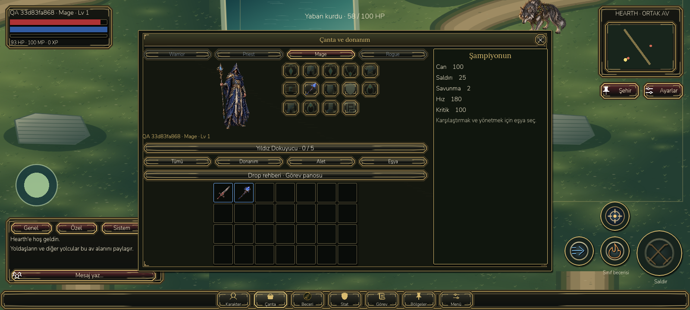
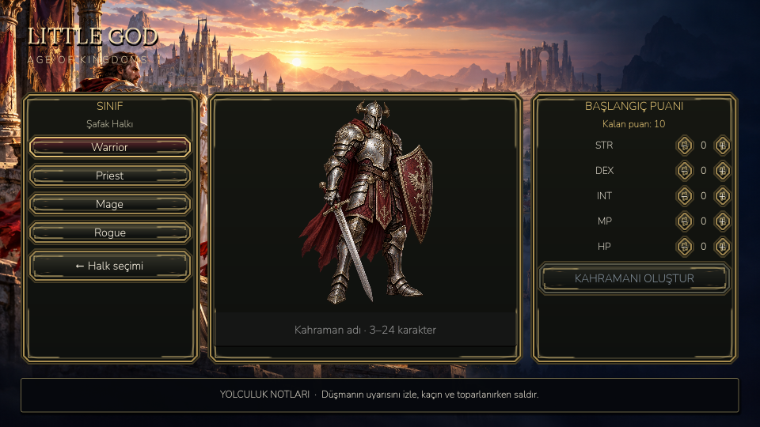

# Yazı, başlık ve ikon hizalaması

28 Ekim 2026 — Android istemci sürüm kodu 113.

- Alt menüde ikon ve etiket ayrı, ortalanmış satırlara taşındı. Çizimler yazının üzerine binmiyor; görsel alt öğeler dokunmayı engellemiyor.
- Pencere başlıkları X düğmesine göre sola kaymıyor: aynı genişlikte sol boşlukla tam pencere merkezine yerleşiyor.
- Karakter oluşturma başlıkları, stat satırları ve giriş alanları hizalandı. Ana logo sol üstte korunuyor.
- Çanta ekipman yuvaları, yuva içi ikonlar, karakter/donanım grubu ve eşya ızgarası ortalandı. Kare eşya hücreleri yatayda esnemiyor.
- Yatay düğme grupları alanı eşit paylaşıyor. Sohbet sekmelerinin metni dikey sütunlara dönüşmüyor. Sistem sekmesinde ilgisiz mesaj/bildirim kontrolleri gizleniyor.
- Sohbet önizlemesindeki yazılar altın çerçeveden içeri alındı; tek satırlık sekme başlığındaki gereksiz satır kaydırma kapatıldı. Paragraf ve mesajlar okunabilirlik için sola hizalı tutuluyor.
- Hız düğmesinin değişen 1×/3× etiketi doğru alanda güncelleniyor; ortada ikinci yazı oluşmuyor.
- Pencere kapandığında boş seçim şeridi gösterilmesi engellendi.

## Doğrulama

Gerçek Godot görüntüleri 960×540 ve 1600×720 boyutlarında incelendi. **162 kontrol**; ikon/etiket merkezleri, birbirinden ayrılmaları, düğme içinde kalmaları, yedi pencerenin başlık merkezleri, çanta ikonları, dinamik hız etiketi ve sohbet iç boşlukları doğrulandı. **61 gerçek fare navigasyon kontrolü** ve **14 RPG etkileşim kontrolü** geçti.

Android host GPU emülatöründe **19 kontrol, 12 harici ADB dokunması ve 3 yeni süreçte kayıt doğrulaması** geçti. Çanta ikonu ve X düğmesi gerçek dokunmayla kullanıldı. Mevcut iki paketin oyuncu dosyaları korundu. Boş görüntü, shader-link hatası veya script hatası son çalışmada yok. Fiziksel telefon/dokunma rahatlığı sertifikasyonu yapılmadı. Bilinen Godot kapanış kaynak temizliği uyarıları sürüyor.

Raporlar: [benchmarks/alignment](benchmarks/alignment). Yeniden çalıştırma: `tests/alignment.gd`, `tests/navigation_clicks.gd`, `tests/rpg_ui_interactions.gd`; Android için Pillow bulunan Python ile `devtools/android_entry_validate.py --output alignment-android --apk LittleGod-Kingdom-UI-QA-debug.apk --endpoint https://31.42.127.79:8443`.

## Çalıştırma

Masaüstü: `D:/LittleGod/Launch LittleGod.cmd`.

APK: `D:/LittleGod/builds/android/LittleGod-Kingdom-UI-debug.apk`.
QA: `D:/LittleGod/builds/android/LittleGod-Kingdom-UI-QA-debug.apk`.

[Android APK indir](https://31.42.127.79:8443/downloads/LittleGod-Kingdom-UI-debug.apk).

SHA-256: `358ecd792bce4d52dda444e8047fa3a04eea39c3e6b344073fb6fc993e8bf6d5`.

Sunucu, kullanıcı hesabı ve oyun dengesi değişmedi. Önceki UI raporundaki v112 APK özeti tarihsel kayıttır; aynı indirme adresindeki güncel paket v113'tür.

