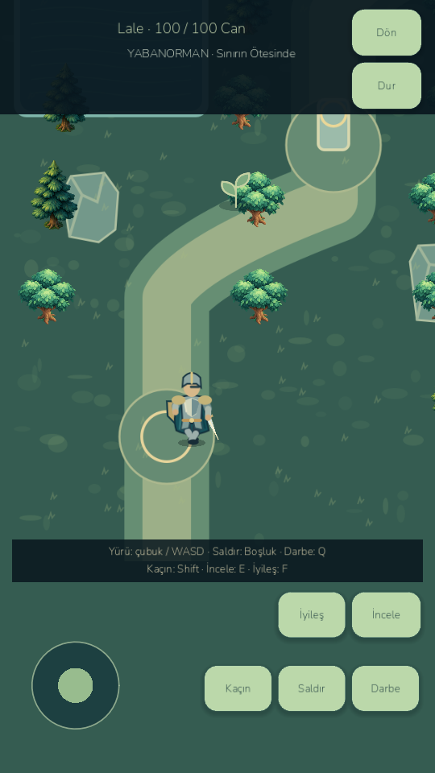
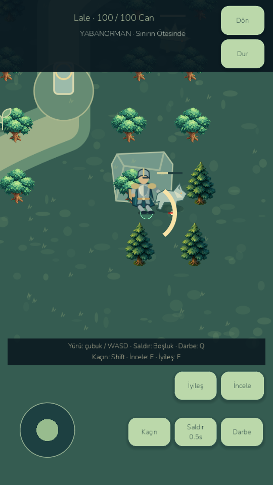

# V4B before / after — rendered evidence

Both versions were run through the repository's verified Godot4.7.2 runtime. The screenshots are gameplay, not concept art. Source, atlas data and controlled pose generator are included.

| Area | Baseline E3 | Isolated V4B preview |
|---|---|---|
| Warrior | Single detailed PNG, whole-sprite bob/rotation | Coherent vector style study with articulated limbs |
| Walking | No alternating foot poses | Eight distance-driven cells, four cardinal views |
| Body pivot | Single sprite offset | Fixed foot pivot and attached weapon/shield sockets |
| Equipment | Equipment baked into original character image | Generic silhouettes shown only from actual equipped IDs |
| Attack | Immediate model damage plus static slash | Immediate contact pose and follow-through; real windup still pending |
| Input interruptions | Joystick indicator could retain the last direction while paused | Pause/cancel/focus/suspend clear held input and stick display |
| Art approval | Existing art | Unapproved, opt-in study; not a production-wide style replacement |

The new study trades painted detail for pose consistency. It is not described as a finished premium art upgrade. Side silhouettes, armor variants, defeat collapse, enemy motion and boss choreography need further work.

Additional files include walk-cycle0–7, four directional views, follow-through, dodge, hurt, kneeling defeat, MCP gameplay and emulator/restart captures. See `docs/benchmarks/visual-v4/rendered.json` for exact screenshot/model clocks and pose indices; no video or eight-direction animation is claimed.
