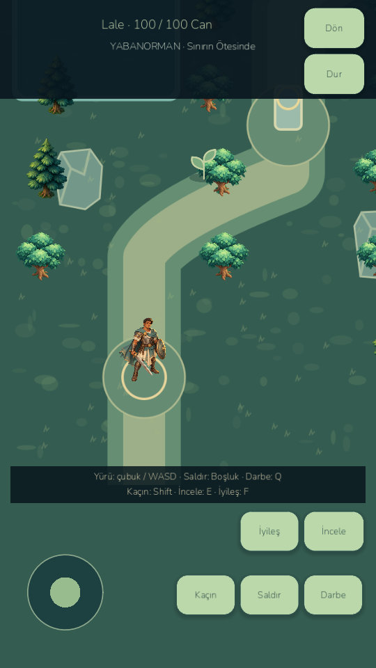

# Visual Rebirth V4 — verified slice, not a completed V4 release

Work date: 2026-10-24. Branch: `codex/visual-rebirth-v4`, based on the last fully released gameplay checkpoint `age085-e3-ancients` (`094f81a`). Expansion development is frozen. In-progress E4 code is preserved separately at `work/e5-sovereign`, commit `8b83003`; it is not part of this prototype and is not declared complete. E5/E6/throne and V2/V3 approval are not inferred from earlier requests.

## Audit and scope

Actual Godot 4.7.2 rendering was captured before editing. The existing adventure uses a CharacterBody2D with a single Warrior PNG, body rotation/bobbing, and an instantaneous sword damage check in `adventure.gd`. Enemy actors use static SVGs with modest procedural movement. Walking has no articulated footsteps. The sword effect is a 65-unit, 1.8-radian arc whereas ordinary model attacks use a 78-unit radius and a dot-product threshold of .15; these do not describe the same region. Heavy attacks use a 105-unit circular check. Damage has no authored windup/active interval. The current spider teleports at the end of its windup rather than having an airborne model state. The visual overhaul must account for these real constraints.

The repository has general `ART_DIRECTION.md` but no verified V2/V3 production UI approval or completed character animation direction. Therefore this delivery is **an isolated V4A/V4B style and movement prototype**. It does not replace the production art direction. No final `littlegod-visual-rebirth-v4` tag is created.

## Implemented

- Original, reproducible vector key-pose source with 144 atlas cells: four cardinal views of idle, walk, contact/follow-through, dodge, hit and kneeling defeat. Six SVG atlases, fixed foot pivot, articulated limbs and cape/armor facets. These are scripted vector poses, not hand-painted animation or image-generated frames.
- A cached SpriteFrames/AnimatedSprite2D presentation layer that reads the existing model clock, HP, positions, facing, dash, swing and real equipment IDs. It never grants damage, invulnerability, resources or rewards.
- Walk cycles advance with actual displacement; blocked movement selects idle. Same-clock samples do not restart animation. Defeat overrides other visual states. Sword and shield sockets follow the authored arm poses. An unequipped shield is hidden.
- Optional F8 weapon socket, blade segment, hero collision radius and damage-event point diagnostics. This is a limited diagnostic overlay, not the complete V4 hitbox debugger.
- Actual rendered before/after screenshots and an eight-sample walking sequence, contact/miss/follow-through/dodge/hit/defeat shots. Frame metadata records model clock and animation index.
- An isolated Android preview package and native-input/restart/profile tooling. Normal launcher, production package, version92, E3 APKs, progression and save schema remain intact.

## Verification

See `docs/benchmarks/visual-v4/` for exact test reports and Android results. The retained 822 assertions passed again without weakening tests. The first baseline attempt failed phase6's player-save-preservation assertion while another game process was open; a standalone phase6 rerun passed all74, then the full retained suite passed. Initial failure logs are retained. New deterministic presentation and rendered tests check no model mutation, four directions, blocked movement, frame stability, real equipment, hit/miss, dodge, reaction priority, death, exact save/load and scene exit.

Rendered fixture shots use labelled deterministic model stepping and real CharacterBody2D collision, plus a separately checked live scene scheduler. Contact fixture positioning is not evidence of completing a campaign by native input. Screenshots were visually inspected; the prototype has visible articulated motion but is not declared commercial-quality finished art.

## Still required for full V4

V4C's real anticipation/active damage interval and full weapon-contact alignment; V4D's finished collapse/interruptions; three enemy animation remakes; boss telegraphs/phase/death overhaul; worker/soldier animation; combat audio and bounded VFX; full multitouch/cancelled-touch testing and final Android combat stress verification. Existing sword damage timing, enemy AI, boss rules, sound bank and mobile control layout are unchanged. Input cancellation/pause/focus-loss/suspension now clear held attack, aim, movement, touch ownership and the joystick indicator; this correctness fix also applies to the normal game. Current attack presentation starts at contact, then follows through, because E3 applies damage immediately. It would be misleading to animate anticipation after damage.

This is a partial playable checkpoint. Do not label it full V4, E4/E5/E6, 0.9 or1.0.

Launch prototype: `D:/LittleGod/Launch V4 Warrior Preview.cmd`.
Normal game: `D:/LittleGod/Launch LittleGod.cmd`.
Android isolated preview: `D:/LittleGod/builds/android/LittleGod-V4B-preview-qa-debug.apk` (`org.littlegod.livinguniverse.v4preview`).

Committed diagnostic text removes trailing whitespace; original raw captures remain under builds/visual-v4.
